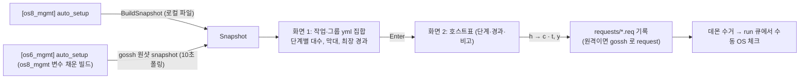
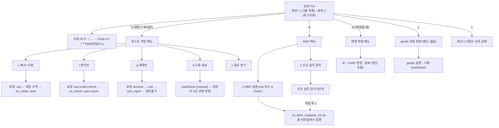
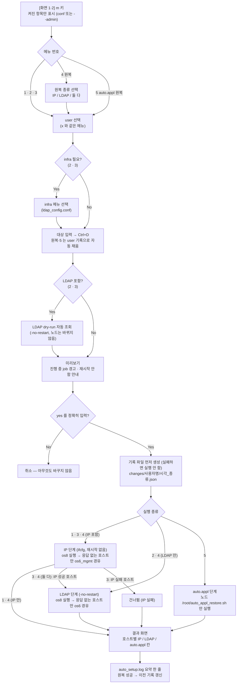
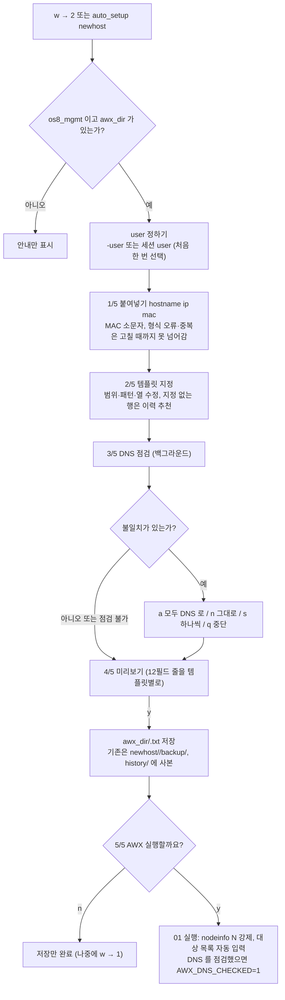
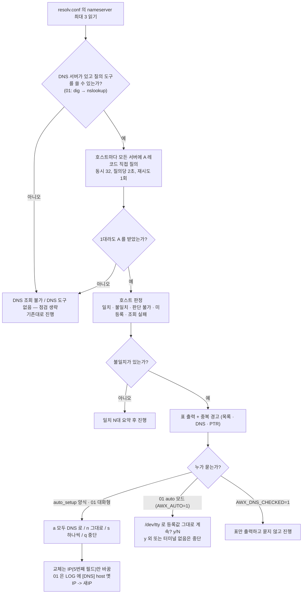
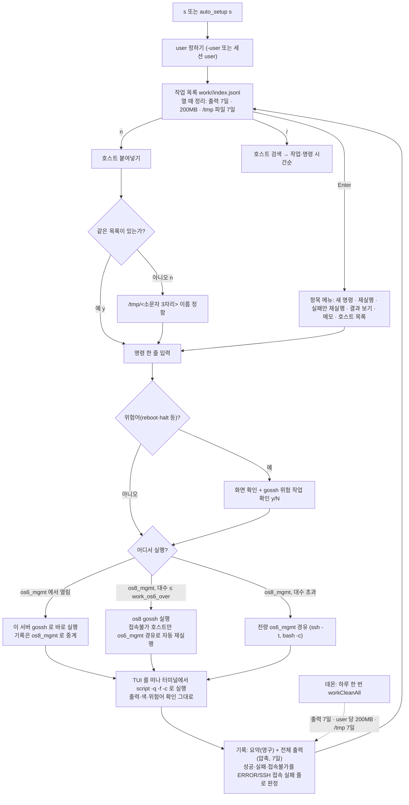

# WORKFLOW

그림 모음: 전체 [`workflow.svg`](workflow.svg), 명령·키별 31개 [`docs/svg/`](docs/svg/README.md). 사용법은 [README.md](README.md), 코드 구조는 [ARCHITECTURE.md](ARCHITECTURE.md).

## auto_setup 실행 흐름 (Mermaid, v0.8.0 반영)

```mermaid
flowchart TD
    A6["[os6_mgmt] 01 실행<br/>auto_setup_host 채움"] -->|"gossh 원샷(base64)"| Q
    A8["[os8_mgmt] 01 실행"] -->|"로컬 기록"| Q
    Q["os8_mgmt queue/<epoch>_<user>_<pid>.job<br/>user=, time=, 호스트줄, 그룹 줄(yml=…/all=…)"]
    Q --> C["[cron 매분] auto_setup ensure<br/>(os8_mgmt 에서만)"]
    C --> D{"데몬 실행중?"}
    D -->|Yes| D1["flock 실패, 즉시 종료"]
    D -->|No| D2["setsid daemon 백그라운드 기동"]
    D1 --> E
    D2 --> E["[데몬] queue 수거 5초 주기"]

    E --> F["호스트명 → IP (DNS, 동시 32)<br/>경로 판별: 로컬 ping 실패 → route=os6<br/>(설치 중 os8 무응답·os6 응답 → os6 전환)"]
    F --> I["jobs/<jobid>.json 저장"]
    I --> BK["전달 시점 LDAP 백업<br/>ping O 인 호스트만, ldapbak/<jobid>/<host>/"]

    BK --> J["[루프 ①] ping 감시 10초<br/>무응답 2회 → seen_down (설치 시작)"]
    J --> L["[루프 ②] 준비확인 30초 (후보만)<br/>gossh -pm cat /proc/uptime<br/>호출당 60초 제한, 원격은 bash -c"]
    L --> N{"READY?<br/>응답 · anaconda 아님 ·<br/>uptime < 경과시간"}
    N -->|No| L
    N -->|Yes| LD["LDAP 비교 (stage=ldap)<br/>새 OS ldap.conf binddn uid vs 백업"]
    LD --> LDQ{"같은가?"}
    LDQ -->|"same / 백업 없음"| O
    LDQ -->|diff| LR["공유경로(ldap_share_dir) 경유로<br/>백업 파일 세트 복원 + 서비스 재시작<br/>(변수 비면 수동 복원 필요)"]
    LR --> O["[루프 ③] 스케줄 7분/3분<br/>전부 READY 면 즉시"]

    O --> R["[run] os_check -auto user targets.txt<br/>동시 1개, runs/<code>/"]
    R --> S2{"2차 대상 있음?<br/>route=local 의 접속불가·FAIL<br/>(os6_mgmt·os6_os_check_sh 설정 시)"}
    S2 -->|Yes| S3["os6_mgmt 에서 os_check -auto 1회<br/>결과 tar 회수 → runs/<code>/second/"]
    S2 -->|No| V
    S3 --> V["code 파일 생성<br/>① 결과 리포트 ② FAIL/NO FAIL ③ LDAP·Splunk·커널<br/>④ 원본 경로 ⑤ ### 2차 체크 (os6_mgmt)"]
    V --> Y["wall 발송 (기본 꺼짐): 완료 호스트 + code"]
    Y --> AA["processed 표시 (최종 = 1차 OK 또는 2차 OK)"]
    AA --> AB{"모든 호스트 완료?"}
    AB -->|Yes| AB1["작업 종료 jobs → done"]
    AB -->|No| J

    DN["os_check 정상 종료 시 완료기록<br/>done/<host> : epoch user sha256 source"] -.->|"전달·부팅 이후만 인정"| AA
    RQ["TUI h→c·t·g / auto_setup request / done<br/>requests/*.req"] -.->|"5초 수거, 수동 run"| R
```



## 상태 리포트 흐름 (TUI, 양방향 동일)



## 키 · 메뉴 구조 (v0.8.0)

기능이 늘어 안내 줄이 길어졌으므로 `m` 과 같은 **인라인 메뉴**(화면을 바꾸지 않고 안내 줄 아래에 한 줄로 열림)를 분야별로 둡니다. 메뉴 글자는 예전 단축키와 같아서 `c` `t` `g` `v` `d` `x` 는 **숨은 단축키로 그대로 동작**합니다. 그림 목록: [docs/svg/README.md](docs/svg/README.md)



- `w` 는 메뉴이며 `ww`·`w` `Enter`·`w` `1` 이 예전의 AWX 실행입니다. 화면 1 에서는 `h` 가 없습니다 (호스트 표가 없음). 전체 보기(`a`)에서는 `h` 메뉴에 `g`·`d` 만 나옵니다.
- 안내 줄 둘째 줄: ` h 호스트 작업  w AWX·신규설치  m 변경  s gossh 작업  x 단독 체크` (`m 변경` 은 켜졌을 때만).
- **세션 user**: `-user` 로 실행했으면 그 user. 아니면 `s`·신규 설치 양식을 처음 열 때 한 번 고르고 TUI 를 닫을 때까지 기억합니다 (`x`·`w`→1·`m` 은 기존처럼 매번 묻습니다).

## 실행 흐름 상세 설명

### 1단계: 전달 (01.AWX_nodeinfo_V2.sh)

```bash
# [14-1] 02 성공 직후 (auto_setup_host 가 비어 있으면 로컬, 채워져 있으면 gossh 로 os8_mgmt 에 전송)
{ echo "user=${user}"; echo "time=$(date +%s)"; cat "$hostfile"; as_group_lines; } > job
```

- 항상 전달(프롬프트 없음), 02 실패 시 전달 없음, 실패해도 경고 1줄만
- `as_group_lines`: 그룹 yml 이 2개 이상일 때 `yml=<파일명> infra= os= boot= splunk= hosts=<h1,h2,…>` 그룹별 한 줄 + `all=<전체 yml>`
- 원격 전송은 base64 를 두 글자마다 `.` 로 나눠 gossh 위험어를 우연히 만드는 것을 피함

### 2단계: 감시 시작 (데몬 큐)

```bash
# 01 이 넘긴 job 파일을 로드
jobs/<jobid>.json 생성
- id / user / submitted
- hosts: host → {ip, route, seen_down, ready_at, processed, stage, ldap, second, done_src, ...}
- groups: yml → {infra, os, boot, splunk, hosts}, all_yml
- runs: [{code, hosts, at}, ...]
```

### 3단계: 경로 판별 · 전달 시점 LDAP 백업

```bash
# 로컬 ICMP ping 응답 없음 → route=os6 (os6_mgmt 비어있으면 모두 local)
# ssh os6_mgmt "<os6_autosetup>/auto_setup probe -i 10s" 장기 세션 유지
# ping O 인 호스트: gossh 로 LDAP 설정 파일 수집 → ldapbak/<jobid>/<host>/ (0700/0600)
```

### 4단계: 감시 루프 (ping)

```bash
# 10초마다: local 은 raw ICMP, os6 는 probe 세션에서 변화 수신
# route=local 인데 로컬 무응답 → 다음 주기는 로컬+os6 probe(both), os6 가 응답하면 route=os6 로 전환 (0.4.0)
# 무응답 2회 연속 → seen_down=true (설치 시작 간주)
# stage: queued → deploying → installing → booting; seen_down 후 60분 넘기면 stuck(화면 표시만)
```

### 5단계: 준비확인 (30초 주기)

```bash
# 후보: (미처리 && ping up && seen_down) || (기동 후 1회)
# gossh -pm -script -w <list> "cat /proc/uptime"
# READY = 응답 있음 && anaconda 아님 && uptime < (지금 − submitted)
# route=local 무응답 호스트는 같은 주기에 os6_mgmt 경유 재확인 → 응답하면 route=os6 (os6_gossh 필요, 0.4.0)
# 호출 1회마다 전체 60초 제한(초과 시 프로세스 그룹 종료, 사유 "시간 초과(60초)"), os6 ssh 는 bash -c 로 감싸 csh/tcsh 로그인 셸에서도 동작 (0.8.0)
# gossh 출력은 parseGossh 하나로 해석 (FQDN ↔ 짧은 이름, 해석 실패 시 로그 "[!] gossh 출력 해석 실패" + 사유 "출력 형식 불일치")
```

### 6단계: LDAP 비교·복원 (READY 직후, os_check 전)

```bash
# 백업 보유 호스트: 새 OS 의 ldap.conf binddn 줄의 uid=<값> 의 값만 백업과 비교 (bindpw 는 읽지 않음)
# same → 생략 / diff → 공유경로(ldap_share_dir) 경유로 백업 파일 세트 복원(명령줄엔 경로만, 권한·소유, restorecon, sssd|nslcd·chronyd|ntpd 재시작, 끝나면 공유 임시 디렉터리 삭제) / ldap_share_dir 비면 "수동 복원 필요" 표시
# 실패해도 run 진행 (os_check 가 FAIL 로 보고). os_check·설정 스크립트는 변경 없음
```

### 7단계: 스케줄 (7분/3분)

```bash
# 1차: 전부 READY → 즉시 / 아니면 첫 READY + 7분
# 늦은: 첫 늦은 READY + 3분 모아서
# 각 run 시 targets.txt (1차=전체, 재실행=미처리만, 완료기록·수동 완료 호스트 제외)
```

### 8단계: os_check 실행

```bash
# cd /tmp/auto_setup/runs/<code>
# os6 호스트 포함 시: /tmp/auto_setup/bin/gossh 래퍼 PATH 앞에 삽입
# bash os_check_sh -auto <user> targets.txt > os_check.log 2>&1
# os_check 는 정상 종료 시 (빈 변수 auto_done_* 가 채워진 경우) 완료기록을 남김
```

### 9단계: 2차(이중) 체크

```bash
# 대상: route=local 중 접속불가 또는 postapply FAIL (route=os6 제외)
# os6_mgmt 에서 os_check -auto <user> <목록> 1회 → tar 회수 → runs/<code>/second/
# 최종 판정 = 1차 OK 또는 2차 OK. os6_os_check_sh="-" 면 끔
# 부작용: 설정(set)이 같은 호스트에 한 번 더 적용될 수 있음
```

### 10단계: code 파일 생성

```
codes/<code>.txt
├── 결과 리포트 (담당자 문구)
├── 설정체크 (FAIL/NO FAIL)
├── LDAP/Splunk/커널 요약
├── 원본 경로
└── ### 2차 체크 (os6_mgmt)  (2차 체크를 한 경우)
```

### 11단계: wall 발송 (v0.4.3 부터 기본 꺼짐 — 결과는 TUI·code·로그로 확인)

```bash
# wall "[auto_setup] OS 설치 + 설정체크 완료 (user=<user>)"
#      "host01 host02 host03 (3대)"
#      "code : 4821   →  auto_setup code 4821"
```

### 12단계: 감시 계속 또는 종료

```bash
# processed 된 호스트 제외
# 남은 호스트 있음 → 무기한 감시 (cancel 까지)
# 모두 처리 → 작업 종료 (jobs → done)
```

### 완료기록 (타 경로에서 먼저 끝난 호스트)

```bash
# os_check(어느 서버든) 정상 종료 → done/<host> : "epoch user sha256 source"
# 데몬: 전달 이후 · 마지막 부팅 이후 기록만 인정 (미래 +5분 초과 거부) → processed(done_src=external)
# 수동: auto_setup done <host...> (부팅 시각 검증 없음)
```

### 요청 (TUI h→c·t·g · request)

```bash
# requests/<epoch>_<kind>.req (manual-run | cancel) → 데몬 5초 주기 수거
# manual-run 은 완료 여부와 상관없이 수락(접속불가는 결과에 표시) → 데몬 run 큐에서 실행(동시 1개), code 동일
# TUI 에서는 h → c (설정체크 + 설정수정) / h → t (설정체크만, mode=check) / h → g (recheck)
```

## 변경 작업 흐름 (m 메뉴, v0.7.0)

화면 1·2 어디서나 `m` → 메뉴 번호. 엔진(`ip-change-engine`, `ldap-config-engine`)을 os8_mgmt 에서 호출하고, 응답 없는 호스트만 os6_mgmt 경유로 다시 시도합니다. 미리보기에서 `yes` 를 정확히 입력해야 실행됩니다.



- 취소: 실행 중 `Ctrl+X` → `y` (프로세스 그룹 SIGTERM, 3초 뒤 SIGKILL). 중단되면 호스트별 결과를 그대로 기록하고 "일부 호스트만 변경됐을 수 있음" 을 표시합니다.
- 경유 래퍼: os6 경유가 필요한 호스트가 있을 때만 임시 래퍼(0700)를 만들어 엔진 `-gossh` 로 넘기고, 끝나면 지웁니다.
- 기록 위치와 형식은 README 「변경 작업」 참고. 변경 흐름의 화면 구성은 `change_render.go` 에 있습니다.
- `workflow.svg` 는 전체 흐름(v0.8.0 신규 기능 열 포함)이며, 변경 작업 흐름의 그림은 [docs/svg/tui_m.svg](docs/svg/tui_m.svg) 에도 있습니다.

## 신규 설치 양식 흐름 (w→2 / auto_setup newhost, v0.8.0)

nodeinfo 를 쓸 수 없는 신규 설치 서버용입니다. hostname ip mac 만으로 01 의 12필드 양식(`awx_dir/<user>.txt`)을 만들고 AWX 로 이어집니다 (nodeinfo 는 항상 N). os8_mgmt 에서만 열립니다. 그림: [tui_w_2.svg](docs/svg/tui_w_2.svg) · [cli_newhost.svg](docs/svg/cli_newhost.svg)



- 각 단계에서 `Esc` = 이전 단계, `Ctrl+X` → `y` = 취소(저장 안 함). 저장 전에는 어떤 파일도 바꾸지 않습니다.
- 프로파일(`awx_profile_N`)이 있으면 5/5 의 `y` 뒤에 프로파일을 고르고, 없으면 `AWX_AUTO` 없이 `AWX_AUTO_NODEINFO=n` 만 넘깁니다.

## DNS 점검 흐름 (auto_setup 양식 · awx_script 01 [4-1], v0.8.0)

같은 규칙을 Go(`dnscheck.go`)와 bash(01 `dns_check`)가 씁니다. 그림: awx_script 의 `workflow.svg` 에도 [4-1] 단계가 있습니다.



## gossh 작업 흐름 (s / auto_setup s, v0.8.0)

호스트 목록 파일(`/tmp/<3자리>`)별로 gossh 실행 기록을 user 별로 남깁니다. 그림: [tui_s.svg](docs/svg/tui_s.svg) · [cli_s.svg](docs/svg/cli_s.svg)



## 흐름도 보조 자료

- **계획서 §14**: 2차 설계
- **workflow.svg**: 정적 SVG 흐름도 (v0.8.0 반영: 항목별 메뉴·신규 설치 양식·DNS 점검·gossh 작업 열 추가)
- **docs/svg/**: CLI 명령·TUI 키별 흐름도 31개 — [목록](docs/svg/README.md)
- **README.md**: 사용법·옵션·키 표 (키 행마다 해당 SVG 링크)
- **ARCHITECTURE.md**: 함수 및 단계 매핑
