# redfish — BMC BIOS 표준값 점검·설정 도구 (biostool)

관리망 BMC 에 **Redfish** 로 접속해 서버의 BIOS 설정이 표준값(프로파일)과 같은지 **점검**하고, 사람이 승인(Y)한 항목만 BIOS **Pending** 으로 **설정**하는 도구입니다. Go(실제 작업) + bash(실행 편의) 한 쌍으로 만들어져 있고, Go 는 표준 라이브러리만 씁니다.

- 대상: Dell(iDRAC), HPE(iLO), Lenovo(XCC), Cisco(CIMC), Supermicro. 점검은 5개 벤더 모두, **설정(쓰기)은 Dell·HPE·Lenovo 이고 모델을 지정한 `verified=Y` 행에만** 합니다.
- **재부팅은 하지 않습니다.** 설정은 BMC 의 Pending(다음 재부팅 때 반영)까지입니다. OS 설치 같은 정상 재부팅에서 반영됩니다.
- 수천 대를 한 번에 처리합니다(동시 접속 기본 100). 일시 오류는 자동 재시도하고, 실패 목록(`retry.txt`)만 다시 돌릴 수 있습니다.
- BMC 에 남기는 흔적을 줄이려고 호스트당 **로그인 1회**, 허용목록 밖 호출(로그 조회·ClearLog·Reset 등)은 **전송 전에 코드가 차단**합니다.
- **`bash bios.sh` 하나로** 대상 입력 → 프로파일 점검 → (선택) BIOS 전체비교 → (선택) 수정까지 터미널 화면(TUI)에서 진행합니다. 호스트당 1회 접속으로 프로파일 결과와 전체비교를 함께 얻고, 결과는 색상 줄과 CSV 로 봅니다(2.0절). auto_setup 같은 자동화는 `bash bios.sh -auto <user> targets.txt` 로 점검만 합니다.
- **Cisco 장비는 XML API 로 점검합니다(`bios.sh` 혼합 대상).** hostname 이 `bios.conf` 의 `xml_host_prefix`(기본 `c`)로 시작하는 대상과 `-user-xml` 목록은 Cisco UCSM/CIMC XML API 로 읽고(읽기 전용: `aaaLogin`·`configResolveClass`·`aaaLogout`), 나머지는 Redfish 로 점검합니다. XML 대상은 프로파일 점검만 하고 전체비교·설정에서는 빠집니다. 2.0절 “Cisco(XML) 혼합 대상”.
- 사전조사(`xml.sh`)로 처음 만나는 모델의 속성 이름을 확인하고, 모델별 BIOS 전체 비교(`all_bios_check.sh`)도 할 수 있습니다.
- 공용(1순위) 계정이 없는 BMC 는 벤더 admin(rf.conf, 2순위)으로 접속해 **계정을 만들 수 있고**(`account_create.sh`, 기본 Y), 공용 계정의 **비밀번호를 바꿀 수도 있습니다**(`biostool account change`). 2.12절.

> **현재 상태(v0.1.0): 실제 BMC 에 접속해 본 적이 없습니다.** 모든 검증은 합성 데이터로 만든 mock BMC 와 `-from-dump` 로만 했습니다. 같은 이유로 Cisco UCSM 점검(`ucsm_check.sh`, 2.9절)도 실제 UCSM 에 접속해 보지 않았습니다. 모델을 처음 만날 때의 절차와 사람이 확인할 항목은 [FIRST_RUN.md](FIRST_RUN.md) 에 모았습니다. 반드시 먼저 읽으십시오.

관련 문서: [ARCHITECTURE.md](ARCHITECTURE.md)(파일별 역할·수정 가이드) · [WORKFLOW.md](WORKFLOW.md)(작업 흐름도) · [FIRST_RUN.md](FIRST_RUN.md)(첫 실장비 절차) · [PR_CHECKLIST.md](PR_CHECKLIST.md) · [CHANGELOG.md](CHANGELOG.md) · [사용법.txt](사용법.txt)(명령만 모은 목록) · [계획서.md](계획서.md)(설계·결정 이력)

---

## 1. 빌드 및 설치 방법

### 1.1 폐쇄망에서 받기 (Go 없이 바로 사용)

저장소를 통째로 내려받으면(`git clone` 또는 웹에서 ZIP 다운로드 후 압축 해제) **빌드가 끝난 바이너리가 이미 `bin/` 에 들어 있어** Go 를 설치하지 않고 바로 쓸 수 있습니다.

```bash
git clone <저장소 주소>           # 폐쇄망이면 ZIP 을 옮겨 압축 해제
cd <저장소>/.claude/HPC/redfish
chmod +x bin/biostool bin/biostool_os6 *.sh    # 실행 권한이 없을 때 (없어도 아래 `bash x.sh` 형태로 실행 가능)
```

| 파일 | 대상 | 비고 |
|---|---|---|
| `bin/biostool` | RHEL8 등 커널 3.x 이상 | 정적 링크(CGO 없음). Go 1.26.5 로 빌드(v0.2.0 후보, sha256 은 CHANGELOG 참고) |
| `bin/biostool_os6` | **RHEL6**(커널 2.6.32) | 정적 링크. **Go 1.20.x** 로 빌드(RHEL6 커널에서는 Go 1.24 이상 바이너리가 동작하지 않음). **RHEL6 에서는 빌드하지 않고 이 파일을 그대로 씁니다.** `setup.sh` 는 os8 만 만들고, RHEL6 용은 저장소에 빌드 완료 상태로 커밋되어 있습니다 |

`bios.sh`·`bios_check.sh`·`xml.sh`·`all_bios_check.sh`·`bios_export.sh`·`encrypt.sh` 는 `uname -r` 의 커널 메이저 버전이 3 미만이면 `bin/biostool_os6`, 아니면 `bin/biostool` 을 **자동 선택**합니다(선택한 바이너리에 실행 권한이 없으면 `chmod +x` 를 시도합니다). 바이너리가 없고 `go` 도 없으면 안내 후 종료합니다(종료코드 2). 스크립트는 RHEL6 의 bash 4.1 에서도 돌아가도록 썼습니다.

> 스크립트에 실행 권한이 없어도 **`bash bios_check.sh` 처럼 `bash` 를 앞에 붙이면** 됩니다. 이 문서의 명령은 모두 그 형태입니다.

### 1.2 소스에서 빌드 (Go 가 있는 PC·랩)

| 방법 | 설명 |
|---|---|
| `bash setup.sh` | Go 가 있는 **랩·PC 전용**. `GOPROXY=off`, 인터넷 접속 시도 없음. os8 용 `bin/biostool` 만 만듭니다. go 가 없으면 안내 후 종료코드 2. **회사 폐쇄망(Go 없음)과 RHEL6 에서는 실행하지 않습니다** |
| `bash build.sh` | os8 용 `bin/biostool` (`setup.sh` 와 같은 결과) |
| `bash build_os6.sh` | **관리자용.** 소스를 고친 뒤 RHEL6 용 `bin/biostool_os6` 를 **다시 만들 때만** 사용합니다(`/opt/go1.20/bin` 의 Go 1.20.x 필요). 일반 사용자는 실행하지 않고 커밋된 파일을 씁니다 |
| `go vet ./... && go test ./...` | 정적 분석 + 전체 테스트(약 10초). 실제 BMC 에는 접속하지 않습니다 |

```bash
bash setup.sh          # (Go 가 있는 랩·PC 에서만) os8 바이너리 bin/biostool 생성
bash build_os6.sh      # (관리자가 소스를 고쳤을 때만) RHEL6 바이너리 bin/biostool_os6 재생성, Go 1.20.x 필요
```

**vendor/ 가 없는 이유.** 이 프로젝트는 외부 의존성이 **하나도 없습니다**(`go.mod` 에 `require` 가 없고 표준 라이브러리만 사용, `module biostool`, `go 1.20`). 그래서 `go mod vendor` 로 모을 것이 없고 `vendor/` 디렉터리가 필요 없습니다. `setup.sh` 는 다른 프로젝트와 같은 틀(`GOFLAGS=-mod=vendor`, `go build -mod=vendor`)을 그대로 쓰는데, 의존성이 없으면 vendor 디렉터리가 없어도 이 옵션이 정상 동작합니다(랩의 Go 1.25.10 과 Go 1.20.14 에서 둘 다 `setup.sh` 성공을 확인했습니다). 나중에 외부 모듈을 쓰게 되면 `go mod vendor` 로 `vendor/` 를 만들어 커밋해야 폐쇄망 빌드가 유지됩니다.

**소스를 고쳤다면** 바이너리도 다시 빌드해 **두 파일(`bin/biostool`, `bin/biostool_os6`)을 함께 커밋**해야 합니다(mock 서버를 고쳤다면 `bin/mockbmc`, `bin/mockbmc_os6` 도, UCSM mock 을 고쳤다면 `bin/mockucsm`, `bin/mockucsm_os6` 도). 회사 환경에는 Go 가 없어 저장소의 바이너리가 곧 배포본입니다([PR_CHECKLIST.md](PR_CHECKLIST.md)).

### 1.3 처음 한 번 준비할 것

```bash
cp bios.conf.example bios.conf       # user= 에 BMC 계정 ID 입력 (나머지는 기본값으로 시작)
bash encrypt.sh                      # BMC 비밀번호 입력(2회) → pass.enc + key.bin 생성 (권한 600)
cp user.txt.example user.txt         # 점검할 대상을 한 줄에 하나씩
cp diff.txt.example diff.txt         # (all_bios_check.sh 를 쓸 때) 정상 설정값을 가진 기준 호스트
cp ignore_attrs.txt.example ignore_attrs.txt   # (선택) 비교에서 뺄 속성
mkdir -p refs                        # (선택) 전체비교 기준으로 고를 JSON 폴더 (bios_export.sh 결과를 복사해 둠, bios.conf 의 refs_dir)
```

`bash bios.sh` 로 쓸 때는 대상을 TUI 화면에서 직접 입력(붙여넣기)해도 되므로 `user.txt` 가 꼭 필요하지는 않습니다(`-plain`·`-user` 를 줄 때만 필요). `bios.conf` 에는 점검에서 뺄 속성(`exclude_attrs`), 전체비교 차이를 수정 대상에 넣을지(`allcheck_set`), 절대 바꾸지 않을 속성 추가(`protect_attrs`), 기준 JSON 폴더(`refs_dir`), 비대화형 기본 프로파일(`auto_profile`) 키가 있습니다(3.3절).

- **BMC 비밀번호는 평문으로 디스크·명령행·로그에 남지 않습니다.** `encrypt.sh` 가 화면에 보이지 않게 두 번 입력받아 파이프(표준입력)로만 넘기고, AES-256-GCM 으로 암호화한 `pass.enc` 와 키 `key.bin` 으로 나눠 보관합니다. 둘은 짝이므로 함께 보관하고 **git 에 올리지 마십시오**.
- `user.txt` 한 줄에 대상 하나: `IP` / `hostname-m` / `hostname`(+ 선택적으로 `:포트`). `hostname` 은 `/etc/hosts` 에서 `hostname-m` 의 IP 를, `hostname-m` 은 그 이름의 IP 를 찾습니다(`/etc/hosts` 형식은 `IP  hostname-m`, 한 줄에 별칭이 여럿이어도 됨). 빈 줄·`#` 주석은 무시하고 중복은 한 번만 처리합니다.
- `bios.conf`, `pass.enc`, `key.bin`, `user.txt`, `diff.txt`, `ignore_attrs.txt`, `results/`, `dumps/` 는 실제 호스트 이름·계정 정보가 들어가므로 `.gitignore` 로 커밋이 막혀 있습니다(예시 파일 `*.example` 만 저장소에 있습니다).

---

## 2. 사용 방법

### 2.0 통합 진입점 — `bios.sh` (TUI, 권장)

점검·전체비교·수정을 한 명령으로 합친 기본 진입점입니다. 아래 2.1~2.4절의 옛 래퍼(`bios_check.sh`·`all_bios_check.sh`)는 그대로 쓸 수 있고, 터미널에서 옛 전용 옵션 없이 실행하면 이 흐름으로 넘어옵니다. 흐름도는 [WORKFLOW.md](WORKFLOW.md) 7번([workflow_bios.svg](workflow_bios.svg)), 자동화용은 8번([workflow_auto.svg](workflow_auto.svg))입니다.

```bash
bash bios.sh                                  # (터미널) TUI: 대상 입력 → 프로파일 선택 → 점검 → 전체비교 → 수정
bash bios.sh -profile VM -user user.txt       # 프로파일·대상 파일을 미리 지정 (화면에서 묻지 않음)
bash bios.sh -plain -profile VM               # TUI 없이 색 없는 평문 출력 (읽기 전용, 설정 질문 없음)
bash bios.sh -profile VM -user user.txt -user-xml user_xml.txt  # Redfish 대상 + Cisco(XML) 대상 혼합 (IP 형태 Cisco 는 -user-xml)
bash bios.sh -plain -profile VM -ref <비교서버> # 평문 + 비교서버와 BIOS 전체 값 비교
bash bios.sh -auto-check <user> targets.txt   # 비대화형 점검만 → 호출한 폴더에 check.res_<user>
bash bios.sh -auto       <user> targets.txt   # 위와 같음 + check.res_<user>_postapply (auto_setup 용)
```


**진행 순서 (TUI)**

1. **대상 입력** — 대상 파일을 지정하거나 hostname / hostname-m / IP 를 붙여넣습니다(한 줄에 하나, Ctrl+D 완료, Ctrl+X 취소). `-user` 를 주면 묻지 않습니다(대상을 옵션으로 줬으면 돌아갈 대상 입력 단계도 없습니다). 대상에 IP 가 있으면 이어서 **Cisco(XML) 대상**을 따로 묻습니다(파일 지정 또는 붙여넣기, 비워 두면 없음. `-user-xml` 을 주면 묻지 않음). hostname 은 접두어로 자동 분류되므로 묻지 않습니다.
2. **프로파일 선택** — `profiles/*.tsv` 중에서 고릅니다(`-profile` 로 지정하면 생략).
3. **접속·조회** — 호스트당 **로그인 1회**로 BIOS 전체 속성을 한 번에 읽어, 프로파일 판정과 전체비교에 함께 씁니다(전체비교 때 대상에 다시 접속하지 않음). 진행 상황이 한 줄로 갱신됩니다.
4. **결과 화면 `[프로파일 점검]`** — 프로파일에 등록된 항목의 결과를 색상 줄로 보여 줍니다. 맨 위에 화면 탭 `[프로파일 점검] [전체 설정 비교]` 가 있고 `Tab` 으로 오갑니다.
5. **`[전체 설정 비교]`** — 처음 `Tab` 으로 넘어가면 기준을 고르고(아래 “전체비교 기준”, `-ref`/`-ref-json`/`-diff` 를 줬으면 묻지 않음) 비교 결과를 이 화면에 보여 줍니다. `-ref`/`-ref-json`/`-diff` 를 줬으면 `Tab` 을 기다리지 않고 **수집 직후 바로 전체 비교까지** 해 두며(첫 화면은 그대로 `[프로파일 점검]`) 비교에 실패하거나 취소해도 안내만 남기고 다음 `Tab` 에 다시 시도합니다. 그다음부터 `Tab` 은 두 결과를 자유롭게 오가며 화면마다 벤더·그룹·필터·스크롤 위치를 따로 기억합니다. 이 화면에서 `r` 을 누르면 기준을 다시 골라 비교합니다.
6. **수정** — 벤더 줄에서 `q` 를 두 번 누르거나(설정할 항목이 있을 때) `e`(어디서든)를 누르면 수정 단계입니다. 먼저 **차이 항목 전부**를 호스트별로 `현재값 -> 변경값 (수정대상)` / `현재값 -> 변경값 (수정제외: 사유)` 로 보이고 **“위 수정대상을 적용할까요?”** 를 묻습니다. y 이고 수정제외 항목이 있으면 그 항목만 “아래 항목은 변경하지 않습니다” 로 다시 보이며 **“수정제외 항목을 확인했습니다. 진행할까요?”** 를 한 번 더 묻습니다. 남의 Pending 이 있으면 포함 여부를 묻고(아래 “수정 규칙”), 모두 통과해야 Pending 까지만 설정합니다(프로파일 + 전체비교를 했으면 그 difference 까지). 재부팅은 하지 않습니다. 첫 두 질문에서 `n`·`Esc`·`Ctrl+X` 면 **아무것도 쓰지 않고** 결과 화면으로 돌아옵니다. `-profile`·`-user`·`-ref` 등 옵션으로 미리 지정해도 이 확인은 항상 묻습니다.
7. **요약** — TUI 를 닫고 OK / difference / N/A / 오류 건수, 결과 폴더, CSV 목록, 설정 결과를 출력합니다.

**TUI 키**

| 키 | 동작 |
|---|---|
| `Tab` / `Shift+Tab` | 화면 전환 `[프로파일 점검]` ↔ `[전체 설정 비교]` (어느 위치에서나, 처음이면 기준을 고르고 비교) |
| `←` `→` | 벤더 줄: 벤더 이동 / 관리망 그룹 줄: 관리망(관리 컨트롤러) 그룹 이동. 지금 움직이는 줄은 앞에 `>>` 가 붙고 선택 탭이 반전됩니다 |
| `Enter` | 벤더 안으로 들어가기 (이후 `←` `→` 가 관리망 그룹을 바꿈, 그룹이 2개 이상일 때) |
| `q` | **어디서나 한 단계 뒤로**: 관리망 그룹 줄 → 벤더 줄, 미리보기·설정 결과 → 결과 화면, 프로파일 고르기 → 대상 입력. 벤더 줄(맨 위)에서는 “종료하려면 q 를 한 번 더 누르세요” 가 나오고 `q` 를 한 번 더 누르면 결과 보기를 마칩니다 |
| `Esc` | `q` 와 같이 한 단계 뒤로. 벤더 줄(맨 위)에서는 종료 확인만 취소하고 끝내지 않습니다 |
| `r` | `[전체 설정 비교]` 화면에서 기준 다시 선택 → 다시 비교 |
| `↑` `↓` (`k` `j`) | 한 줄 위 / 아래 |
| `PgUp` `PgDn` | 한 화면 위 / 아래 (`Home` `End` = `g` `G` 처음 / 끝) |
| `a` `o` `f` `n` | 필터: 전체 / OK 만 / difference 만 / N/A 만 (접속·조회 실패 포함) |
| `s` | 요약: 호스트마다 한 줄(OK / difference / N/A 건수) |
| `e` | 수정 단계로 바로 이동 (어디서든. 설정할 항목이 없으면 그 안내, 이미 적용했으면 “다시 점검한 뒤 설정하십시오” 안내) |
| `?` | 도움말 (아무 키로 닫음) |
| `Ctrl+X` | **진행 중 작업 취소**: 접속·조회(아직 시작하지 않은 호스트는 접속하지 않고 `CANCELED`, `retry.txt` 로 다시 실행), 기준 조회, 설정 적용, 대상 붙여넣기·질문. 결과 화면에서는 아무것도 끝내지 않고 안내만 합니다 |
| `Ctrl+C` / `Ctrl+Z` | **무시**됩니다 (“종료는 q 를 두 번 누르세요” 안내만). 터미널이 깨지지 않게 하려는 것입니다 |

↑↓·PgUp/PgDn·Home/End 스크롤과 `a` `o` `f` `n` `s` 필터는 벤더 줄·관리망 그룹 줄 어디서나 동작합니다. 탭 전환·필터는 화면 안에서 제자리로 다시 그립니다. 표준출력이 터미널이 아니거나 `-plain` 이면 TUI 대신 평문으로 출력합니다. 그룹은 같은 벤더 안에서 관리 컨트롤러 모델별로 나누되 **BIOS 속성 이름 목록이 같으면 하나로 합칩니다**(예: iLO 4 + iLO 5).

**끝내기 규칙** (벤더 줄에서 `q` 두 번)

- 벤더 줄에서 `q` 다음 키가 `q` 이면 끝이고, `Esc` 를 포함한 다른 키(`N`·`Ctrl+X` 도)는 종료 확인만 취소하며 결과 보기를 계속합니다. 대상 입력·프로파일 고르기 화면의 `q`/`Esc` 는 취소(한 단계 뒤로)입니다.
- **수정 단계는 `e` 로만** 갑니다. `q` `q` 로 끝낼 때는 수정 여부를 **묻지 않고** 그대로 끝납니다. `e` 에서 거절·취소하면 결과 화면으로 돌아오고, 다시 `e` 로 갈 수 있습니다.
- 설정을 한 번 **적용한 뒤에는 같은 세션에서 다시 설정할 수 없습니다**(화면의 값이 적용 전 값이기 때문. 재부팅 후 다시 점검하십시오). 설정할 항목이 없거나 이미 거절·적용했으면 `q` `q` 에 바로 끝납니다.

**견고성**

- 흐름 중 오류(패닉)가 나도 터미널(대체 화면·커서·raw 모드)은 되돌립니다. 호스트 하나를 처리하다 패닉하면 프로그램이 죽지 않고 그 호스트만 `BMC_ERROR` 로 남기고 나머지를 계속합니다.
- 질문을 띄우기 전에 이미 쌓인 키(미리 친 `y` 등)는 버려서 확인 질문이 앞서 친 키로 넘어가지 않습니다.
- 작업을 취소하고 기다리는 중 종료 시그널(SIGINT/SIGTERM/SIGHUP)을 한 번 더 받으면 기다리지 않고 터미널을 되돌린 뒤 바로 끝냅니다.

**출력 줄 형식과 태그 3종** (TUI 본문·평문 공통, 탭 구분)

```text
[OK]  hostname  ip  vendor  model  bios_version  attribute  기준값  현재값  비고
```

| 태그 | 색 | 묶이는 상태(비고에 원래 상태명이 그대로 나옴) |
|---|---|---|
| `[OK]` | 초록 | `OK`, `PENDING_OK`(전체비교는 `SAME`, 기준 서버 자신은 `REFERENCE` — 자기 값을 기준값·현재값으로 보임) |
| `[difference]` | 노랑 | `FAIL`, `UNVERIFIED`, `PENDING_EXISTS`, `PENDING_NO_JOB`(전체비교는 값이 다름 `DIFF`, 대상에만 있는 속성 `ONLY_HOST` — 기준값은 `(없음)`) |
| `[N/A]` | 회색 | `MAPPING_MISSING`, `NO_DUMP`, 대상에 속성이 없음(`ONLY_REF`), 접속·조회 실패 |

- 기준값 칸(프로파일 기대값 또는 비교서버 값)은 호스트 단위 오류 줄까지 **항상 초록**이고, 현재값 칸은 태그 색을 따릅니다. 호스트 단위 오류(접속 실패 등)는 태그·현재값·비고가 빨강입니다.
- 값이 없는 칸(`-`)은 화면·CSV 에서 `(N/A)` 로 표시합니다. `profiles/*.tsv` 의 양식은 바뀌지 않습니다.
- `NO_COLOR` 환경변수를 설정하거나 터미널이 아니면 색이 없습니다.
- **태그는 묶음 표시이므로 `[N/A]` 를 “문제 없음”으로 읽지 마십시오.** 판정할 수 없다는 뜻이고(매핑 없음, 대상에 속성 없음 등), 접속 실패도 N/A 줄로 나옵니다. 원인은 비고(원래 상태명)에서 확인합니다.

**전체비교 기준 (3종 중 하나)**

| 기준 | 지정 | 설명 |
|---|---|---|
| 비교서버 hostname | TUI 에서 입력(한 줄에 하나 또는 공백 구분, Ctrl+D 완료) / `-ref <hostname>`(쉼표·공백으로 여러 개) | 대상 목록에 있으면 그 호스트의 조회 결과를 쓰고, 없으면 그 서버만 추가 조회합니다. 비워 두면 `diff.txt` |
| refs 폴더의 JSON | TUI 목록에서 선택 / `-ref-json <파일>`(파일 이름만 주면 `refs_dir` 에서 찾음) | `bios_export.sh`(2.4.1절)로 뽑은 속성 JSON. 기준으로 쓸 수 없는 파일은 목록에서 빠집니다 |
| `diff.txt` | TUI 목록에서 선택 / `-diff <파일>` | 모델별 기준 호스트 목록(옛 `all_bios_check.sh` 와 같은 선택 규칙) |

`-ref`·`-ref-json`·`-diff` 를 주면 기준을 묻지 않으며 셋 중 하나만 쓸 수 있습니다. **같은 모델끼리만** 비교하고, BIOS 버전이 달라도 속성 이름 목록이 같으면 비교 대상이 되지만(다르면 “속성 이름 목록이 기준과 다름 (설정 불가)”), 비교서버와 BIOS 버전이 다른 호스트(`BIOS_VER_DIFF`)의 차이는 비교서버 값으로 **설정하지 않습니다**(수정제외). 비교에서 뺄 속성은 `ignore_attrs.txt`(없으면 내장 목록)와 `bios.conf` 의 `exclude_attrs` 를 합쳐 적용하며, `exclude_attrs` 는 프로파일 점검에서도 그 속성 행을 점검하지 않습니다.

**수정 규칙** (확인 질문 1~3개 — 모두 통과해야 씁니다)

- **확인 1 (차이 항목 전부)**: 맨 위에 `수정대상 N건 · 수정제외 N건` 을 보이고, 호스트별로 `속성  현재값 -> 변경값 (수정대상)` 과 `... (수정제외: 사유)` 를 모두 보입니다(값은 자르지 않음). 이어서 남의 Pending 목록과 “참고”(항목 줄이 없는 제외 사유)가 나오고 **“위 수정대상을 적용할까요?”** 를 묻습니다.
- **확인 2 (수정제외가 있을 때만)**: “아래 항목은 변경하지 않습니다” 와 수정제외 항목만 다시 보이고 **“수정제외 항목을 확인했습니다. 진행할까요?”** 를 묻습니다. `n`·`Esc`·`Ctrl+X` 면 아무것도 쓰지 않고 결과 화면으로 돌아옵니다.
- 대상: 프로파일의 difference(**`verified=Y` 행만**)와, `bios.conf` 의 **`allcheck_set=on` 일 때만** 전체비교의 difference 를 함께 설정합니다(기본 `off` = 프로파일 항목만).
- 같은 속성의 목표값이 프로파일과 비교서버에서 다르면 설정하지 않고 미리보기에 **`[충돌]`** 로 보입니다.
- 제외 목록(`ignore_attrs.txt` + `exclude_attrs`)·위험 속성·N/A·쓰기 불가 벤더(Dell·HPE·Lenovo 가 아닌 호스트)·속성 이름 목록이 다른 호스트는 확인 화면에 `(수정제외: 사유)` 로 보이고 설정하지 않습니다.
- **보호 속성**(아래 “절대 바꾸지 않는 속성”)은 프로파일이든 비교서버 값이든 어느 쪽에서도 설정 항목이 되지 않고 `(수정제외: 보호 속성 …)` 로만 보입니다.
- 전체비교 difference 는 **비교서버와 BIOS 버전이 같은 호스트만** 설정합니다(다르면 `BIOS_VER_DIFF` 로 그 호스트의 비교서버 값은 수정제외). 비교서버 값은 적용 때 레지스트리 형식을 다시 확인해 **Enumeration·Integer·Boolean 일 때만** 보내며(문자열·형식 불명은 `INVALID_VALUE` “수정제외”), 이 판정은 적용 때 정해지므로 확인 화면에는 수정대상으로 보일 수 있습니다.
- 시스템 프로파일 성격 속성(Dell SysProfile, HPE WorkloadProfile·PowerProfile 등)이 한 호스트에 여러 개면 **프로파일 행 항목만** 보내고 나머지는 수정제외(적용 단계에서는 `DEPENDS_ON_PROFILE`)로 미룹니다. 재부팅 후 다시 점검해 설정하십시오.
- 남이 걸어 둔 **Pending 이 있는 장비**는 호스트·속성·Pending 값 목록을 보여 주고 `y` 포함 / `n` 제외 / `Ctrl+X` 취소를 묻습니다. 포함하기로 했을 때도 그 목록과 정확히 같은 Pending 만 허용하고, 설정 중에 새로 생긴 Pending 이 있으면 쓰지 않습니다(`PENDING_EXISTS`). 단 **Dell 은 설정 Job 이 남의 Pending 까지 함께 적용**하므로, 남의 Pending 이 있는 Dell 호스트는 묻지 않고 통째로 수정제외합니다.
- 적용은 옛 설정(2.1절)과 같은 안전 경로(`set.go`)입니다: 재조회 → 레지스트리 검사 → 호스트당 PATCH 1회(+Dell Job 최대 1회) → **재부팅 없음**. 끝나면 Pending 을 다시 조회해 반영 여부를 설정 결과 화면에 보여 줍니다. 적용 중 `Ctrl+X` 로 취소하면 아직 시작하지 않은 호스트는 쓰지 않고 `CANCELED` 로 남으며 `apply_failed.txt` 에 모입니다.
- `-from-dump`(덤프 읽기)·`-plain`·`-auto`/`-auto-check` 에서는 설정하지 않습니다.

**절대 바꾸지 않는 속성 (보호 속성)** — 서버마다 다른 고유값과 부팅·보안·스토리지·네트워크 관련 속성은 프로파일이든 전체비교(비교서버 값)든 **설정하지 않습니다**. 코드에 고정된 내장 패턴(`cmd/biostool/protect.go`, `*` 는 0글자 이상 와일드카드·대소문자 무시)이며 `bios.conf`·`ignore_attrs.txt` 로 **끌 수 없습니다**.

| 분류 | 패턴 예 |
|---|---|
| iSCSI·NVMe-oF 식별자 | `*Iscsi*` `*Iqn*` `*Initiator*` `*Nqn*` |
| IP·네트워크 주소 | `*Ipv4*` `*Ipv6*` `*IpAddress*` `*Subnet*` `*Gateway*` `*Dns*` `*Dhcp*` `*Vlan*` `*MacAddr*` |
| 서버 이름·식별 정보 | `ServerName` `*HostName*` `*AssetTag*` `*ServiceTag*` `*SerialNumber*` `*Uuid*` `Admin*` |
| 부팅 | `BootMode` `*Boot*` `*Pxe*` `*Url*` `*HttpBoot*` `*Ipxe*` `*Network*` (부팅 모드·순서·PXE·URL/HTTP 부팅 포함) |
| 보안 | `SecureBoot*` `*Secur*` `*Tpm*` `*Password*` `*Pwd*` `*Passphrase*` `*Cert*` `*Sgx*` |
| 스토리지·RAID | `*Raid*` `*Sata*` `*Nvme*` `*Storage*` `*Vroc*` `*Vmd*` `*Erase*` |
| NIC·슬롯 | `*Nic*` `*Lom*` `Ocp*` `*Wol*` `*WakeOnLan*` `*OptionRom*` `*Oprom*` `*Slot*` |

- 위 표는 일부이며 전체 목록은 `protect.go` 의 `builtinProtect` 입니다. 성능 속성을 잘못 막지 않도록 짧은 부분 일치는 좁혀 두었고(예: Dell CPU 전원 관리 `ProcPwrPerf` 는 막지 않음), `protect_test.go` 가 `profiles/*.tsv` 의 속성이 막히지 않는지 확인합니다.
- `bios.conf` 의 `protect_attrs=A|B|*패턴*` 은 이 목록에 **더하기만** 합니다(빼기 불가).
- **겹겹이 막습니다**: ① 설정 계획에서 보호 속성은 항목이 되지 않고 수정제외로 표시 ② 적용 단계(`set.go`)에서 항목 중 하나라도 보호 속성이면 그 호스트는 접속도 하지 않고 **통째로** `PROTECTED_ATTR` ③ PATCH 직전에 실제 본문의 속성을 다시 검사해 하나라도 걸리면 보내지 않음 ④ Redfish 클라이언트(`redfish.go` `checkAttributes`)가 PATCH 본문 전체를 거부.

**진행 표시** — 지금 단계 하나를 한 줄로 보입니다: `[1/4 설정 확인] [2/4 접속·조회 123/1000 · OK 100 difference 20 N/A 3 오류 0 · 경과 00:12] [3/4 CSV 저장] [4/4 TUI]`. 설정을 적용할 때는 호스트별 진행 줄이 나옵니다. 터미널은 한 줄을 제자리 갱신하고, 비대화형(`-auto`)은 10초마다 한 줄을 표준에러로 찍습니다.

**결과 파일** — `results/<일시>/` 에 기존 `result.tsv`·`ok.txt`·`fail.tsv`·`retry.txt`·`run_info.txt` 와 함께 CSV 가 저장됩니다(UTF-8 BOM, 엑셀에서 바로 열림, 권한 0600). 프로파일 결과는 `profile_`, 전체비교는 `compare_` 접두어입니다.

| CSV | 내용 |
|---|---|
| `<접두어>summary.csv` | 호스트 1줄: 불일치 건수, N/A 건수, 다른 속성의 “대상값 / 기준값” 나열 |
| `<접두어>wide_hosts_<벤더>_<그룹>.csv` | 호스트=행, 속성=열, 첫 행이 기준값(difference 칸은 `[DIFF]` 표시) |
| `<접두어>wide_attrs_<벤더>_<그룹>.csv` | 속성=행, 호스트=열, “차이” 열(몇 대가 다른지) |
| `<접두어>long.csv` | 화면 줄 형식 그대로(태그·비고 포함) |

`<그룹>` 은 벤더 안에서 관리 컨트롤러 버전별로 나눈 것이며, BIOS 속성 이름 목록이 같으면 하나로 합쳐 `iLO 4+iLO 5` 처럼 이어 부릅니다(파일 이름에서는 영문·숫자·`.`·`_`·`-` 밖의 글자가 `_` 가 되어 `iLO_4_iLO_5`).

**출력 안전** — BMC·호스트에서 온 글자(호스트 이름·속성 이름·값)가 화면이나 엑셀에서 명령처럼 동작하지 않게 막습니다.

- CSV 의 모든 칸에서 `=` `+` `@` TAB CR 로 시작하는 값, 그리고 `-` 로 시작하지만 음수(`-5`, `-1.5`)가 아닌 값은 앞에 `'` 를 붙여 엑셀 수식으로 실행되지 않게 합니다(수식 주입 방지. `-` 하나는 그대로).
- 화면·평문 출력과 `check.res_<user>` 에서는 제어 문자(ESC 를 포함한 C0, DEL, C1, TAB·CR·LF)를 공백으로 바꿔 터미널 이스케이프 주입을 막고 호스트당 한 줄 형식을 지킵니다.

**비대화형 `-auto` / `-auto-check`** (auto_setup 이 호출)

```bash
bash bios.sh -auto-check <user> targets.txt [-profile VM]
bash bios.sh -auto       <user> targets.txt [-profile VM]
```

- 묻지 않고 **프로파일 점검만** 합니다(`-auto` 도 설정하지 않음). `-ref`·`-ref-json`·`-diff` 와는 함께 쓸 수 없습니다. 프로파일은 `-profile` 또는 `bios.conf` 의 `auto_profile` 이며 둘 다 없으면 오류입니다. 이름 `<user>` 는 결과 파일 이름에 쓰이므로 영문·숫자·`.`·`_`·`-` 만 가능합니다.
- `targets.txt` 는 **호출한 폴더 기준 경로**이고, 결과 `check.res_<user>`(`-auto` 는 같은 내용의 `check.res_<user>_postapply` 도)는 **호출한 폴더**에 만들어집니다(`bios.sh` 가 `-res-dir` 로 넘김, 권한 0644).
- 호스트마다 한 줄입니다: `host: OK` / `host: OK (N/A N건)` / `host: FAIL difference N건 (속성 현재값→기준값, …)` / `host: FAIL N/A 접속실패(사유)`. 속성 수준 N/A 만 있으면 OK 로 보고 건수만 남깁니다.
- 점검을 끝냈으면 FAIL 이 있어도 종료코드 0 이고, conf 오류·대상 없음·프로파일 없음 같은 치명적 오류만 0 이 아닙니다.
- 시작할 때 **이전 `check.res_<user>`(와 `_postapply`)를 먼저 지웁니다.** 이번 실행이 치명적 오류로 끝나도 auto_setup 이 옛 `OK` 줄을 읽지 않게 하려는 것입니다(심볼릭 링크면 링크만 지우고 가리키는 파일은 건드리지 않음). 결과 파일은 같은 폴더의 임시 파일에 쓴 뒤 이름을 바꾸는 방식(원자적)으로 만들어 읽는 쪽이 반쯤 쓴 파일을 보지 않습니다.



**옛 래퍼와의 관계** — `bios_check.sh` 는 옛 전용 옵션(`-retry-from`·`-dry-run`·`-no-prompt`·`-stdin-ok`·`-list-max`·`-fail-max`)이 없고 프로파일을 줬거나 터미널이면 `bios.sh` 로 넘기고, 옵션이 있으면 옛 방식(`biostool check`, 2.1절)으로 동작합니다. `all_bios_check.sh` 는 인자 없이 터미널에서 실행하면 `bios.sh` TUI 로 넘어가고(옛 1.체크/2.전체비교 메뉴는 `-diff-max`·`-list-max`·`-export-attrs` 를 줄 때만), `-user`·`-diff`·`-ref`·`-from-dump`·`-retry-from` 을 주면 옛 방식(2.4절)입니다.

#### Cisco(XML) 혼합 대상 — Redfish 와 XML API 를 한 번에

Cisco 장비(UCSM 이 관리하는 블레이드, CIMC 단독 랙서버)는 Redfish 가 아니라 XML API 로 읽어야 하므로, `bios.sh` 는 대상마다 접속 방식을 나눕니다. 한 번 실행에 Dell·HPE 같은 Redfish 장비와 Cisco 장비를 섞어도 됩니다. XML 호출은 읽기 전용(`POST https://<관리주소>/nuova` 의 `aaaLogin` → `configResolveClass` → `aaaLogout`)이며 같은 계정(`bios.conf` 의 `user`, `pass.enc`)을 씁니다.

| 대상 | 점검 방식 |
|---|---|
| hostname(`-m`·`:포트` 를 뗀 이름)이 `xml_host_prefix` 로 시작 (기본 `c`, 쉼표로 여러 개, 대소문자 무시) | **XML API** — 관리 주소 `hostname-m` 로 접속 |
| 그 밖의 hostname | Redfish |
| IP 대상 (`-user` 목록 / TUI 의 Redfish 대상) | Redfish. 접두어와 관계없음 |
| `-user-xml <파일>` 에 적은 대상 (IP·hostname) | **XML API** (IP 형태 Cisco 는 이쪽에) |

```bash
bash bios.sh -profile VM -user user.txt                      # user.txt 의 c 로 시작하는 이름은 자동으로 XML
bash bios.sh -profile VM -user user.txt -user-xml cisco.txt  # IP 형태 Cisco 는 cisco.txt 에 적어 -user-xml 로
bash bios.sh -plain -profile VM -user-xml cisco.txt          # -user-xml 만 주면 user.txt 는 읽지 않음
```

- **기대값**은 프로파일의 `# [xml]` 구역입니다(3.4절). 이 구역에 해당 모델 행이 없으면 `MAPPING_MISSING` 입니다.
- **서버 선택.** XML 응답에 서버가 1대면 그 서버가 이 호스트입니다. 여러 대(UCSM 도메인)면 **서비스 프로파일 이름(`lsServer`)이 hostname 과 같은 서버**를 고르고(대소문자 무시), 하나도 같지 않으면 모든 서버를 `<호스트>/<서버 dn>` 이름으로 나열하며 비고에 `[XML SP=서비스프로파일]` 를 붙입니다.
- **폴백.** XML 로그인 전에 실패하면(연결 실패·타임아웃·XML 이 아닌 응답·HTTP 오류) 그 호스트만 **Redfish 로 1번 다시 점검**하고 비고에 `XML 실패 → Redfish` 를 남깁니다. `AUTH_FAIL`(계정 거부)은 계정 잠금을 막으려고 **다시 시도하지 않습니다**.
- **XML 대상은 점검만 합니다.** 전체비교 화면에서는 `[N/A]` 와 비고 `XML 대상 — 비교 제외(읽기 전용)` (오류가 아니라 제외라 회색)로 보이고, 수정(설정) 계획에서도 빠집니다.
- 접두어 목록을 비우면(`xml_host_prefix=`) 이름으로는 XML 로 보내지 않고 `-user-xml` 목록만 XML 로 갑니다. 이때 TUI 는 hostname 이어도 Cisco(XML) 대상을 묻고 “IP·이름 모두 Cisco(XML) 대상에 넣으십시오” 라고 안내합니다.
- 장비 없이 혼합 실행을 눌러 보려면 [testcase/README.md](testcase/README.md) 의 `demo_env.sh` (c101·c201·c202·c301)를 쓰십시오. **실제 Cisco 장비에는 접속해 본 적이 없습니다.** 첫 실행 때 확인할 항목은 [FIRST_RUN.md](FIRST_RUN.md) 입니다.

### 2.1 점검과 설정 — `bios_check.sh`

> 터미널에서 인자 없이, 또는 `--profile` 만(옛 전용 옵션 없이) 주면 이 스크립트는 `bios.sh`(2.0절)로 넘어가 TUI 로 점검하고 마지막에 수정 여부를 묻습니다. 아래의 한 줄 프롬프트 방식(`Y/N`)은 `-dry-run`·`-no-prompt`·`-stdin-ok`·`-retry-from`·`-list-max`·`-fail-max` 를 줄 때의 동작입니다.

```bash
bash bios_check.sh                    # profiles/*.tsv 를 번호 메뉴로 선택
bash bios_check.sh --profile VM       # 메뉴 생략
bash bios_check.sh --profile VM_research   # 조사 데이터 기반 표준값 (전부 verified=N 이라 점검만 되고 설정은 안 됨, 3.4절)
```

1. 스크립트가 필요한 파일(`bios.conf`, `user.txt`, `pass.enc`, `key.bin`)이 있는지 확인하고 없으면 만드는 방법을 알려 줍니다.
2. 프로파일(표준값 파일 `profiles/<이름>.tsv`)을 고릅니다. 새 프로파일(예: BM)은 파일만 추가하면 메뉴에 나옵니다.
3. 모든 대상을 **읽기 전용**으로 점검하고 결과를 `results/<일시>/` 에 저장한 뒤 터미널에 리포트를 보여 줍니다.
4. 설정할 수 있는 FAIL 이 있으면 **`FAIL N건(호스트 M대)을 Pending 으로 설정하시겠습니까? 재부팅은 하지 않습니다. (Y/N):`** 하고 묻습니다. `Y`/`y` 만 설정하고, 그 밖의 입력·빈 입력·입력 끝은 모두 N 입니다.

> **Y/N 은 사람이 터미널에서 직접 입력할 때만 받습니다.** 표준입력이 파이프·파일이면(`yes | …`, `< 답.txt`) 묻지 않고 **N 으로 처리**합니다(미리 넣어 둔 Y 로 의도치 않게 설정되는 것을 막기 위해). 자동화가 꼭 필요하면 `-stdin-ok` 를 붙이십시오(실행 시 경고 한 줄이 나옵니다).

실제 점검 결과 예시입니다(합성 mock 서버 4대를 대상으로 한 실제 출력이며, 호스트 이름이 `127.0.0.1:포트` 로 보이는 것은 mock 이라서입니다).

```text
프로파일: VM
설정: bios.conf (user=admin, concurrency=4, timeout=10s, insecure=true, retries=1, auth_fail_stop=3)
대상: 4개 중 해석 4개, NO_HOSTS_ENTRY 0개
프로파일: VM (testdata/profiles-test/VM.tsv)
모드: 실제 접속 (비밀번호 복호화 성공: pass.enc)

== BIOS 점검 결과 (profile=VM, 대상 4 / 2026-10-07 16:28) ==
OK                     2  → results/20261007_162818/ok.txt (OK·PENDING_OK 호스트 이름)
PENDING_OK             0
FAIL                   2

[OK] 2대
  127.0.0.1:18441  127.0.0.1:18443

[FAIL 상세] 3건 (호스트 2대)
  127.0.0.1:18442  Dell PowerEdge R660       hyper_threading  LogicalProc  기대=Enabled  현재=Disabled
  127.0.0.1:18442  Dell PowerEdge R660       llc_prefetch     LlcPrefetch  기대=Enabled  현재=Disabled
  127.0.0.1:18444  HPE ProLiant DL360 Gen11  hyper_threading  ProcHyperthreading  기대=Enabled  현재=Disabled

* 결과 파일: results/20261007_162818/  (result.tsv 전체, fail.tsv FAIL·설정 불가 행, retry.txt 재시도 대상, run_info.txt)

FAIL 3건(호스트 2대)을 Pending 으로 설정하시겠습니까? 재부팅은 하지 않습니다. (Y/N):
```

리포트의 구역:

| 구역 | 내용 |
|---|---|
| 상단 집계 | 호스트 대표 상태별 호스트 수. `OK` 줄 끝에 `ok.txt` 경로. 호스트 오류는 `기타 오류` 한 줄로 묶음(자세한 구분은 아래 구역) |
| `[OK] N대` | 모든 항목이 OK/PENDING_OK 인 호스트 이름(PENDING_OK 는 `(재부팅 대기)` 표시). `-list-max`(기본 100)대를 넘으면 개수와 `ok.txt` 경로만 |
| `[FAIL 상세]` | **Y 로 설정할 수 있는** 항목: 호스트·모델·항목·속성·기대값·현재값. `-fail-max`(기본 200)줄을 넘으면 `fail.tsv` 안내 |
| `[설정 불가]` | UNVERIFIED · PENDING_EXISTS · MAPPING_MISSING · (설정 못 하는) PENDING_NO_JOB 항목과 사유. MAPPING_MISSING 은 속성 이름 후보도 보여 줍니다 |
| `[2순위 계정(rf.conf)으로 접속] N대` | 공용(1순위) 계정이 거부되어 벤더별 예비 계정으로 접속한 호스트(이름과 벤더만, 계정명 없음). 2.10절 |
| `[접속불가] N대` | `UNREACHABLE`·`TIMEOUT`·`BMC_ERROR`·`HTTP_ERROR` — 네트워크·포트·TLS·BMC 쪽 문제이며 **계정 문제가 아님** |
| `[계정 오류 AUTH_FAIL] N대` | 1순위·2순위 계정 모두 실패했거나 예비 계정이 없는 호스트와 사유. 계정 잠금을 막으려고 재시도하지 않음 |
| `[기타 오류]` | 위에 속하지 않는 호스트 오류(`UNSUPPORTED`·`NO_HOSTS_ENTRY` 등)와 재시도 대상 수·`retry.txt` 경로 |

**Y 를 입력하면** 점검 이후 상태를 다시 읽어 확인한 뒤 호스트당 PATCH 1회로 Pending 만 설정하고, 반영을 재조회로 확인합니다.

```text
설정 시작: 호스트 2대, 항목 3건 (재조회 후 Pending 으로만 설정, 재부팅 없음)

== BIOS Pending 설정 결과 (호스트 2대, 항목 3건) ==
APPLIED                         3건 (호스트 2대)

[적용된 호스트 (Pending 설정 확인)] 2대 → results/20261007_162818/applied.txt
  127.0.0.1:18442  127.0.0.1:18444

* 설정 결과 파일: results/20261007_162818/  (apply_result.tsv 항목별 결과, applied.txt 적용 호스트, apply_failed.txt 실패·미확인 대상(있을 때), apply_requests.txt 보낸 요청)
※ 재부팅은 하지 않았습니다. 설정은 BMC 의 Pending 까지이며, 다음 재부팅(OS 설치 등) 때 BIOS 에 반영됩니다.
※ 반영(재부팅) 후 bios_check.sh 로 재점검하십시오.
※ [Disclaimer] 설정 변경 후 랜덤한 서버 몇 대를 직접 확인해 실제 변경되었는지 확인하십시오.
```

설정 후에는 같은 명령으로 **재점검**합니다. 적용한 항목은 재부팅 전까지 `PENDING_OK`(`[OK]` 에 `(재부팅 대기)`)로 보이고, 재부팅 후에는 `OK` 가 됩니다.

```bash
bash bios_check.sh --profile VM -no-prompt     # 재점검 (묻지 않고 결과만)
```

설정이 적용되지 않은 항목은 결과 리포트의 `[적용 안 됨 · 사유별]` 에 상태와 안내가 나옵니다(상태 표는 3.6절). 설정 쓰기는 **자동 재시도하지 않습니다**(`SET_ERROR`·`APPLY_UNCONFIRMED` 는 재점검으로 먼저 확인하십시오).

#### 실제 프롬프트 사용 예시 — 조사 데이터 프로파일 `VM_research`

```bash
bash bios_check.sh                                  # 메뉴에서 VM_research 선택 (또는 --profile VM_research)
bash bios_check.sh --profile VM_research            # 점검만 됩니다 (전부 verified=N)
bash bios_check.sh --profile VM_research -from-dump dumps    # 사전조사 덤프로 BMC 접속 없이
```

아래는 합성 덤프(`testdata`) 6대를 `-from-dump` 로 점검한 실제 출력입니다. Dell R660 은 값이 맞아 `OK`, 값이 다른 HPE 는 `verified=N` 이라 `UNVERIFIED`, 프로파일에 모델 행이 없는 Lenovo SR650 V3·Cisco C220 M7·Supermicro X12 는 `MAPPING_MISSING` 이며 BMC 에서 찾은 **속성 이름 후보와 허용값**을 함께 보여 줍니다(이 값을 확인해 프로파일 행을 추가하는 절차는 [FIRST_RUN.md](FIRST_RUN.md)).

```text
프로파일: VM_research (profiles/VM_research.tsv)
모드: 덤프 읽기 (testdata), 접속 안 함

== BIOS 점검 결과 (profile=VM_research, 대상 6 / 2026-10-10 08:15) ==
OK                     1  → results/20261010_081538/ok.txt (OK·PENDING_OK 호스트 이름)
PENDING_OK             0
FAIL                   0
UNVERIFIED             2
MAPPING_MISSING        3
(덤프 읽기 모드: BMC 에 접속하지 않았고, 설정도 할 수 없습니다)

[OK] 1대
  dell-r660

[설정 불가] 15건 (호스트 5대)
  hpe-dl360gen11  HPE ProLiant DL360 Gen11  system_profile  WorkloadProfile  UNVERIFIED  기대=HighPerformanceCompute|HighPerformanceCompute(HPC)  현재=GeneralPowerEfficientCompute  (프로파일 행이 verified=N (설정하지 않음))
  hpe-dl360gen10  HPE ProLiant DL360 Gen10  llc_prefetch    MAPPING_MISSING  (프로파일 후보 속성(LlcPrefetch)이 BMC 에 없음)  후보: 없음
  lenovo-sr650v3  Lenovo ThinkSystem SR650 V3  hyper_threading  MAPPING_MISSING  (프로파일에 Lenovo ThinkSystem SR650 V3 행이 없음)  후보: Processors_HyperThreading=Enable [허용값 Enable|Disable]
  ...
```

> 위 호스트 이름과 모델은 mock 입니다. 실제 장비 값은 아직 확인하지 않았습니다. 실제 BMC 에서 처음 쓸 때는 반드시 `-dry-run` 본문을 사람이 확인한 뒤 `verified` 를 `Y` 로 바꾸십시오.

### 2.2 설정 없이 미리 보기 — `-dry-run`

```bash
bash bios_check.sh --profile VM -dry-run
```

점검 리포트 뒤에 **호스트별로 Y 를 누르면 보낼 PATCH 경로·본문(과 Dell Job)** 만 출력하고, BMC 에 아무것도 쓰지 않으며 Y/N 도 묻지 않습니다(읽기 전용 클라이언트라 쓰기가 구조적으로 불가능합니다). 미검증(`verified=N`) 모델의 FAIL 은 `[미검증 — 실제 설정 불가, 시험 출력]` 으로 따로 보여 줘서, 사람이 본문을 확인하는 데 쓸 수 있습니다.

```text
== dry-run: 보낼 요청 (BMC 에 아무것도 쓰지 않음) ==

127.0.0.1:18442 (127.0.0.1)  Dell PowerEdge R660
  [Y 응답 시 보낼 요청]
  PATCH /redfish/v1/Systems/System.Embedded.1/Bios/Settings
  본문  {"@Redfish.SettingsApplyTime":{"ApplyTime":"OnReset"},"Attributes":{"LlcPrefetch":"Enabled","LogicalProc":"Enabled"}}
  Job   POST /redfish/v1/Managers/iDRAC.Embedded.1/Jobs {"TargetSettingsURI":"/redfish/v1/Systems/System.Embedded.1/Bios/Settings"}
        (Dell: PATCH 후 자동 생성된 BIOS 설정 Job 이 보이지 않을 때만, 최대 1회. 재부팅 필드 없음)

127.0.0.1:18444 (127.0.0.1)  HPE ProLiant DL360 Gen11
  [Y 응답 시 보낼 요청]
  PATCH /redfish/v1/systems/1/bios/settings/
  본문  {"@Redfish.SettingsApplyTime":{"ApplyTime":"OnReset"},"Attributes":{"ProcHyperthreading":"Enabled"}}
  Job   없음

dry-run 요약: Y 응답 시 보낼 호스트 2대(항목 3건), 미검증 시험 출력 0대.
dry-run 이므로 BMC 에 아무것도 쓰지 않았고 설정 여부(Y/N)를 묻지 않습니다.
```

### 2.3 사전조사 — `xml.sh`

처음 만나는 모델은 BMC 에서 속성 이름·허용값을 눈으로 확인해야 프로파일에 행을 추가할 수 있습니다. (이름은 요청에 따라 `xml.sh` 로 두었지만 산출물은 JSON 입니다.)

```bash
bash xml.sh 192.0.2.10 host0002-m     # 대상을 직접 지정 (ip:포트 도 가능)
bash xml.sh                           # 대상 생략 시 user.txt 전체
bash xml.sh --compact 192.0.2.10      # 호스트당 1줄 요약
```

호스트마다 로그인 1회로 **GET 만** 보내 Redfish 트리를 좁게 순회하고(ServiceRoot, Systems, Bios, Settings, 속성 레지스트리, Managers; LogServices 등은 요청하지 않음) `dumps/` 에 JSON 으로 저장한 뒤, 사람이 읽고 옮겨 적을 수 있는 **짧은 요약**을 터미널에 출력합니다.

```text
== 127.0.0.1:18441 Dell PowerEdge R660 1.8.2 auth=session
  settings=/redfish/v1/Systems/System.Embedded.1/Bios/Settings (SettingsObject)  bios_attrs=19
  pending=없음 (settings_diff=0 jobs=0)  registry=BiosAttributeRegistry.v1_0_0
  system_profile   SysProfile = PerfOptimized [허용값: PerfPerWattOptimizedDapc | PerfPerWattOptimizedOs | PerfOptimized | Custom]
  hyper_threading  LogicalProc = Enabled [허용값: Enabled | Disabled]
  llc_prefetch     LlcPrefetch = Enabled [허용값: Enabled | Disabled]
  sub_numa_cluster SubNumaCluster = Disabled [허용값: Enabled | Disabled]
-- 합계 1대: OK 1 / PARTIAL 0 / 실패 0 | 저장 위치: dumps (index.tsv 포함)
```

**폐쇄망이라 덤프 파일은 반출할 수 없으므로, 이 요약을 사람이 읽어 전달합니다.** 요약에는 비밀번호·토큰·시리얼이 없습니다(호스트 헤더 한 줄에만 식별 이름이 나옵니다). 전달할 때 필요한 정보는 **모델(Vendor Model), BIOS 버전, 4개 표준 항목의 속성 이름·현재값·허용값·ReadOnly 표시, Settings 경로(괄호 안 출처), pending 여부** 입니다. 전달받은 값으로 `profiles/*.tsv` 에 `verified=N` 행을 추가하는 절차는 [FIRST_RUN.md](FIRST_RUN.md) 에 있습니다.

저장 위치: `dumps/<vendor>/<model>/<biosver>/<host>/redfish/v1/…` (+ `dump_meta.json`), 호스트 목록은 `dumps/index.tsv`(열: `host ip vendor model biosver path status`). 같은 호스트 폴더는 다시 실행하면 덮어씁니다.

### 2.4 모델별 BIOS 전체 비교 — `all_bios_check.sh`

표준 4개 항목이 아니라, **같은 모델 안에서 정상(기준) 호스트와 BIOS Attribute 전체를 비교**합니다. 읽기 전용이며 설정은 하지 않습니다.

> 인자 없이 터미널에서 실행하면 `bios.sh` TUI(2.0절)로 넘어가므로 아래 “대화형 흐름”(1.체크 / 2.전체비교 메뉴)은 `-diff-max`·`-list-max`·`-export-attrs` 를 함께 줄 때만 나옵니다. `-user`·`-diff`·`-ref`·`-from-dump`·`-retry-from` 을 주는 방식은 그대로입니다. 전체비교 결과를 보고 바로 수정까지 하려면 `bash bios.sh` 를 쓰십시오.

```bash
bash all_bios_check.sh                       # 터미널이면 대화형: 대상 입력 → 1.체크 / 2.전체비교 → 비교서버 입력
bash all_bios_check.sh -ref host0001-m       # 비교서버 1대를 직접 지정, user.txt 의 대상과 BIOS 전체 값 비교
bash all_bios_check.sh -user u.txt -diff diff.txt   # 목록 파일 방식(비대화형)
bash all_bios_check.sh -diff-max 10          # 나머지 인자는 biostool allcheck 에 그대로 전달
```

**대화형 흐름** (인자 없이 터미널에서 실행했을 때. `-user`/`-diff`/`-ref`/`-from-dump`/`-retry-from` 중 하나라도 주면 아래 대화 없이 곧바로 실행):

```text
대상(user.txt 파일 경로 또는 hostname, 쉼표·공백 구분) [user.txt] : 127.0.0.1:19302,127.0.0.1:19303
1. 체크      (프로파일 표준값과 비교, 다르면 설정 여부를 묻는다)
2. 전체비교  (비교서버 1대의 BIOS 전체 값과 대상을 비교, 다른 값만 리포트)
선택 [1/2] : 2
비교서버(hostname 1대) : 127.0.0.1:19301
```

- **1. 체크**는 `bios_check.sh -user <대상>` 을 그대로 실행합니다(프로파일 선택 메뉴 → 점검 → 설정 Y/N).
- **2. 전체비교**는 비교서버 1대의 BIOS 속성 전체를 읽어, 대상의 속성 전체와 비교합니다. 호스트마다 달라야 하는 값(서비스태그·MAC·시간 등)은 `ignore_attrs.txt`(없으면 내장 목록)로 뺍니다.
- 비교서버와 모델이 다른 대상은 비교하지 않고 `NO_REFERENCE` 로 알립니다(같은 모델끼리만 비교).
- 리포트 전체는 화면과 같은 내용이 `results/<일시>_all/report.txt` 로도 저장됩니다(상한 없음, 색 없음).

- `diff.txt` 에는 정상 설정값을 가진 대표 호스트의 **hostname 만** 한 줄에 하나씩 적습니다(모델은 BMC 에서 자동 조회). 모델마다 한 대 이상 적으십시오.
- 기준·대상 모두 BMC 가 보고한 실제 모델을 정규화(`ProLiant DL360 Gen11` = `DL360Gen11`)해 **같은 모델끼리** 비교합니다.
- 호스트마다 값이 달라야 하는 속성(서비스태그·부팅순서·MAC 등)은 `ignore_attrs.txt`(없으면 내장 기본 목록)로 비교에서 뺍니다.
- BIOS 버전이 달라도 비교는 하고, 특이사항(`BIOS_VER_DIFF`)으로 따로 보여 줍니다.

```text
== BIOS 전체 비교 (대상 4대, 기준 2대 / 2026-10-07 16:28) ==
완전 일치                  0
차이 있음                  2  → results/20261007_162826_all/all_diff.tsv
기준 자신                  2  (같은 모델의 다른 기준이 없어 비교 안 함)

[Dell PowerEdge R660] 기준: 127.0.0.1:18441 (BIOS 1.8.2) / 대상 1대 / 완전 일치 0대 / 차이 있음 1대 (기준 자신 1대 제외)
  127.0.0.1:18442  DIFF 2, ONLY_REF 0, ONLY_HOST 0
      LlcPrefetch  기준=Enabled → 대상=Disabled
      LogicalProc  기준=Enabled → 대상=Disabled

[속성별 집계] 같은 속성이 몇 대에서 다른가 (모델 그룹별, 많은 순)
  [Dell PowerEdge R660] 비교 1대 중
    LlcPrefetch  1대 (100%)  기준 Enabled(1) → 대상 Disabled(1)
    LogicalProc  1대 (100%)  기준 Enabled(1) → 대상 Disabled(1)

* 결과 파일: results/20261007_162826_all/  (all_diff.tsv 차이 전체, summary.tsv 호스트별 요약·특이사항, retry.txt 재시도 대상, run_info.txt)
```

같은 속성이 대상의 과반에서 다르게 나오면 기준 호스트의 값이 예외일 수 있으니 기준을 다시 확인하라는 안내가 `[속성별 집계]` 에 붙습니다.

**비교서버 모드(`-ref`, 대화형 2번)의 리포트** — 호칭이 "비교서버" 이고, 양쪽 방향의 차이를 모두 보여 줍니다. 아래는 mock BMC 3대(비교서버 1, 같은 대상 1, ProcTurbo 만 다른 대상 1)와 mock BMC 대상 1대(`Sriov` 없음 + `OnlyOnTarget` 추가)의 실제 출력입니다.

```text
== BIOS 전체 비교 (대상 2대, 비교서버 1대 / 2026-10-13 08:56) ==
완전 일치                  1
차이 있음                  1  → results/20261013_085622_all/all_diff.tsv

[HPE ProLiant DL360 Gen11] 비교서버: 127.0.0.1:19301 (BIOS U54 v1.40 (01/15/2025)) / 대상 2대 / 완전 일치 1대 / 차이 있음 1대
  127.0.0.1:19303  DIFF 1, ONLY_REF 0, ONLY_HOST 0
      ProcTurbo  비교서버=Enabled → 대상=Disabled
```

```text
  127.0.0.1:19304  DIFF 0, ONLY_REF 1, ONLY_HOST 1
      Sriov         비교서버=Enabled → 대상=<없음>  (비교서버에만 있음)
      OnlyOnTarget  비교서버=<없음> → 대상=x  (대상에만 있음)
```

대상이 모두 같으면 한 줄이 맨 위에 붙습니다.

```text
== BIOS 전체 비교 (대상 1대, 비교서버 1대 / 2026-10-13 08:57) ==
모두 동일: 대상 1대의 BIOS 값이 (제외 속성을 뺀) 비교서버와 전부 같습니다.
완전 일치                  1
차이 있음                  0  → results/20261013_085750_all/all_diff.tsv
```

- 한 속성에서 값이 다르면 `비교서버=a → 대상=b`, 한쪽에만 있는 속성은 `(비교서버에만 있음)` / `(대상에만 있음)` 로 방향을 말로 표시합니다. `all_diff.tsv` 에는 같은 내용이 `DIFF` / `ONLY_REF` / `ONLY_HOST` 로 들어갑니다.
- 비교서버를 읽지 못하면(접속 불가·계정 오류) 그 모델의 대상은 비교하지 못하고 `[비교서버 오류]` 로 알립니다.

#### 2.4.1 설정값(JSON)을 뽑아 눈으로 비교 — `bios_export.sh`

리포트는 **다른 값만** 보여 줍니다. 비교서버와 대상서버의 BIOS 속성 **전체**를 나란히 보고 싶으면 JSON 으로 뽑습니다. 읽기 전용이며(서버당 GET 4번, 로그인 1회) 추가 접속 없이 읽은 값을 파일로 저장할 뿐입니다.

```bash
bash bios_export.sh <비교서버> <대상1> <대상2>    # hostname / IP / IP:포트
bash bios_export.sh <비교서버>                    # 대상은 user.txt
```

- 호스트마다 `results/<일시>_all/attrs/<호스트>.json`(호스트 이름의 `:` 등은 `_` 로 바뀜)이 만들어집니다. 안에는 호스트·모델·BIOS 버전과 속성 전체(이름 순 정렬)만 있고 비밀번호·토큰은 없으며 권한은 0600 입니다.
- 같은 실행의 차이 리포트(`report.txt`, `all_diff.tsv`)도 함께 나옵니다.
- 직접 쓰려면 `biostool allcheck -ref <비교서버> -export-attrs`(옵션 없이는 저장하지 않음).

비교하는 법(실행이 끝나면 같은 명령이 안내됩니다):

```bash
cd results/<일시>_all/attrs
diff -u <비교서버>.json <대상>.json | less
diff -y -W 200 --suppress-common-lines <비교서버>.json <대상>.json | less
vimdiff <비교서버>.json <대상>.json
```

첫 줄의 `host`·`ip` 는 서버마다 달라서 항상 다르게 나옵니다. 아래 `attributes` 의 차이만 보시면 됩니다.

### 2.5 저장된 덤프로 오프라인 실행 — `-from-dump`

BMC 에 접속하지 않고 `xml.sh` 가 저장한 덤프를 읽어 같은 판정을 합니다(비밀번호 복호화도 하지 않으므로 `pass.enc`·`key.bin` 불필요). 설정은 할 수 없습니다(Y/N 도 묻지 않음).

```bash
bash xml.sh                                          # (먼저) 대상 전체 덤프 저장
bash bios_check.sh --profile VM -from-dump dumps     # 점검
bash bios_check.sh --profile VM -from-dump dumps -dry-run   # 덤프 시점 기준으로 보낼 요청 계산
bash all_bios_check.sh -from-dump dumps              # 전체 비교 (diff.txt 와 user.txt 의 모든 호스트 덤프가 있어야 함)
```

덤프 폴더 이름(호스트 이름)이 대상 이름과 같아야 하며, 없으면 그 호스트는 `NO_DUMP` 입니다. Dell 의 `PENDING_OK` 는 개별 Job 상세가 덤프에 없어 BIOS 설정 Job 존재를 확인할 수 없으므로 `Job 을 확인하지 못했습니다` 경고가 붙는 것이 정상입니다.

### 2.6 실패 건만 다시 — `-retry-from`

일시 오류(`UNREACHABLE`·`TIMEOUT`·`BMC_ERROR`)와 차단기가 건너뛴 `SKIPPED_AUTH_STOP` 호스트는 결과 폴더의 `retry.txt` 에 모입니다(`AUTH_FAIL` 은 계정부터 고쳐야 하므로 넣지 않음). 이전 결과 폴더를 지정하면 그 대상만 다시 점검하고 **이전 결과와 병합**합니다.

```bash
bash bios_check.sh --profile VM -retry-from results/20261007_162934/        # 폴더 또는 그 안의 retry.txt 경로
bash all_bios_check.sh -retry-from results/20261007_162826_all/
```

```text
== BIOS 점검 결과 (profile=VM, 대상 1 / 2026-10-07 16:29) ==
OK                     1  → results/20261007_162940/ok.txt (OK·PENDING_OK 호스트 이름)
...
* [재시도 병합] 이전 결과: results/20261007_162934/
  재시도 1대 → 복구 1대 / 여전히 일시오류 0대 (→ merged_retry.txt) / 다른 오류 0대
  병합본 전체 3대: FAIL 1, OK 2
  병합 파일: results/20261007_162940/ (merged_result.tsv · merged_ok.txt · merged_retry.txt · merged_run_info.txt)
```

- `-retry-from` 과 `-user` 는 함께 쓸 수 없습니다. 폴더에 `merged_retry.txt` 가 있으면(재시도 결과 폴더) 그것을 읽으므로 재시도를 여러 번 이어 갈 수 있습니다.
- 이전 결과 폴더는 읽기만 합니다. 이전 결과의 재시도 대상이 아닌 호스트 행은 한 글자도 바꾸지 않습니다. 같은 프로파일로 실행해야 합니다.
- 재시도 목록이 없거나 비어 있으면 `재시도할 대상이 없습니다` 를 출력하고 정상 종료합니다.
- `retry.txt` 는 그대로 `-user` 로 넘겨 다시 실행할 수도 있습니다.

**AUTH_FAIL 차단기.** 모든 호스트가 같은 공통 계정을 쓰므로, 비밀번호가 틀린 채 수천 대에 로그인하면 계정이 잠깁니다. 그래서 처음 `auth_fail_stop`(기본 3)대는 한 대씩 접속해 로그인이 한 번이라도 성공하면 그때부터 병렬로 처리하고, 전부 AUTH_FAIL 이면(또는 병렬 중 누적 AUTH_FAIL 이 그 수에 이르면) 새 호스트 접속을 멈추고 나머지를 `SKIPPED_AUTH_STOP` 으로 기록합니다.

```text
기타 오류                  3  (AUTH_FAIL 2, SKIPPED_AUTH_STOP 1)
!! 계정 잠금 방지를 위해 2대에서 AUTH_FAIL → 나머지 1대 중단. 계정/비밀번호 확인 후 retry.txt 로 재실행
```

### 2.7 결과 파일 위치와 컬럼

결과 폴더는 실행 위치 기준 `results/` 아래에 만들어집니다(`conf` 의 `result_dir`). 모든 결과 파일은 권한 0600 이고 비밀번호·토큰은 들어 있지 않습니다. 같은 초에 또 실행하면 폴더 이름 끝에 `_2`, `_3` 이 붙습니다.

| 파일 | 만드는 쪽 | 내용 |
|---|---|---|
| `results/<YYYYMMDD_HHMMSS>/result.tsv` | check | 호스트×항목 1행 전체 결과 |
| `…/ok.txt` | check | 모든 항목이 OK/PENDING_OK 인 호스트 이름 |
| `…/fail.tsv` | check | FAIL·UNVERIFIED·PENDING_EXISTS·MAPPING_MISSING·PENDING_NO_JOB 항목 행(같은 열) |
| `…/retry.txt` | check·allcheck | 재시도 대상 입력 원문(그대로 `-user` 로 사용 가능) |
| `…/run_info.txt` | 모두 | 실행 요약: 프로파일·시각·모드·대상 수·상태별 집계·BMC 호출 수(세션 생성 N, GET N) |
| `…/mapping_missing/` | check | MAPPING_MISSING 모델의 덤프 1대분 + `index.tsv` + `summary.txt`(사람이 읽고 프로파일에 행을 추가) |
| `…/profile_summary.csv` · `profile_wide_hosts_*.csv` · `profile_wide_attrs_*.csv` · `profile_long.csv` | bios | 프로파일 결과 CSV 4종(UTF-8 BOM, 2.0절) |
| `…/compare_*.csv` (위와 같은 4종) | bios | 전체비교 결과 CSV (전체비교를 했을 때만) |
| `<호출한 폴더>/check.res_<user>` (`-auto` 는 `check.res_<user>_postapply` 도) | bios `-auto`/`-auto-check` | auto_setup 이 읽는 호스트별 한 줄 결과(2.0절). `results/` 가 아니라 호출한 폴더에 만들어짐 |
| `…/apply_result.tsv` | 설정(Y) | 항목별 설정 결과 |
| `…/applied.txt` | 설정(Y) | Pending 반영을 재조회로 확인한(APPLIED) 호스트 |
| `…/apply_failed.txt` | 설정(Y) | 실패·미확인·접속 못 한 대상(있을 때만) |
| `…/apply_requests.txt` | 설정(Y) | 실제로 보낸 PATCH·Job 요청과 결과 |
| `…/merged_*` | `-retry-from` | 병합 결과(check: `merged_result.tsv`·`merged_ok.txt`·`merged_retry.txt`·`merged_run_info.txt`, allcheck: `merged_summary.tsv`·`merged_all_diff.tsv`·…) |
| `results/<일시>_all/all_diff.tsv` | allcheck | 차이가 있는 속성만 한 행씩 |
| `…_all/summary.tsv` | allcheck | 호스트별 요약 한 행 |
| `dumps/index.tsv`, `dumps/<vendor>/…` | dump | 덤프 목록과 JSON |

**`result.tsv` 열** (탭 구분, 호스트 단위 오류는 `std_name` 이 `-` 인 한 행):

| 열 | 의미 |
|---|---|
| `hostname` | 보고용 이름. 입력의 `-m` 을 뗀 기본 이름(IP 로 입력하면 IP, 포트가 있으면 `:포트` 포함) |
| `ip` | 접속한 BMC 주소 |
| `profile` | 사용한 프로파일 이름 |
| `vendor` / `model` / `bios_version` | BMC 가 보고한 값(알 수 없으면 `-`) |
| `protocol` | 항상 `json-redfish` (UCSM 점검의 `ucsm_result.tsv` 와 열 구성을 맞춤) |
| `mgmt_version` | BMC 관리 컨트롤러 식별: Manager 의 `Model` + `FirmwareVersion`(예 `iLO 5 2.99`). 점검이 끝난 호스트마다 Manager 를 1회 더 읽고, 못 읽으면 `-`. **v0.1.0 의 12열 `result.tsv` 는 `protocol`·`mgmt_version` 이 없는 형식이며 `-retry-from` 이 읽어 새 형식으로 병합합니다** |
| `std_name` | 표준 항목 이름(`system_profile`, `hyper_threading`, `llc_prefetch`, `sub_numa_cluster` + 프로파일이 추가한 항목) |
| `attribute` | BMC 의 실제 속성 이름 |
| `expected` | 프로파일의 기대값(`A\|B` 면 원문 그대로) |
| `current` | BMC 현재값 |
| `pending` | 그 속성의 Pending 값(없으면 `-`) |
| `result` | 상태(3.6절) |

**`apply_result.tsv` 열:** `host ip vendor model std_name attribute expected status detail`.
**`all_diff.tsv` 열:** `model ref_host host bios_version ref_bios_version attribute ref_value host_value status`(`status` = DIFF / ONLY_REF / ONLY_HOST, 없는 쪽 값은 `<없음>`, 빈 문자열은 `""`).
**`summary.tsv` 열:** `host ip model ref_host bios_version ref_bios_version compared ignored diff only_ref only_host status notes`.

### 2.8 mock 서버로 연습하기 (실서버 아님)

`mockbmc.sh` 는 `testdata/` 의 **합성 Redfish 트리**를 BMC 처럼 서빙하는 개발·검증용 서버입니다(빌드 완료 `bin/mockbmc`·`bin/mockbmc_os6` 가 저장소에 있어 Go 없이 바로 실행되며, 바이너리가 없을 때만 go 로 빌드). 실제 서버에 쓰기 전에 흐름을 익히는 용도이며 임시 conf 를 따로 쓰는 방법은 [사용법.txt](사용법.txt) 의 “mock 연습” 에 있습니다. testdata 의 설명과 한계는 [testdata/README.md](testdata/README.md) 를 보십시오.

`mockucsm`(`cmd/mockucsm`·`internal/mockucsm`)은 Cisco UCSM/CIMC XML API 를 흉내 내는 mock 입니다. `aaaLogin`·`configResolveClass`·`aaaLogout` 만 응답하고 `configConfMo` 등 나머지는 errorCode 로 거절하며, 서버 정의(JSON)는 합성 값입니다. `testcase/demo_env.sh` 가 Redfish mock 과 함께 띄웁니다. 빌드 완료 `bin/mockucsm`·`bin/mockucsm_os6` 가 필요합니다(없으면 `go build -o bin/mockucsm ./cmd/mockucsm`).

### 2.9 Cisco UCSM 점검 (읽기 전용) — `ucsm_check.sh`

UCSM 이 관리하는 블레이드(B200 M4/M5, B480 M5, X210c M7 등)는 Redfish 가 없어 `bios_check.sh` 로는 `UNSUPPORTED` 가 됩니다. 이 블레이드는 `ucsm_check.sh` 로 UCSM XML API 를 읽어, 프로파일(`profiles/<이름>.tsv`, 기본 VM)의 `# [xml]` 구역 기대값과 비교합니다. **읽기 전용이며 설정 기능이 없습니다.**

> `bios.sh` 도 같은 XML 점검을 씁니다. Redfish 대상과 섞어 점검하려면 `ucsm_check.sh` 대신 `bash bios.sh`(2.0절 “Cisco(XML) 혼합 대상”)를 쓰십시오. `ucsm_check.sh` 는 **UCSM 주소만 적은 목록**을 XML 로만 점검하는 독립 도구이고, `bios.sh` 는 호스트 이름(`hostname-m`)의 관리 주소로 접속해 서비스 프로파일 이름으로 서버를 고릅니다.

```bash
bash ucsm_check.sh                                # user.txt 의 UCSM 주소를 점검
bash ucsm_check.sh -user ucsm.txt -list-max 50    # 나머지 인자는 biostool ucsm 에 그대로 전달
```

- `user.txt` 의 한 줄은 블레이드 BMC 가 아니라 **UCSM(Fabric Interconnect VIP) 주소**입니다. 계정은 `bios.conf` 의 `user`, 비밀번호는 `bash encrypt.sh` 로 만든 `pass.enc` 를 씁니다(읽기 전용 계정 권장).
- UCSM 에 보내는 호출은 `POST https://<UCSM>/nuova` 의 `aaaLogin` → `configResolveClass`(computeBlade·computeRackUnit·lsServer, 그리고 `# [xml]` 구역의 `bios*` 클래스마다 1회) → `aaaLogout` 뿐입니다. 그 밖의 요청은 전송 전에 코드가 막습니다.
- 결과는 `results/<일시>/ucsm_result.tsv` 에 쓰며 Redfish 의 `result.tsv` 와 섞지 않습니다. 열: `ucsm_host ip protocol mgmt_version server_dn vendor model std_name xml_class attribute expected current result`. 서버·항목마다 1행이고, 호스트 단위 오류는 `server_dn`·`std_name` 이 `-` 인 1행입니다.
- 항목 판정: `OK` · `FAIL` · `UNVERIFIED` · `MAPPING_MISSING` · `UNSUPPORTED`. 호스트 오류: `AUTH_FAIL` · `UNREACHABLE` · `TIMEOUT` · `XML_ERROR`. 저장소 프로파일의 `# [xml]` 행에는 `verified=Y` 가 없어서 불일치는 모두 `UNVERIFIED` 로 보입니다.
- 기대값은 `-profile <이름>`(기본 VM)의 `# [xml]` 구역입니다 (`-xml-map` 과 `standard_bios_map_xml.tsv` 는 없어졌습니다). `-dry-run`, `-from-dump`, `-retry-from` 과 `retry.txt` 는 없습니다(`ucsm` 이 이 옵션을 거부합니다). 실패한 UCSM 은 `-user` 로 그 주소만 다시 실행하십시오.

실제 프롬프트 사용 예시입니다(합성 mock UCSM 1대, 블레이드 3대를 `bash ucsm_check.sh` 로 점검한 실제 출력이며 호스트가 `127.0.0.1:포트` 로 보이는 것은 mock 이라서입니다). `system_profile` 은 조사 데이터에 후보가 둘(`vpCPUPerformance=hpc`, `vpEnergyPerformance=performance`)이라 **둘 다 각각 별도 항목으로 점검**합니다.

```text
UCSM XML 기대값: profiles/VM.tsv # [xml] 구역 (행 12개, 조회 클래스 3개: biosVfCPUPerformance, biosVfIntelHyperThreadingTech, biosVfProcessorEnergyConfiguration)
대상은 UCSM(Fabric Interconnect VIP) 주소입니다. 호출: aaaLogin → configResolveClass(읽기) → aaaLogout

== UCSM BIOS 점검 결과 (XML API, 읽기 전용 / 2026-10-10 08:36) ==
대상 UCSM 1개 (점검 완료 1개, 오류 0개), 서버(블레이드) 3대
항목 판정:
  OK                     2
  FAIL                   0
  UNVERIFIED             3
  MAPPING_MISSING        8
  UNSUPPORTED            1

[UNVERIFIED] 서버 2대 (항목 3건)
  127.0.0.1:38271  sys/chassis-1/blade-1  UCSB-B200-M5
    hyper_threading  biosVfIntelHyperThreadingTech.vpIntelHyperThreadingTech  기대=enabled  현재=disabled  (매핑 행이 verified=N)
  127.0.0.1:38271  sys/chassis-1/blade-2  UCSX-210C-M7
    system_profile   biosVfCPUPerformance.vpCPUPerformance  기대=hpc  현재=platform-default  (매핑 행이 verified=N; 플랫폼 기본값이라 실제 적용값은 biosPlatformDefaults 확인 필요)
    system_profile   biosVfProcessorEnergyConfiguration.vpEnergyPerformance  기대=performance  현재=balanced-energy  (매핑 행이 verified=N)

[MAPPING_MISSING] 항목 8건 (모델·항목별)
  UCSB-B200-M5  llc_prefetch  (매핑 TSV 에서 UNMAPPED (none_of_candidates)) — 서버 1대
  UCSB-B200-M6  system_profile  (매핑 TSV 에 UCSB-B200-M6 의 system_profile 행이 없음) — 서버 1대
  ...

[UNSUPPORTED] 항목 1건 (모델·항목별)
  UCSX-210C-M7  hyper_threading  biosVfIntelHyperThreadingTech.vpIntelHyperThreadingTech  (biosVfIntelHyperThreadingTech 에 속성 vpIntelHyperThreadingTech 이(가) 없음) — 서버 1대

* 결과 파일: results/20261010_083617/ucsm_result.tsv
```

결과 파일 `ucsm_result.tsv` 의 일부입니다(탭 구분, 열은 위 설명 순서).

```text
ucsm_host        ip         protocol  mgmt_version  server_dn              vendor  model         std_name        xml_class                           attribute             expected     current           result
127.0.0.1:38271  127.0.0.1  xml       UCSM          sys/chassis-1/blade-1  Cisco   UCSB-B200-M5  system_profile  biosVfCPUPerformance                vpCPUPerformance      hpc          hpc               OK
127.0.0.1:38271  127.0.0.1  xml       UCSM          sys/chassis-1/blade-1  Cisco   UCSB-B200-M5  system_profile  biosVfProcessorEnergyConfiguration  vpEnergyPerformance   performance  performance       OK
127.0.0.1:38271  127.0.0.1  xml       UCSM          sys/chassis-1/blade-1  Cisco   UCSB-B200-M5  hyper_threading biosVfIntelHyperThreadingTech       vpIntelHyperThreadingTech enabled  disabled          UNVERIFIED
```

한계:

- BIOS 정책(`org-root/.../bios-prof-*`)은 보지 않고, **서버에 실제 적용된 값**(`<서버 dn>/bios/bios-settings/…`)만 봅니다.
- `biosPlatformDefaults` 를 조회하지 않습니다. 현재값이 `platform-default` 이면 실제 값은 확인되지 않으며, OK 로 추측하지 않고 사유에 확인 안내를 붙입니다.
- 세션 갱신이 없습니다. 긴 실행 중 세션이 만료(errorCode 552 등)되면 해당 항목이 `UNSUPPORTED` 로 보일 수 있습니다.
- 랙 서버(computeRackUnit)는 대상이 아닙니다.
- **실제 UCSM 에 접속해 본 적이 없습니다.** 응답 형태, 블레이드 dn·PID 매칭, 실효 설정 위치는 [FIRST_RUN.md](FIRST_RUN.md) 의 확인 항목 18~25 입니다.

### 2.10 2순위 계정 (`/etc/rf_tool/rf.conf`)

공용(1순위) 계정이 일부 BMC 에 아직 없을 때를 위한 **예비 계정**입니다. 파일이 없으면 이 기능은 꺼져 있고 동작은 이전과 완전히 같습니다.

```bash
sudo mkdir -p /etc/rf_tool
sudo vi /etc/rf_tool/rf.conf          # 아래 형식으로 작성
sudo chmod 600 /etc/rf_tool/rf.conf   # root 만 읽기 (그룹/기타에 열려 있으면 경고)
```

```text
# /etc/rf_tool/rf.conf — key=value, # 주석. 벤더별 예비 계정 (평문)
dell_user=...
dell_pass=...
hpe_user=...
hpe_pass=...
lenovo_user=...
lenovo_pass=...
# supermicro_user / supermicro_pass , cisco_user / cisco_pass , cray_user / cray_pass 도 같은 형식
```

| 항목 | 내용 |
|---|---|
| 키 | `<vendor>_user`, `<vendor>_pass` (`vendor` = `dell` `hpe` `lenovo` `supermicro` `cisco`). 그 밖의 키·`key=value` 가 아닌 줄은 오류. `user` 만 있고 `pass` 가 비면 오류 |
| 경로 | 기본 `/etc/rf_tool/rf.conf`. `-rf-conf <경로>` 또는 환경변수 `RF_TOOL_CONF` 로 바꿈(플래그가 우선). 명시했는데 파일이 없으면 `알림` 한 줄만 출력하고 기능을 끔 |
| 시도 조건 | 1순위(`bios.conf` 의 `user` + `pass.enc`) 로그인이 **401 인증 실패일 때만**. 연결 거부·타임아웃·5xx 같은 인증 외 실패에는 시도하지 않음 |
| 벤더 식별 | 비인증 ServiceRoot(`/redfish/v1`)의 `Vendor` → `Oem` 키 → `Product` → `Name` 순서. 식별하지 못하거나 rf.conf 에 그 벤더 계정이 없으면 시도하지 않음(다른 벤더 계정을 돌려가며 넣지 않음) |
| 횟수 | 호스트당 예비 계정 **1회**, 재시도 없음. 둘 다 실패면 최종 `AUTH_FAIL`. 한 번 실행(점검+Y 적용)에 같은 BMC 에 인증 시도는 최대 4회(단계마다 2회) — BMC 잠금 정책은 [FIRST_RUN.md](FIRST_RUN.md) 확인 항목 |
| 차단기 | **웜업(처음 `auth_fail_stop` 대) 동안** 예비 계정으로만 붙는 호스트는 `auth_fail_stop` 집계에서 AUTH_FAIL 처럼 셈 — 공용 계정(비밀번호)이 틀렸는데 예비 계정이 가려 주는 상황을 막기 위함. 웜업 중 1순위로 한 번이라도 성공하면 이후 예비 계정 사용은 세지 않음(일부 BMC 만 공용 계정이 없는 정상 상황) |
| 결과 | 리포트의 `[2순위 계정(rf.conf)으로 접속] N대` 구역, 결과 폴더의 `fallback_login.txt`(호스트 이름만, 0600), `run_info.txt` 의 `2순위 계정(rf.conf)으로 접속: N` 줄. `result.tsv` 열(14열)은 바뀌지 않음 |
| 비밀번호 | 어떤 출력·로그·결과 파일에도 싣지 않음. 리포트에는 벤더만 나오고 계정명도 나오지 않음 |

**접속불가와 계정 오류는 다른 구역입니다.** 포트가 닫혔거나 응답이 없는 호스트는 `[접속불가]`, 계정이 거부된 호스트는 `[계정 오류 AUTH_FAIL]` 로 나뉘므로 “계정 문제로 보이지만 사실은 네트워크” 를 구분할 수 있습니다.

**보안 주의.** rf.conf 는 **평문**입니다. `chmod 600`(root 만 읽기)을 지키고, 저장소에 커밋하지 말며(`.gitignore` 와 무관하게 `/etc` 에만 두는 파일), 백업·티켓·메신저에 붙여 넣지 마십시오. 예비 계정은 가능한 한 권한이 낮은(BIOS 설정만 가능한) 계정으로 만들고, 쓰고 나면 해당 BMC 에 공용 계정을 등록해 예비 계정 접속이 사라지게 하십시오.

**벤더 식별의 한계(위험).** 벤더는 인증 전 ServiceRoot 응답만으로 정합니다. 1순위를 거부하고 `{"Vendor":"Dell"}` 같은 응답을 돌려주는 상대(TLS 검증을 끈 기본 설정에서의 중간자, 침해된 BMC, `user.txt` 에 잘못 들어간 주소)에게는 해당 벤더의 예비 비밀번호가 넘어갈 수 있습니다. 신뢰하는 관리망에서만 쓰고, 벤더별 예비 비밀번호는 서로 다르게 두십시오. 점검 후 Y 적용·dry-run 은 같은 규칙으로 BMC 에 다시 로그인하므로 한 번 실행에 인증 시도가 늘어납니다(위 표의 “횟수”).

> 1순위 계정이 BMC 에 **아예 없을 때** 만들어 주는 기능(점검 끝의 Y/n)과 비밀번호 변경 기능은 2.12절입니다.

### 2.11 테스트케이스 — `testcase/rf_fallback_case.sh`

2순위 계정·접속불가 구분·설정 표기 선택을 **직접 돌려 볼 수 있는** 시험입니다. 실제 BMC 에는 접속하지 않고 `127.0.0.1` 의 포트 19101~19106 에 mock BMC(`bin/mockbmc`)를 띄우며, Go 가 필요 없습니다(bash 와 기본 coreutils 만). 임시 폴더에 설정을 만들고 `-rf-conf` 로 임시 rf.conf 를 지정하므로 `/etc/rf_tool/rf.conf` 는 건드리지 않고, 끝나면 mock 과 임시 폴더를 정리합니다.

```bash
bash testcase/rf_fallback_case.sh          # 실행 (시나리오별 PASS/FAIL 과 종합, 실패 시 종료코드 1)
bash testcase/rf_fallback_case.sh -v       # biostool 출력 전체도 보기
RF_FORCE_OS6=1 bash testcase/rf_fallback_case.sh   # 커널과 무관하게 *_os6 바이너리로 시험
```

| # | 대상(mock) | 상황 | 기대 결과 |
|---|---|---|---|
| 1 | 19101 Dell R660 | 1순위 계정 정상 | 일반 점검(OK), 2순위 목록에 없음 |
| 2 | 19102 HPE DL360 Gen11 | 1순위는 거부, 예비(`hpe_user`)만 유효 | 점검 진행, `[2순위 계정(rf.conf)으로 접속]` 과 `fallback_login.txt` 에 표시 |
| 3 | 19103 Lenovo SR650 V3 | 1순위·예비 모두 무효 | `[계정 오류 AUTH_FAIL]` |
| 4 | 19104 (아무도 안 들음) | 접속 불가 | `[접속불가]` 에만 표시(계정 오류와 구분) |
| 5 | 19105 Supermicro X12 | 1순위 정상, 값이 다름(기대 `Performance`/현재 `Custom`, `verified=N`) | 해당 항목 `UNVERIFIED` |
| 6 | 19106 Lenovo(Hyper-Threading 현재값 `Disable`) | 프로파일 `Enabled\|Enable`, `-dry-run` | 보낼 본문에 `"Processors_HyperThreading":"Enable"`(`Enabled` 아님) |
| 7 | 19107 HPE (계정 서비스 켠 mock) | 1순위 계정이 없음, 빈 입력 = 기본 Y | `[CREATED]`, 비밀번호 비노출, 이후 점검이 1순위 계정으로 접속 |
| 8 | 19107 (7 의 뒤) | 같은 id 가 이미 있음 | 다시 만들지 않음 |
| 9 | 19108 Dell (슬롯 방식, POST 불가) | 빈 슬롯 PATCH | `[CREATED]`, 방식 `PATCH` |
| 10 | 19109 HPE (새 계정 로그인 거부) | 생성 후 검증 실패 | `[VERIFY_FAIL_ROLLED_BACK]` (만든 계정만 되돌림) |
| 11 | 19107 | `account change -dry-run` | `[WOULD_CHANGE]` (새 비밀번호 입력 없음, 쓰기 없음) |

> 시나리오 2 는 mock 에 `-open-serviceroot` 플래그를 붙여 실행합니다(스크립트가 자동으로 붙임). mock 은 기본으로 비인증 ServiceRoot 를 401 로 막아 벤더 식별이 안 되기 때문입니다. 자세한 설명은 [testcase/README.md](testcase/README.md).
> 시나리오 7~11 은 mock 의 `-accounts` 계층(계정 서비스)을 씁니다. 비밀번호 **변경의 실제 입력**(별표 표시·붙여넣기 거부)은 터미널이 필요해 스크립트가 시험하지 않으므로 2.12절 절차로 직접 해 보십시오.

### 2.12 1순위 계정 생성·비밀번호 변경 — `account_create.sh` / `biostool account`

1순위 계정(`bios.conf` 의 `user` + `pass.enc` 의 비밀번호)이 일부 BMC 에 없을 때 **같은 id/pw 의 관리자 계정을 만들고**(create), 필요하면 **비밀번호를 바꿉니다**(change). 확정 사양은 [ACCOUNT_SPEC.md](ACCOUNT_SPEC.md), 벤더별 API 근거는 `id_json/<벤더>/` 입니다.

**준비.** 계정을 만드는 호출은 `rf.conf` 의 벤더 admin(2순위) 계정으로 합니다(2.10절). 만들 계정의 비밀번호는 `bash encrypt.sh` 로 `pass.enc` 에 넣어 둔 값입니다. `rf.conf` 에는 `dell` `hpe` `lenovo` `supermicro` `cisco` `cray` 의 `<vendor>_user` / `<vendor>_pass` 를 쓸 수 있습니다.

#### 만들기 (create)

```bash
bash account_create.sh -dry-run     # 보낼 계획만 (BMC 에 쓰지 않음)
bash account_create.sh              # 점검 → 대상 목록 → [Y/n] (빈 입력 = Y) → 생성·검증·롤백
bash account_create.sh -ucsm        # 대상이 Cisco UCSM(XML API)일 때
```

실제 실행 화면입니다(mock BMC 4대. 19201 HPE·19202 Dell 슬롯 방식·19203 HPE 인데 새 계정 로그인을 거부하는 시험 장비·19204 는 이미 1순위 계정이 있음):

```text
$ bash account_create.sh -dry-run
설정: bios.conf (id=biosadmin, 동시 5, dry-run=true)
대상: 4개, 결과 폴더: results/20261010_130939

[1/2] 점검 중 (읽기 전용, 1순위 계정 → 안 되면 2순위 계정 1회)

점검 결과: 1순위 계정으로 접속 1대, 2순위로만 접속(생성 대상) 3대, 그 밖 0대

계정 "biosadmin" 를 만들 대상 (3대):
  127.0.0.1:19201              hpe          ProLiant DL360 Gen11
  127.0.0.1:19202              dell         PowerEdge R660
  127.0.0.1:19203              hpe          ProLiant DL360 Gen11

[2/2] dry-run: 보낼 계획만 확인 (쓰기 없음)

[WOULD_CREATE] 3대
  127.0.0.1:19201  127.0.0.1:19202  127.0.0.1:19203
※ 경고: Dell 빈 슬롯 PATCH 는 iDRAC8/9 에서 verified, iDRAC10 은 POST 만 verified — 거부되면 POST 로 다시 시도

결과 파일: results/20261010_130939/account_result.tsv

※ dry-run 이므로 BMC 에는 아무것도 쓰지 않았습니다.
```

```text
$ bash account_create.sh
(점검 · 대상 목록은 위와 같음)
1순위 계정(biosadmin)을 3대에 만들까요? 재부팅·BIOS 변경은 없습니다. [Y/n]:      ← 그냥 Enter
[2/2] 계정 생성 · 로그인 검증 · 실패 서버 롤백

[CREATED] 2대
  127.0.0.1:19201  127.0.0.1:19202
[VERIFY_FAIL_ROLLED_BACK] 1대
  127.0.0.1:19203
    - 127.0.0.1:19203: 새 계정 로그인 검증 실패(AUTH_FAIL(HTTP 401)) — 만든 계정을 되돌림

결과 파일: results/20261010_130941/account_result.tsv

※ 주의: 이 도구는 참고용(보조 도구)입니다. 계정을 만든 뒤에는 랜덤한 서버 몇 대를 직접 골라 실제로 로그인되는지 확인하십시오.
```

| 단계 | 하는 일 |
|---|---|
| 1. 점검 | 1순위 계정으로 로그인해 보고, 거부(401)되면 비인증 ServiceRoot 로 벤더를 식별해 rf.conf 의 그 벤더 admin 으로 1회 로그인(읽기 전용). `PRIMARY_OK`(이미 있음) / `NEED_CREATE`(생성 대상) 로 나눔 |
| 2. 확인 | 대상 목록을 보여 주고 **한 번에** Y/n. 빈 입력은 Y(기본). 터미널이 아니면(`yes \|`, 파일) `-stdin-ok` 없이는 묻지 않고 만들지 않음. 묻기 직전에 점검 중 눌러 둔 Enter 는 버림 |
| 3. 생성 | admin 계정으로 로그인해 계정 컬렉션을 읽고 **같은 id 가 있으면 건너뜀**(덮어쓰지 않음), 없으면 관리자 역할로 생성. Dell iDRAC8/9 는 빈 슬롯(3~16) PATCH, 그 밖은 컬렉션 POST(거부되면 빈 슬롯 PATCH, HPE iLO4 는 Oem 권한 방식) |
| 4. 검증 | 새 계정으로 **1회** 로그인. 통신 오류로 확인하지 못하면 롤백하지 않고 `VERIFY_UNKNOWN`(수동 확인) |
| 5. 롤백 | 로그인이 **인증 거부**된 서버만, **이번 실행이 만든 계정**을 삭제(슬롯 방식은 비활성 후 이름 비우기). 원래 있던 계정은 건드리지 않음. 롤백도 실패하면 `ROLLBACK_FAILED`(수동 조치) |

`bios_check.sh` 도 점검 끝에 같은 질문을 합니다: 1순위 로그인이 거부되어 2순위로 접속한 호스트가 있으면 `1순위 계정(…)을 N대에 만들까요? [Y/n]` 을 묻고(빈 입력 = Y), `-no-prompt` 이거나 터미널이 아니면 `account_create.sh` 안내만 합니다. `-dry-run` 이면 계획만 보여 줍니다.

결과 파일 `results/<일시>/account_result.tsv` (0600, **비밀번호·계정 해시 없음**): `hostname ip vendor model op method result rollback detail warn`.

| result | 뜻 |
|---|---|
| `CREATED` | 만들고 새 계정 로그인 검증까지 통과 |
| `WOULD_CREATE` / `WOULD_CHANGE` | dry-run 계획(전송 없음) |
| `PRIMARY_OK` | 1순위 계정으로 이미 로그인됨(만들 필요 없음) |
| `SKIP_EXISTS` | 같은 id 가 이미 있음(덮어쓰지 않음). 비밀번호가 다르면 change 또는 BMC 에서 확인 |
| `NO_ADMIN` | rf.conf 에 이 벤더 admin 이 없거나 벤더를 식별하지 못함 |
| `REJECTED` / `NO_FREE_SLOT` | BMC 가 거부(암호 정책·권한 등, 사유가 detail 에) / 빈 슬롯 없음 |
| `VERIFY_FAIL_ROLLED_BACK` | 검증 로그인 실패 → 만든 계정을 되돌림 |
| `ROLLBACK_FAILED` | 검증 실패 + 롤백도 실패 → **수동 조치 필요**(detail 에 안내) |
| `VERIFY_UNKNOWN` | 만들었으나 통신 오류로 검증 못 함(롤백 안 함) → 수동 확인 |
| `AUTH_FAIL` / `UNREACHABLE` / `TIMEOUT` … | admin 계정 거부, 접속 불가 등 호스트 오류(기존 상태 코드와 같음) |
| `SKIPPED_WARMUP_FAIL` | 처음 10대에서 실패가 절반 이상이라 나머지는 건너뜀 |

#### 바꾸기 (change) — 바이너리를 직접 씁니다

비밀번호 변경은 바이너리를 직접 실행합니다(래퍼 없음).

```bash
bin/biostool account change -dry-run      # 대상·요청 형태만 확인 (새 비밀번호 입력 없음)
bin/biostool account change               # 새 비밀번호 입력 → y → 변경·검증·롤백
bin/biostool_os6 account change           # RHEL6
```

실제 화면입니다(터미널에서 입력, 입력한 글자는 `*` 로만 보임):

```text
$ bin/biostool account change
설정: bios.conf (id=biosadmin, 동시 5, dry-run=false)
대상: 1개, 결과 폴더: results/20261010_131119

1대의 계정 "biosadmin" 비밀번호를 바꿉니다. 새 비밀번호를 입력하십시오.
※ 복사·붙여넣기는 사용할 수 없습니다. 붙여넣지 말고 키보드로 직접 입력하십시오. (붙여넣은 입력은 거부됩니다)
새 비밀번호:                                  ← 붙여넣어 봄
거부됨: 붙여넣기로 보이는 입력입니다. 키보드로 직접 입력하십시오.
새 비밀번호: ************
새 비밀번호 확인: ************

1대의 biosadmin 비밀번호를 지금 바꿉니다. 계속할까요? [y/N]: y

비밀번호 변경 · 새 비밀번호 로그인 검증 · 실패 서버 롤백

[CHANGED] 1대
  127.0.0.1:19201

결과 파일: results/20261010_131119/account_result.tsv

※ pass.enc 는 자동으로 바꾸지 않았습니다. 새 비밀번호로 바꾸려면 아래 명령을 복사해 실행하십시오 (csh/tcsh/bash 공통, 비밀번호는 실행 중 직접 입력):
    cd '/root/biostool-work'; bash encrypt.sh
```

- **대상:** `bios.conf` 의 1순위 계정을 **1순위 계정으로 로그인된 호스트에서만** 바꿉니다(admin 세션으로 남의 계정 비밀번호를 바꾸지 않음). 로그인이 안 되는 호스트는 `AUTH_FAIL`(계정이 없거나 비밀번호 불일치), 계정 컬렉션에 이름이 없으면 `NO_ACCOUNT`. 이름은 **정확히** 일치해야 합니다.
- **새 비밀번호:** 터미널에서만 입력받고(파이프·파일은 거부), 인자·환경변수·파일로는 받지 않습니다. `@` `!` `#` `$` `<` `&` `"` 등 특수문자도 그대로 보냅니다.
- **붙여넣기 거부:** 한 번에 여러 글자가 들어오거나 글자 간격이 너무 짧거나 bracketed paste 이면 거부합니다. 터미널 설정에 따라 감지하지 못하는 붙여넣기는 막을 수 없으니 **직접 입력**하십시오.
- **y/N:** 변경은 기본이 N 입니다(explicit `y` 필요). `-dry-run` 은 묻지 않습니다.
- **검증·롤백:** 새 비밀번호로 1회 로그인. 인증 거부면 열려 있는 세션으로 **이전 비밀번호를 되돌림**(`VERIFY_FAIL_ROLLED_BACK`), 되돌리기도 실패하면 `ROLLBACK_FAILED`.
- **`pass.enc` 는 자동 갱신하지 않습니다.** 위 `cd …; bash encrypt.sh` 를 직접 실행하십시오. 일부 호스트가 변경되지 않았다면 안내문이 알려 줍니다(그 호스트는 이전 비밀번호가 유지되므로, 모두 성공한 뒤에 `pass.enc` 를 바꾸는 것이 안전합니다).

#### Cisco UCSM (`-ucsm`)

대상은 **UCSM 주소**(블레이드 BMC 가 아님)이고 계정은 UCSM 로컬 사용자입니다. `rf.conf` 의 `cisco_user`/`cisco_pass` 로 `aaaLogin` → `configConfMo`(sys/user-ext/user-<id>, 역할 `admin`) → `aaaLogout` 만 보냅니다(`aaaUser` 하나의 생성·비밀번호 변경·삭제 외 호출은 코드가 차단). UCSM 은 대상을 한 대씩 처리합니다.

#### 동시 처리 수 (`-j`)

기본 100, 최대 300. 처음 10대는 한 대씩 처리해 실패가 절반 이상이면 나머지를 건너뜁니다(`SKIPPED_WARMUP_FAIL`). gossh 읽기 작업처럼 수천 병렬을 쓰지 마십시오: 계정 쓰기는 BMC 쪽 지연·세션 한도·잠금 정책이 병목입니다. 값은 실장비에서 첫 실행 로그로 조정합니다(실측 전).

#### 한계 (실장비 미확인)

- 벤더별 생성·변경 방식은 `id_json` 의 문서·공개 스크립트 근거이며 **실제 BMC 로 확인하지 않았습니다**. 사양에 따라 미확인 방식도 Y 로 적용되며 결과의 `warn` 열에 경고가 남습니다. 첫 실장비는 **1대부터** `-dry-run` 으로 본문을 확인하십시오(FIRST_RUN.md).
- Cray XD2000 의 관리자 역할 이름·`PasswordChangeRequired` 동작, HPE iLO4 의 Oem 권한 방식, UCSM XML 쓰기는 문서 근거만 있습니다.
- RHEL6 커널에서의 기동과 bash 4.1 에서의 `account_create.sh` 는 확인하지 못했습니다(랩은 EL8).

---

## 3. 옵션별 상세 설명

### 3.1 서브커맨드

`biostool` 은 한 바이너리에 서브커맨드 일곱 개가 있고, bash 래퍼가 파일 확인·바이너리 선택·프로파일 메뉴를 맡습니다. 직접 실행하려면 `bin/biostool help` 를 보십시오.

| 서브커맨드 | 래퍼 | 하는 일 | BMC 쓰기 |
|---|---|---|---|
| `bios` | `bios.sh` | **통합 진입점**: 프로파일 점검 + 전체비교(비교서버 / refs JSON / `diff.txt`) + TUI 수정, CSV, 비대화형 `-auto`/`-auto-check`. 2.0절 | **TUI 에서 “위 수정대상을 적용할까요?” 등 확인에 y 일 때만**(`-plain`·`-auto`·`-from-dump` 는 쓰기 없음) |
| `check` | `bios_check.sh` | 프로파일 표준값 점검, 승인 시 Pending 설정, `-dry-run` | **Y 응답 시에만**(PATCH, Dell 은 Job POST) |
| `allcheck` | `all_bios_check.sh` | 모델별 BIOS 전체 Attribute 비교 | 없음 |
| `dump` | `xml.sh` | 사전조사 덤프(GET 전용) | 없음 |
| `ucsm` | `ucsm_check.sh` | Cisco UCSM(XML API) 블레이드 BIOS 실효값 점검, 대상은 UCSM 주소 | 없음 |
| `account` | `account_create.sh` (create 만, change 는 바이너리 직접) | 1순위 계정 생성(`create`) / 비밀번호 변경(`change`). 2.12절 | **계정 경로만**(POST·계정 멤버 PATCH, 이번에 만든 계정만 DELETE, UCSM 은 aaaUser 하나). Y/n 후 |
| `encrypt` | `encrypt.sh` | 표준입력의 비밀번호를 AES-256-GCM 으로 암호화 | 해당 없음 |

### 3.2 플래그

플래그 앞에는 `-` 또는 `--` 를 쓸 수 있습니다. 래퍼에 준 인자는 `--profile` 을 뺀 나머지가 그대로 `biostool` 에 전달됩니다.

| 플래그 | 기본값 | 대상 | 설명 |
|---|---|---|---|
| `-conf <파일>` | `bios.conf` | check allcheck dump | 설정 파일 |
| `-user <파일>` | `user.txt` | check allcheck dump | 대상 목록 파일(BMC 계정 ID 는 conf 의 `user`) |
| `-hosts <파일>` | `/etc/hosts` | check allcheck dump | 이름 해석에 쓸 hosts 파일 |
| `-profile <이름>` | (필수) | check | `profile_dir/<이름>.tsv`. 경로 문자(`/` `\` `..`)는 쓸 수 없음. (`bios_check.sh` 는 `--profile`) |
| `-from-dump <디렉터리>` | (없음) | check allcheck | 접속 대신 덤프에서 읽기. `dump` 와는 함께 쓸 수 없음 |
| `-retry-from <경로>` | (없음) | check allcheck | 이전 결과 폴더 또는 그 안의 `retry.txt`. `-user` 와 함께 쓸 수 없음. `dump` 에는 쓸 수 없음 |
| `-dry-run` | `false` | check | 설정 없이 보낼 PATCH·Job 만 출력. Y/N 안 묻음. `allcheck` 에는 쓸 수 없음 |
| `-no-prompt` | `false` | check | FAIL 이 있어도 묻지 않고 종료(아무것도 설정하지 않음) |
| `-stdin-ok` | `false` | check | 표준입력이 터미널이 아니어도(파이프·파일) Y/N 을 읽음. 자동화 전용(경고 출력) |
| `-rf-conf <파일>` | 환경변수 `RF_TOOL_CONF`, 없으면 `/etc/rf_tool/rf.conf` | check allcheck dump | 2순위(예비) 계정 파일. 파일이 없으면 기능 꺼짐. 2.10절 |
| `-ucsm` | `false` | account | 대상이 Cisco UCSM(XML API, 로컬 사용자). 대상은 UCSM 주소. 2.12절 |
| `-j <N>` | `100` (최대 300) | account | 동시 처리 수. 처음 10대는 한 대씩 처리(웜업) |
| `-dry-run`·`-no-prompt`·`-stdin-ok` | | account | create: 계획만 / 묻지 않고 목록만 / 터미널이 아닌 입력의 y/n 허용. change 는 `-dry-run` 만 의미 있음(새 비밀번호는 터미널 직접 입력) |
| `-list-max <N>` | check 100 / allcheck 20 / ucsm 20 / account 20 | check allcheck ucsm account | check: `[OK]` 호스트 이름을 나열할 최대 대수. allcheck: 차이 상세·특이사항·오류에 나열할 호스트 수. ucsm: FAIL·UNVERIFIED 서버, MAPPING_MISSING·UNSUPPORTED 묶음을 나열할 최대 수 |
| `-user-xml <파일>` | (없음) | bios | XML API(UCSM/CIMC)로만 점검할 대상 목록 (IP·이름, 점검만 — 전체비교·설정 제외). 이름 대상은 bios.conf `xml_host_prefix`(기본 c)로도 XML 로 갑니다 |
| `-fail-max <N>` | `200` | check | `[FAIL 상세]`·`[설정 불가]`·`[적용 안 됨]` 에 보여 줄 최대 줄 수(넘으면 `fail.tsv`·`apply_result.tsv` 안내) |
| `-diff <파일>` | `diff.txt` | allcheck | 기준(정상) 호스트 목록. 한 줄에 hostname(뒤에 모델을 적어도 확인용) |
| `-ignore <파일>` | `ignore_attrs.txt` | allcheck | 비교 제외 속성 목록. 파일이 없으면 내장 기본 목록, `-ignore` 로 직접 준 파일이 없으면 오류 |
| `-diff-max <N>` | `30` | allcheck | 호스트당 터미널에 보일 차이 속성 수(넘으면 `all_diff.tsv` 안내) |
| `-conf`·`-user`·`-hosts`·`-profile`·`-from-dump` | 위와 같음 | bios | `bios` 에서도 같은 뜻. `-profile` 은 TUI 에서는 생략하면 화면에서 고르고, `-plain`·`-auto` 에서는 필수(`-auto` 는 `auto_profile` 로 대체 가능). `-user` 를 주면 TUI 가 대상을 묻지 않고, `-profile` 을 주면 프로파일도 묻지 않음 |
| `-ref <hostname>` | (없음) | bios | 전체비교 비교서버(쉼표·공백으로 여러 개). 대상 목록에 있으면 다시 접속하지 않음. TUI 에서는 수집 직후 바로 전체 설정 비교까지 실행(설정 확인은 그대로 묻음) |
| `-ref-json <파일>` | (없음) | bios | 전체비교 기준 속성 JSON(`bios_export.sh`·`allcheck -export-attrs` 결과). 파일 이름만 주면 `refs_dir` 에서 찾음 |
| `-diff <파일>` | (없음) | bios | 전체비교 기준 목록(모델별 기준 호스트). `-ref`·`-ref-json`·`-diff` 는 하나만 |
| `-ignore <파일>` | `ignore_attrs.txt` | bios | 전체비교에서 제외할 속성 목록(없으면 내장 목록, `bios.conf` 의 `exclude_attrs` 와 합침) |
| `-plain` | `false` | bios | TUI 없이 색 없는 평문 출력(설정 질문 없음). 표준출력이 터미널이 아니어도 평문 |
| `-auto-check <user> <targets>` / `-auto <user> <targets>` | | bios | 비대화형 점검만 → `check.res_<user>`(`-auto` 는 `_postapply` 도). 설정 없음, 동시에 쓸 수 없음 |
| `-res-dir <폴더>` | `.` | bios | `check.res_<user>` 를 쓸 폴더. `bios.sh` 가 호출한 폴더를 자동으로 넘김 |
| `-targets <대상,...>` | (없음) | dump | 대상을 쉼표·공백으로 직접 지정(지정하면 `-user` 파일 대신 사용, `ip:포트` 가능). `xml.sh` 가 인자를 모아 전달 |
| `-out <디렉터리>` | conf 의 `dump_dir` | dump | 덤프 저장 디렉터리 |
| `-compact` | `false` | dump | 호스트당 1줄 요약 |
| `-key <파일>` | `key.bin` | encrypt | AES-256 키 파일(없으면 새로 생성, 0600) |
| `-out <파일>` | `pass.enc` | encrypt | 암호문 출력 경로 |

`-list-max`·`-fail-max`·`-diff-max` 는 0 이상이어야 합니다. 색은 표준출력이 터미널이고 `NO_COLOR`·`TERM=dumb` 가 없을 때만 켜집니다. `encrypt` 는 비밀번호를 **인자로 받지 않고** 표준입력(파이프)으로만 받습니다(터미널이면 거부).

**래퍼 스크립트**

| 스크립트 | 사용법 | 설명 |
|---|---|---|
| `bios.sh` | `[--profile <이름>] [biostool bios 옵션...]` / `-auto\|-auto-check <user> <targets.txt>` | **통합 진입점**. 파일 확인(`bios.conf`·`pass.enc`·`key.bin`, `-plain`·`-user` 일 때 `user.txt`, `-auto` 일 때 targets.txt) → `biostool bios`. `-h` 도움말. 2.0절 |
| `bios_export.sh` | `<비교서버> [<대상> ...]` | 속성 JSON 추출(2.4.1절) |
| `bios_check.sh` | `[--profile <이름>] [biostool check 옵션...]` | 옛 전용 옵션이 없고 프로파일을 줬거나 터미널이면 `bios.sh` 로 넘김(2.0절). 그 밖에는 파일 확인 → 프로파일 메뉴(3회까지 재입력) → `biostool check -profile …`. `-retry-from` 이면 `user.txt` 불필요, `-from-dump` 이면 `pass.enc`·`key.bin` 불필요. `-h` 도움말 |
| `xml.sh` | `[--compact] [대상...]` | 대상 인자를 쉼표로 묶어 `biostool dump -targets …`. 대상이 없으면 `user.txt`. **설정은 항상 `./bios.conf` 를 쓰며 `-conf` 등 다른 옵션은 받지 않습니다**(알 수 없는 옵션은 오류). 일부 호스트가 실패해도 안내를 보여 준 뒤 종료코드를 전달 |
| `all_bios_check.sh` | `[-ref <비교서버>] [biostool allcheck 옵션...]` | 인자 없이 터미널에서 실행하면 `bios.sh` TUI 로 넘김(옛 대화형 메뉴 대상 입력 → 1.체크 / 2.전체비교 → 비교서버 입력 은 `-diff-max`·`-list-max`·`-export-attrs` 를 줄 때만). 그 밖에는 파일 확인 후 `biostool allcheck` 실행 |
| `ucsm_check.sh` | `[-user <파일>] [-profile <이름>] [-list-max N] ...` | 파일 확인 후 `biostool ucsm` 실행(읽기 전용). `-h` 도움말. 2.9절 |
| `account_create.sh` | `[-dry-run] [-ucsm] [-j N] [biostool account create 옵션...]` | 파일(bios.conf·user.txt·pass.enc·rf.conf) 확인 후 `biostool account create`. 2.12절 |
| `encrypt.sh` | (인자 없음) | 비밀번호를 두 번 입력받아 같을 때만 `pass.enc`·`key.bin`(권한 600) 생성 |
| `mockbmc.sh` | `<트리이름> [포트]` 또는 `-dir <경로> -listen <주소> -user <ID> [-v]` | mock BMC 기동(개발·검증용). 비밀번호는 환경변수 `MOCKBMC_PASS`. 종료 시 집계 한 줄 출력 |
| `setup.sh` / `build.sh` / `build_os6.sh` | (인자 없음) | 1.2절 |
| `lib.sh` | (직접 실행 안 함) | 래퍼가 `source` 하는 공용 함수: 바이너리 선택·conf 값 읽기 |

종료코드: 래퍼는 필요한 파일이 없으면 `1`, 바이너리를 못 고르거나 go 가 없으면 `2`. `biostool` 은 정상 `0`, 오류 `1`(점검 결과에 FAIL 이 있어도 `0`; `dump` 는 덤프하지 못한 호스트가 있으면 `1`).

### 3.3 설정 파일 `bios.conf`

`key=value` 한 줄씩. `#` 로 시작하는 줄과 빈 줄은 무시하며 **줄 끝 주석은 지원하지 않습니다**. 같은 키가 여러 번 나오면 마지막 값이 적용됩니다. 알 수 없는 키, 그리고 `pass`·`password`·`passwd`·`pw` 키(비밀번호를 conf 에 두는 시도)는 **오류**입니다.

| 키 | 기본값 | 필수 | 설명 |
|---|---|---|---|
| `user` | (없음) | **예** | BMC 계정 ID. 전 벤더 공통 계정 1개를 전제 |
| `pass_file` | `pass.enc` | | 암호화된 비밀번호 파일 |
| `key_file` | `key.bin` | | AES-256 키 파일 |
| `concurrency` | `100` | | 동시에 접속할 호스트 수(1 이상). ulimit 은 3.5절 참고 |
| `timeout` | `20` | | 요청 1건당 타임아웃(초, 1 이상) |
| `insecure` | `true` | | `true`: BMC 자체서명 인증서 검증 생략 / `false`: 검증 |
| `retries` | `2` | | 일시 오류(UNREACHABLE·TIMEOUT·BMC_ERROR) 자동 재시도 횟수(0 이상, 코드 상한 5). **GET 과 세션 연결 실패만** 재시도하고 PATCH·Job POST·DELETE 는 재시도하지 않으며 401(AUTH_FAIL)은 어떤 경우에도 재시도하지 않음 |
| `auth_fail_stop` | `3` | | AUTH_FAIL 호스트가 이 수에 이르면 새 호스트 접속을 멈추고 나머지를 SKIPPED_AUTH_STOP 으로 기록. 처음 이 수만큼은 한 대씩 접속해 로그인이 한 번이라도 성공하면 병렬로 전환. `0` 이면 끔(계정 잠금 위험) |
| `result_dir` | `results` | | 결과 폴더의 부모 |
| `dump_dir` | `dumps` | | 사전조사 덤프 저장 위치 |
| `profile_dir` | `profiles` | | 프로파일(`<이름>.tsv`) 디렉터리 |
| `exclude_attrs` | (비어 있음) | | 점검·전체비교에서 뺄 BIOS 속성 패턴. `\|` 로 구분, `*` 는 와일드카드, 대소문자 무시(예: `ServiceTag\|*Uuid*\|BootSeq*`). 전체비교는 `ignore_attrs.txt`(없으면 내장 목록)와 **합쳐서** 제외하고, 프로파일 점검은 그 속성 행을 점검하지 않음 |
| `allcheck_set` | `off` | | `on`: 전체비교의 difference 도 TUI “위 수정대상을 적용할까요?” 대상에 넣음 / `off`: 프로파일(`verified=Y`) 항목만 설정. `on` 이어도 같은 모델·같은 속성 이름 목록·같은 BIOS 버전·쓰기 가능 벤더이고, 적용 때 레지스트리 형식이 Enumeration·Integer·Boolean 인 속성일 때만 |
| `protect_attrs` | (비어 있음) | | **절대 바꾸지 않을** BIOS 속성 패턴 **추가**. `\|` 로 구분, `*` 는 와일드카드, 대소문자 무시(예: `MemTest\|*Watchdog*\|ProcX2Apic`). 서버 고유값·부팅·보안·RAID·PXE·NIC 관련은 내장 목록으로 이미 막혀 있고 이 키나 `ignore_attrs.txt` 로 끌 수 없음(더하기만). 2.0절 |
| `refs_dir` | `refs` | | 전체비교 기준 속성 JSON 폴더(`-ref-json` 이름 검색, TUI 기준 목록). `bios_export.sh` 결과 `attrs/<호스트>.json` 을 넣어 둠 |
| `auto_profile` | (비어 있음) | | 비대화형 `-auto`/`-auto-check` 에서 `-profile` 을 주지 않았을 때 쓸 프로파일 이름. 비우면 `-profile` 필수 |
| `xml_host_prefix` | `c` | | `bios` 에서 hostname(`-m`·포트를 뗀 이름, 대소문자 무시)이 이 접두어로 시작하면 Redfish 대신 Cisco UCSM/CIMC **XML API** 로 점검(읽기 전용, 전체비교·설정 제외). 쉼표로 여러 개(`c,ucs`). 비우면 이름으로는 XML 로 보내지 않음(`-user-xml` 목록만 XML). IP 대상은 접두어와 관계없이 Redfish. 2.0절 |

같은 BMC 로 가는 연속 요청은 최소 100ms 간격을 두며(BMC 부하 방지), 환경변수 프록시는 거치지 않고 리다이렉트는 따라가지 않습니다.

### 3.4 프로파일 `profiles/<이름>.tsv`

표준값 파일 1개가 프로파일 1개입니다. **탭 구분**(엑셀에서 그대로 붙여넣기 가능, 끝의 빈 열은 무시)이며 첫 줄은 머리글이고 `#` 로 시작하는 줄과 빈 줄은 무시합니다(줄 끝 주석 없음).

```text
vendor	model	std_name	attribute	value	verified
DELL	R660	system_profile	SysProfile	PerfOptimized	N
DELL	R660	hyper_threading	LogicalProc	Enabled	N
DELL	*	llc_prefetch	LlcPrefetch	Enabled	N
HPE	DL360 Gen11	hyper_threading	ProcHyperthreading	Enabled	N
```

| 열 | 설명 |
|---|---|
| `vendor` | 벤더(`DELL` / `Dell Inc.` 모두 `dell` 로 비교) |
| `model` | 모델. 공백·하이픈·밑줄·벤더 접두(`ProLiant`·`PowerEdge`·`ThinkSystem` 등)를 지워 비교(`DL360 Gen11` = `DL360Gen11` = `ProLiant DL360 Gen11`). `*` 는 그 벤더의 공통 행 |
| `std_name` | 표준 항목 이름(소문자·숫자·밑줄) |
| `attribute` | BMC 의 속성 이름(대소문자 무시로 찾음) |
| `value` | 기대값. `A\|B` 로 허용값 여러 개(하나라도 같으면 OK). **값 비교는 대소문자까지 같아야 함**(Cisco 처럼 소문자 값은 행에 그대로). 둘 다 10진 정수면 정수로 비교(`05` = `5`) |
| `verified` | `Y` 또는 `N` |

**구역 `# [redfish]` / `# [xml]`.** 한 파일에 두 프로토콜의 기대값을 함께 둡니다. 주석 줄 `# [redfish]` 아래 행은 Redfish(Bios Attributes) 점검용(위 표 그대로), `# [xml]` 아래 행은 Cisco UCSM/CIMC XML API 점검용입니다(대소문자·공백 무시, 구역 표시가 없는 윗부분은 `[redfish]`). 열은 같은 6열이고 `[xml]` 구역에서만 다음이 다릅니다.

```text
# [xml]
CISCO	UCS B200 M4	system_profile	biosVfCPUPerformance.vpCPUPerformance	hpc	N
CISCO	UCS B200 M4	hyper_threading	biosVfIntelHyperThreadingTech.vpIntelHyperThreadingTech	enabled	N
# UNMAPPED CISCO UCS B200 M4 llc_prefetch: none_of_candidates
```

- `attribute` 는 `<xml_class>.<xml_attribute>` 입니다(`xml_class` 는 `bios` 로 시작하는 클래스만). `value` 는 UCSM 이 보고하는 **소문자 그대로** 적습니다.
- `vendor` 는 `CISCO` 만 쓸 수 있고 모델에 `*` 를 쓸 수 없습니다(모델 이름은 UCSM 표기 `UCS B200 M5` ↔ PID `UCSB-B200-M5` 를 같게 비교). `verified=Y` 는 쓰지 않습니다(XML 은 읽기 전용이라 설정 대상이 아님).
- `# UNMAPPED <벤더> <모델> <std_name>: <사유>` 주석은 그 항목이 `MAPPING_MISSING` 인 사유로 쓰입니다(조사했으나 대응하는 XML 속성이 없는 항목).
- 같은 `std_name` 에 행이 둘이면 둘 다 각각 점검합니다(예: `system_profile` 의 `vpCPUPerformance=hpc` 와 `vpEnergyPerformance=performance`).
- `bios.sh`·`ucsm_check.sh`(`-profile <이름>`, 기본 VM)가 이 구역을 읽습니다. 예전의 `bios_json/standard_map/standard_bios_map_xml.tsv` 와 `-xml-map` 은 없어졌습니다.

규칙:

- **모델 선택:** 같은 `std_name` 에서 모델이 정확히 맞는 행이 있으면 그것만 쓰고, 없으면 `*` 행을 씁니다(항목별로 따로 판단).
- **허용값 `A|B` 와 설정 표기 선택:** `value` 가 `Enabled|Enable` 처럼 여러 표기면 **점검은 어느 쪽이든 OK** 입니다. 설정(Y)·`-dry-run` 은 그중 하나만 보내야 하므로 **BMC 레지스트리가 허용하는 표기**를 고릅니다(여럿이면 파일 순서의 첫 번째). 레지스트리에 정확히 맞는 표기가 없으면 대소문자만 다른 레지스트리 표기를 씁니다. 예: 프로파일 `Enabled|Enable` + Lenovo 레지스트리 `Enable|Disable` → `"Enable"` 을 보냄(`Enabled` 아님). 레지스트리가 없거나 맞는 표기가 하나도 없으면 첫 값을 그대로 쓰고 기존 안전 검사(`INVALID_VALUE`)가 거부합니다. 시험은 2.11절 시나리오 6.
- **후보 이름:** 한 `std_name` 에 행이 여러 개면 속성 이름 **후보**입니다. 파일 순서가 우선순위이고, 실제 BMC 에 있는 첫 후보의 `value`·`verified` 를 적용합니다.
- **표준 4항목**(`system_profile`, `hyper_threading`, `llc_prefetch`, `sub_numa_cluster`)은 프로파일에 행이 없어도 항상 점검 대상이며 행이 없으면 `MAPPING_MISSING` 입니다. 그 밖의 `std_name` 행은 추가 점검 항목이 됩니다.
- **`verified=Y` 는 모델을 지정한 행에만** 쓸 수 있습니다. **`*` 행에 `verified=Y` 를 쓰면 프로파일 로드 오류**입니다(검증하지 않은 모델에도 맞으므로 쓰기 허가를 줄 수 없음). `*` 행은 점검 비교용입니다.
- `verified=Y` 는 첫 실장비에서 dry-run 본문을 **사람이 확인한 뒤에만** 표시합니다. `N` 인 모델은 FAIL 이어도 `UNVERIFIED` 로 점검만 되고 Y 를 눌러도 설정되지 않습니다.
- 같은 (벤더, 모델, 항목, 속성) 행이 중복되면 오류입니다. `profiles/VM.tsv` 에 들어 있는 행은 **엑셀 표에서 가져온 시작값(전부 `verified=N`)** 이며 첫 실장비에서 확정해야 합니다([FIRST_RUN.md](FIRST_RUN.md)).
- **`profiles/VM_research.tsv`(연구용)** 는 조사 데이터(`bios_json/`)에서 만든 Redfish(JSON) 표준값입니다. 모든 행이 `verified=N` 이라 점검만 되고 설정은 되지 않습니다. 생성 스크립트 `bios_json/standard_map/map_bios_attrs.ps1` 와 오프라인 검증 결과 [profile_validation.md](bios_json/standard_map/profile_validation.md)(120행: OK 89, 허용값 확인 불가 29, Supermicro UI 이름만 2, 오류 0)가 있습니다. 검증은 데이터 대조일 뿐 실장비 확인이 아닙니다. 수동 보정 2건(Lenovo `Enabled|Enable`·`Disabled|Disable` 둘 다 허용, SD650 V3 hyper_threading 대체 후보 `Processors_HyperThreading`)은 `map_bios_attrs.ps1` 로 다시 만들면 덮어써지니 다시 적용하십시오.

### 3.5 입력 파일 형식

| 파일 | 형식 |
|---|---|
| `user.txt` | 한 줄에 대상 하나(`IP` / `이름-m` / `이름`, 뒤에 `:포트` 가능). `#` 주석·빈 줄 무시, 중복은 처음 것만 |
| `diff.txt` | 한 줄에 기준 호스트 하나(`user.txt` 와 같은 이름 해석). 뒤에 공백/탭 뒤로 모델을 적어도 되지만 확인용(실제 모델과 다르면 `DIFF_TXT_MODEL_MISMATCH` 경고 후 실제 모델로 분류) |
| `ignore_attrs.txt` | 한 줄에 패턴 하나, `#` 주석, 대소문자 무시, `*` 만 와일드카드. 파일이 있으면 그 파일만 씀(`allcheck`). `bios` 는 이 목록(없으면 내장 기본 목록)과 `bios.conf` 의 `exclude_attrs` 를 합쳐 씀 |
| `refs/*.json` | `bios_export.sh`(`allcheck -export-attrs`)가 만든 호스트별 BIOS 속성 JSON(호스트·벤더·모델·BIOS 버전·속성 전체). 전체비교 기준으로 고르며 `refs_dir` 에 둠 |
| `targets.txt` (`-auto`) | `user.txt` 와 같은 형식(한 줄에 대상 하나). 호출한 폴더 기준 경로 |

**동시 접속과 ulimit.** 호스트마다 연결이 열리므로 `ulimit -n`(열린 파일 수)은 `concurrency` 보다 넉넉해야 합니다(동시 수 + 수십 이상, 기본 100 이면 1024 로 충분). 수천 대를 처리하려고 `concurrency` 를 크게 올릴 때는 `ulimit -n` 도 함께 올리십시오.

### 3.6 결과 상태 코드 표

#### 점검(`check`) — 항목 단위 (`result.tsv` 의 `result`)

| 상태 | 의미 | 재시도 | Y 설정 대상 |
|---|---|---|---|
| `OK` | 현재값 = 기대값 | - | - |
| `PENDING_OK` | 현재값은 다르나 Pending 이 기대값(재부팅 대기). Dell 은 예약된 BIOS 설정 Job 이 확인될 때, 확인 못 하면 경고 | - | - |
| `FAIL` | 현재값 ≠ 기대값(`verified=Y` 행) | - | ○ |
| `UNVERIFIED` | 불일치지만 `verified=N` → 설정 불가(dry-run 시험 출력만) | - | × |
| `PENDING_EXISTS` | 불일치인데 남의 Pending(우리 항목이 아닌 속성, 또는 기대값도 현재값도 아닌 Pending)이 있음 | - | × (**남의 Pending 은 건드리지 않음**) |
| `PENDING_NO_JOB` | Dell: Pending 은 기대값인데 예약된 BIOS 설정 Job 이 없음 → 재부팅해도 반영되지 않을 수 있음 | - | ○ (`verified=Y` 이고 남의 Pending 이 없을 때만 같은 값을 다시 PATCH + Job) |
| `MAPPING_MISSING` | 프로파일에 이 모델 행이 없거나 후보 속성이 BMC 에 없음 → 덤프 자동 저장 | × | × |

#### 점검 — 호스트 단위 (`std_name` 이 `-` 인 한 행)

| 상태 | 의미 | 자동 재시도 | `retry.txt` |
|---|---|---|---|
| `UNREACHABLE` | 연결 거부·no route·DNS | ○ (지수 백오프, conf `retries`) | ○ |
| `TIMEOUT` | 응답 시간 초과 | ○ | ○ |
| `BMC_ERROR` | 5xx | ○ | ○ |
| `AUTH_FAIL` | 401(또는 로그인 403). rf.conf 가 있으면 **1순위가 401 일 때만** 벤더 예비 계정으로 1회 더 시도하고, 둘 다 실패해야 `AUTH_FAIL`(2.10절) | **금지**(계정 잠금·로그인 실패 기록 방지) | × (계정부터 고칠 것) |
| `SKIPPED_AUTH_STOP` | AUTH_FAIL 차단기가 작동해 접속하지 않음 | - | ○ |
| `UNSUPPORTED` | Redfish 미지원(`/redfish/v1` 404, Bios 리소스 없음·속성 비어 있음 등. Cisco UCSM 관리형, Supermicro X11 이하 등) | × | × |
| `HTTP_ERROR` | 그 밖의 4xx·3xx·응답 해석 실패 | × | × |
| `NO_HOSTS_ENTRY` | `/etc/hosts` 에 `이름-m` 이 없음 | × | × |
| `NO_DUMP` | `-from-dump` 폴더에 그 호스트 덤프가 없음 | × | × |

리포트에서는 `UNREACHABLE`·`TIMEOUT`·`BMC_ERROR`·`HTTP_ERROR` 가 `[접속불가]`, `AUTH_FAIL` 이 `[계정 오류 AUTH_FAIL]`, 나머지 호스트 오류가 `[기타 오류]` 구역에 나뉘어 나옵니다(상태 값과 `result.tsv` 는 그대로).

호스트 대표 상태(상단 집계)는 오류가 있으면 그 상태, 없으면 항목 중 가장 나쁜 것(FAIL → PENDING_NO_JOB → PENDING_EXISTS → UNVERIFIED → MAPPING_MISSING → PENDING_OK → OK)입니다.

#### 설정(Y) — 항목 단위 (`apply_result.tsv` 의 `status`)

| 상태 | 의미 | `apply_failed.txt` |
|---|---|---|
| `APPLIED` | PATCH 후 Settings 재조회로 Pending 반영 확인 | |
| `APPLY_UNCONFIRMED` | BMC 는 받았으나 반영을 확인하지 못함(Settings 재조회 실패·Pending 불일치·Dell Job 생성 실패) → 재점검·BMC 화면 확인 | ○ |
| `ALREADY_OK` | 재조회해 보니 현재값 또는 Pending 이 이미 기대값(Dell 은 Job 도 확인) → 쓰지 않음 | |
| `CHANGED` | 점검 이후 모델·Settings 경로·속성이 바뀜 → 쓰지 않음 | |
| `PENDING_EXISTS` | 점검 이후 남의 Pending 이 생김 → 쓰지 않음 | |
| `UNVERIFIED` | 프로파일 재검증 실패(모델을 지정한 `verified=Y` 행 없음, 모델명이 비어 있음) → 쓰지 않음 | |
| `SKIPPED_READONLY` | 레지스트리에서 ReadOnly → 보내지 않음 | |
| `INVALID_VALUE` | 허용값 밖·형식 불일치·위험 속성명 등 안전 검사 거부 → 보내지 않음 | |
| `DEPENDS_ON_PROFILE` | 시스템 프로파일 변경이 먼저(다른 항목이 종속될 수 있음) → 프로파일 항목만 보내고 나머지는 재부팅 후 재점검해 다시 설정 | |
| `SET_NOT_SUPPORTED_VENDOR` | Dell·HPE·Lenovo 외(Cisco·Supermicro 등) → 접속하지 않음 | |
| `DUPLICATE_TARGET` | 같은 BMC(IP:포트)를 가리키는 앞의 대상에서 처리 → 두 번 쓰지 않음 | |
| `PROTECTED_ATTR` | 보호 속성(2.0절)이 섞여 있음 → 그 호스트는 접속도 하지 않고 통째로 쓰지 않음 | |
| `CANCELED` | TUI 에서 `Ctrl+X` 로 취소해 시작하지 않음 | ○ |
| `REJECTED` | BMC 가 400 등으로 거부 | ○ |
| `SET_UNSUPPORTED` | 404/405/501, Settings·Job 경로를 만들 수 없음(허용목록 밖 포함) | ○ |
| `SET_ERROR` | 5xx·타임아웃·연결 끊김: **쓰기 결과 불명**(재시도하지 않음, 재점검 필요) | ○ |
| `AUTH_FAIL` | 인증 실패(재시도하지 않음) | ○ |
| `SKIPPED_AUTH_STOP` | 차단기 작동 → 접속하지 않음 | ○ |
| `UNREACHABLE` `TIMEOUT` `BMC_ERROR` `HTTP_ERROR` `UNSUPPORTED` | 쓰기 전 로그인·조회 단계의 호스트 오류 | ○ |

설정 단계는 **자동 재시도하지 않습니다**(비멱등 호출). 실패 대상은 `apply_failed.txt` 로 알려 주며, 재점검(`bios_check.sh`)으로 현재 상태를 확인한 뒤 필요하면 다시 Y 를 누르십시오.

#### 전체 비교(`allcheck`)

| 상태 | 의미 | `retry.txt` |
|---|---|---|
| `SAME` | 제외 속성을 뺀 모든 속성이 기준과 같음 | |
| `DIFF` | 차이 있음(속성 단위 상태는 아래) | |
| `REFERENCE` | 기준 호스트 자신이라 같은 모델의 다른 기준이 없어 비교하지 않음 | |
| `NO_REFERENCE` | 이 모델의 기준 호스트가 `diff.txt` 에 없음(비교하지 않고 목록화) | |
| `REF_UNREACHABLE` | 이 모델의 기준일 수 있는 호스트를 모두 읽지 못함 | ○ |
| 호스트 오류 | `UNREACHABLE` `TIMEOUT` `BMC_ERROR` `SKIPPED_AUTH_STOP` 는 `retry.txt` ○, `AUTH_FAIL` `UNSUPPORTED` `HTTP_ERROR` `NO_HOSTS_ENTRY` `NO_DUMP` 는 × | |

- `-ref <hostname>`(비교서버 직접 지정, `-diff` 와 함께 쓸 수 없음): `diff.txt` 를 읽지 않고, 리포트가 "기준" 대신 "비교서버" 로 표기하며 모두 같으면 `모두 동일` 한 줄을 냅니다. 화면 리포트 전체는 `report.txt` 로도 저장됩니다.
- 속성 단위(`all_diff.tsv`): `DIFF`(값 다름), `ONLY_REF`(기준에만 존재), `ONLY_HOST`(대상에만 존재; BIOS 버전이 다르면 흔함).
- 특이사항(`summary.tsv` 의 `notes`): `BIOS_VER_DIFF`(대상 버전 ≠ 기준 버전, 비교는 그대로 진행), `MULTI_REF`(같은 모델 기준이 여럿: BIOS 버전이 같은 쪽, 없으면 `diff.txt` 순서의 첫 기준), `DIFF_TXT_MODEL_MISMATCH`(`diff.txt` 의 모델 칸이 실제와 다름).

#### 통합 점검(`bios`) — 화면·CSV 의 태그 3종

화면(색상 줄)·CSV 는 위의 원래 상태를 세 태그로 묶어 보여 주고 원래 상태명은 비고에 남깁니다. `result.tsv` 의 상태 값은 바뀌지 않습니다.

| 태그 | 원래 상태 |
|---|---|
| `[OK]` | `OK`, `PENDING_OK`, `SAME`, `REFERENCE`(전체비교의 기준 서버 자신 — 속성마다 자기 값을 기준값·현재값으로) |
| `[difference]` | `FAIL`, `UNVERIFIED`, `PENDING_EXISTS`, `PENDING_NO_JOB`, `DIFF`, `ONLY_HOST`(기준에 없고 대상에만 있는 속성 — 기준값 `(없음)`) |
| `[N/A]` | `MAPPING_MISSING`, `NO_DUMP`, `ONLY_REF`(대상에 속성 없음), 접속·조회 실패(`UNREACHABLE`·`AUTH_FAIL` 등 호스트 단위 오류, 화면에서는 태그·현재값·비고 빨강) |

XML 로 점검한 호스트(Cisco)는 프로파일 점검 줄의 비고에 `XML` 이 붙고(폴백으로 Redfish 가 되면 `XML 실패 → Redfish`), 전체비교 줄은 `[N/A]` + 비고 `XML 대상 — 비교 제외(읽기 전용)` 입니다(내부 상태 `XML_READONLY`, 오류가 아니라 제외라 화면에서 회색). 서비스 프로파일로 서버를 가렸을 때는 비고에 `[XML SP=...]` 가 붙습니다.

호스트 단위로 `CANCELED`(TUI 에서 Ctrl+X 로 조회를 취소해 접속하지 않은 호스트)는 `retry.txt` 에 모이므로 그 파일을 `-user` 로 넘겨 `bios.sh` 를 다시 실행하면 됩니다.

#### 사전조사(`dump`) — `index.tsv` 의 `status`

`OK`, `PARTIAL`(일부 리소스 실패 또는 호스트당 120경로 상한), `SAVE_FAIL`(저장 실패), 그리고 `UNREACHABLE` `TIMEOUT` `BMC_ERROR` `AUTH_FAIL` `UNSUPPORTED` `HTTP_ERROR` `NO_HOSTS_ENTRY` `SKIPPED_AUTH_STOP`(HTTP 코드가 있으면 `AUTH_FAIL(HTTP 401)` 처럼 붙음).

---

## 4. 문서별 설명

| 파일 | 설명 |
|---|---|
| `README.md` | 이 문서: 설치·빌드·사용법·옵션·상태 코드·주의사항 |
| [ARCHITECTURE.md](ARCHITECTURE.md) | 폴더·파일별 역할 표, “OO 추가면 볼 곳” 가이드, 안전 설계 요약 |
| [WORKFLOW.md](WORKFLOW.md) + `workflow*.svg` | 점검·설정·사전조사·전체 비교·재시도·계정 생성과 통합 진입점 `bios.sh`(`workflow_bios.svg`)·auto_setup 연동 `-auto`(`workflow_auto.svg`)의 작업 흐름도(mermaid, 렌더링한 SVG 포함) |
| [계획서_v0.2_TUI.md](계획서_v0.2_TUI.md) | 통합 점검(TUI)·색상 줄·CSV·제외 목록·`-auto` 의 확정 사양과 단계 |
| [FIRST_RUN.md](FIRST_RUN.md) | 첫 실장비 절차와 사람이 확인할 항목 목록(결과를 어디에 반영할지 포함) |
| [PR_CHECKLIST.md](PR_CHECKLIST.md) | 수정·배포 전 체크리스트(바이너리 재빌드·두 바이너리 커밋·보안 테스트 등) |
| [CHANGELOG.md](CHANGELOG.md) | 변경 이력(v0.1.0), 버전 태그 안내 |
| [사용법.txt](사용법.txt) | 수동 시험용 명령만 모은 목록(각 명령 위에 `#` 설명) |
| [ACCOUNT_SPEC.md](ACCOUNT_SPEC.md) | 계정 생성·비밀번호 변경 확정 사양(인터뷰 결과)과 구현 시 지킬 규칙 |
| `account_create.sh` · `cmd/biostool/account*.go` | 계정 생성(래퍼)·생성/변경 구현·허용목록 본문 검사·터미널 입력(2.12절) |
| [계획서.md](계획서.md) | 설계 원본·인터뷰 결정·성공기준 검증 현황·단계 진행표 |
| `setup.sh`, `build.sh`, `build_os6.sh` | 오프라인 빌드 / os8 빌드 / os6(RHEL6) 빌드 |
| `bios.sh` | **통합 진입점**(TUI 점검·전체비교·수정, `-plain`, `-auto`/`-auto-check`) → `biostool bios`. 2.0절 |
| `bios_check.sh`, `xml.sh`, `all_bios_check.sh`, `bios_export.sh`, `encrypt.sh`, `lib.sh` | 실행 래퍼(점검·설정 / 사전조사 / 전체 비교 / 속성 JSON 추출 / 비밀번호 암호화 / 공용 함수). `bios_check.sh`·`all_bios_check.sh` 는 조건에 따라 `bios.sh` 로 넘김 |
| `mockbmc.sh` | mock BMC 기동(개발·검증용). 빌드 완료 `bin/mockbmc`(`_os6`)가 있으면 그대로 사용 |
| `testcase/` | `rf_fallback_case.sh`(2순위 계정·접속불가 구분·표기 선택 시험)와 설명. 2.11절 |
| `bin/biostool`, `bin/biostool_os6`, `bin/mockbmc`, `bin/mockbmc_os6`, `bin/mockucsm`, `bin/mockucsm_os6` | 빌드 완료 바이너리(os8 / RHEL6, mock 서버 포함) — 저장소에 **커밋**되어 있음 |
| `cmd/biostool/` | Go 소스(점검·설정·덤프·전체 비교·재시도·Redfish 클라이언트, Cisco XML 대상 점검 `xmlhost.go`, 통합 점검 `unified*.go`·TUI `tui_*.go`·출력 `lineout.go`/`csvout.go`/`checkres.go`·설정 계획 `setplan.go`·보호 속성 `protect.go`)와 테스트 |
| `refs/` | (선택) 전체비교 기준 속성 JSON 폴더. 2.0절 |
| `cmd/mockbmc/`, `internal/mockbmc/` | mock BMC 서버와 가상 BMC 수천 대를 한 리스너에 올리는 Farm(시험용) |
| `cmd/mockucsm/`, `internal/mockucsm/` | Cisco UCSM/CIMC XML API mock 서버(시험용, `aaaLogin`·`configResolveClass`·`aaaLogout` 만 응답). `testcase/demo_env.sh` 가 사용 |
| `testdata/` | mock 용 **합성** Redfish 트리 6종(+ 테스트용 프로파일). 실제 덤프가 아님 → [testdata/README.md](testdata/README.md) |
| `profiles/VM.tsv` | 표준값(프로파일) — 엑셀 표 시작값, 전부 `verified=N` |
| `profiles/VM_research.tsv` | 표준값(프로파일, 연구용) — 조사 데이터 기반 Redfish(JSON) 값, 전부 `verified=N`. 3.4절 |
| `ucsm_check.sh` · `cmd/biostool/ucsm.go` · `internal/ucsmxml/` | Cisco UCSM 읽기 전용 점검 래퍼와 구현(2.9절) |
| `bios.conf.example`, `user.txt.example`, `diff.txt.example`, `ignore_attrs.txt.example` | 설정·입력 파일 예시(실제 값 없음) |
| `go.mod` | `module biostool`, `go 1.20`, 외부 의존성 없음 |
| `.gitignore`, `.gitattributes` | 실제 호스트·계정·결과물 커밋 차단 / `.sh` 등은 LF 로 체크아웃 |
| 저장소 루트 `.github/workflows/redfish-ci.yml` | 이 폴더가 바뀔 때 build/vet/test 자동 실행 |

---

## 주의사항 (Disclaimer)

> 본 스크립트 및 툴은 100% 신뢰하기보다는 참고용(보조 도구)으로 사용하는 것을 권장합니다.

> **설정 변경(Y 적용) 후에는 랜덤한 서버 몇 대를 직접 확인해 실제로 변경되었는지 확인하십시오.** (BMC 웹 화면·BIOS Setup 에서 값을 보거나, 재부팅 후 `bios_check.sh` 로 재점검합니다.) 이 도구가 출력하는 `APPLIED` 는 “BMC 의 Pending 에 기대값이 들어간 것을 재조회로 확인했다”는 뜻일 뿐, BIOS 에 실제로 반영되었다는 보증이 아닙니다.

- **이 도구는 아직 실제 BMC 에서 검증되지 않았습니다(v0.1.0).** 모델을 처음 만날 때는 [FIRST_RUN.md](FIRST_RUN.md) 의 절차대로 1대부터 확인하십시오. 속성 이름·허용값·Settings 경로·Dell Job 동작은 실제 응답으로 확정해야 합니다.
- **통합 점검(`bash bios.sh`)의 수정 단계도 같은 규칙입니다.** TUI 에서 “위 수정대상을 적용할까요?”(수정제외가 있으면 “수정제외 항목을 확인했습니다. 진행할까요?” 까지)에 y 를 누를 때만 쓰고, `-plain`·`-auto`·`-auto-check`·`-from-dump` 는 쓰지 않습니다. 전체비교 difference 는 `allcheck_set=on` 일 때만(비교서버와 BIOS 버전이 같고 Enumeration·Integer·Boolean 속성만), 프로파일 항목은 `verified=Y` 일 때만 설정되며 `[충돌]` 항목은 설정하지 않습니다. **수정 뒤에는 랜덤한 서버 몇 대를 직접 확인해 실제로 변경되었는지 확인하십시오.** 태그 `[N/A]` 는 “문제 없음”이 아니라 “판정할 수 없음”입니다. TUI 에서 Ctrl+C/Ctrl+Z 는 무시되고(종료는 q 두 번), 작업 취소는 Ctrl+X 입니다.
- **서버 고유값·부팅·보안·RAID·PXE·NIC 속성은 절대 바꾸지 않습니다.** IQN·IP·ServerName·BootMode·SecureBoot·TPM·`*Raid*`·`*Pxe*`·`*Nic*` 등은 코드에 고정된 보호 목록(2.0절)으로 막혀 있고 설정 파일로 끌 수 없습니다. 보호 속성이 하나라도 섞인 호스트는 접속도 하지 않고 통째로 쓰지 않습니다(`PROTECTED_ATTR`). 다만 목록은 속성 이름 패턴이므로 **확인 화면의 `(수정제외)` 와 `(수정대상)` 을 꼭 읽고** 적용하십시오.
- **재부팅을 하지 않습니다.** 설정은 BMC 의 Pending 까지이고 **다음 재부팅 때 반영**됩니다. 반영 전에는 현재값이 그대로이며 재점검에서 `PENDING_OK` 로 보입니다. Dell 은 iDRAC Job Queue 에 BIOS 설정 Job 이 있어야 반영됩니다(없으면 `PENDING_NO_JOB`).
- **BMC 로그에 흔적이 남습니다.** 호스트당 로그인/로그아웃 기록 1쌍, 설정(Y)을 하면 설정 변경(및 Dell 은 Job) 기록이 추가됩니다. 같은 기능을 짧은 간격으로 반복 실행하지 마십시오. 세션 생성을 지원하지 않는 BMC 는 Basic 인증으로 폴백하므로(`auth=basic`) 요청마다 인증 기록이 남을 수 있습니다. 기존 로그·Job·남의 Pending 은 절대 건드리지 않습니다.
- **`testdata/` 는 합성 자료입니다.** 공개 문서를 바탕으로 사람이 만든 것이라 실제 BMC 덤프가 아니며 속성명·허용값·경로가 실제 장비와 다를 수 있습니다. 테스트가 통과한 것은 실제 장비에서 된다는 뜻이 아닙니다.
- **미검증 모델은 설정하지 않습니다.** `verified=Y`(모델을 지정한 행)만 Y 로 설정되고 `*` 행은 `verified=Y` 를 쓸 수 없습니다. 쓰기는 Dell·HPE·Lenovo 만 하며 Cisco·Supermicro 와 Cisco UCSM 관리형·Supermicro X11 이하는 점검만(안 되면 `UNSUPPORTED`)입니다. Cisco UCSM 관리형 블레이드는 Redfish 점검 대신 `ucsm_check.sh`(읽기 전용)로 봅니다(2.9절).
- **AUTH_FAIL(401)은 재시도하지 않고, 차단기(`auth_fail_stop`)가 계정 잠금을 막습니다.** 공통 계정이 틀렸을 때 수천 대에 시도하지 않도록 처음 몇 대만 접속하고 멈춥니다. `auth_fail_stop=0` 으로 끄면 계정이 잠길 수 있습니다. 계정 잠금 정책이 있는 환경에서는 비밀번호를 먼저 확인하십시오.
- **실제 RHEL6 커널(2.6.32)에서의 기동은 확인되지 않았습니다.** `bin/biostool_os6` 는 Go 1.20.14 정적 빌드이고 CentOS 6 userland(bash 4.1.2)에서의 동작은 확인했지만, 랩의 커널은 4.18 입니다. 회사 RHEL6 에서 처음 실행할 때 `bin/biostool_os6 help` 가 뜨는지부터 확인하십시오.
- 점검·설정 결과(`results/`)에는 호스트 이름·모델·BIOS 설정값이 들어 있고 `pass.enc`·`key.bin` 은 비밀번호와 직결됩니다. 모두 커밋 금지(`.gitignore` 등록)이며 필요 없으면 직접 삭제하십시오. 결과 파일 권한은 0600 입니다.
- **계정 생성·비밀번호 변경(2.12절) 후에는 랜덤한 서버 몇 대를 직접 골라 실제로 로그인되는지 확인하십시오.** 이 기능의 벤더별 방식은 문서 근거이며 실제 BMC 로 확인하지 않았습니다. 생성은 기본이 Y(빈 입력)이므로 `-dry-run` 으로 대상과 본문을 먼저 확인하십시오. rf.conf 의 admin 비밀번호는 평문이므로 권한 600 을 지키고 저장소에 커밋하지 마십시오.
- 같은 BMC 를 가리키는 입력이 둘(예: `host` 와 `host-m`)이면 설정은 한 번만 합니다(`DUPLICATE_TARGET`). 입력 목록에 같은 서버를 다른 표기로 중복해 넣지 않는 것이 좋습니다.

---

## 5. 전역 명령어로 사용하기 (선택 사항)

빌드된 실행 파일을 PATH 환경 변수에 포함된 디렉터리로 이동하거나, 실행 파일이 있는 경로를 PATH에 추가하면 어디서든 명령어처럼 사용할 수 있습니다.

```bash
# 방법 1: 이 폴더를 PATH 에 추가 (래퍼 스크립트와 bin/ 을 그대로 쓰는 방법 — 권장)
echo 'export PATH="$PATH:/opt/redfish"' >> ~/.bashrc      # /opt/redfish = 이 폴더를 놓은 경로
bios.sh --profile VM                # 어디서든 실행 (스크립트가 자기 폴더로 이동해 실행합니다. -auto 의 targets.txt·check.res_<user> 는 호출한 폴더 기준)

# 방법 2: 바이너리만 복사 (직접 biostool 을 쓰는 경우)
sudo cp bin/biostool /usr/local/bin/biostool        # RHEL6 은 bin/biostool_os6 를 biostool 이름으로 복사
```

- 래퍼 스크립트는 `cd "$(dirname "$0")"` 로 **자기 폴더**에서 `lib.sh`·`bin/`·`profiles/`·`bios.conf` 를 찾으므로, 스크립트만 `/usr/local/bin` 으로 복사하거나 **심볼릭 링크로 걸면 동작하지 않습니다**(`lib.sh` 를 찾지 못함). 폴더를 PATH 에 추가하는 방식(방법 1)을 쓰십시오.
- 바이너리만 복사했다면 `bios.conf`·`user.txt`·`profiles/` 등을 **현재 디렉터리 기준**으로 찾으므로, 작업 디렉터리로 이동하거나 `-conf`·`-user` 로 경로를 지정하십시오(예: `biostool check -profile VM -conf /opt/redfish/bios.conf …`, 프로파일 위치는 conf 의 `profile_dir`).
