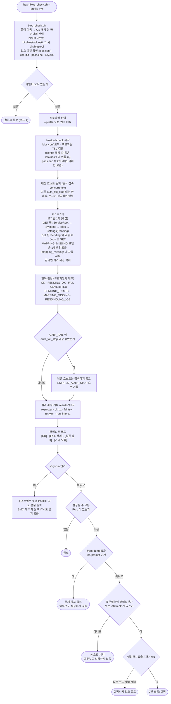
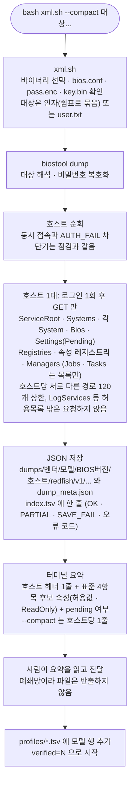
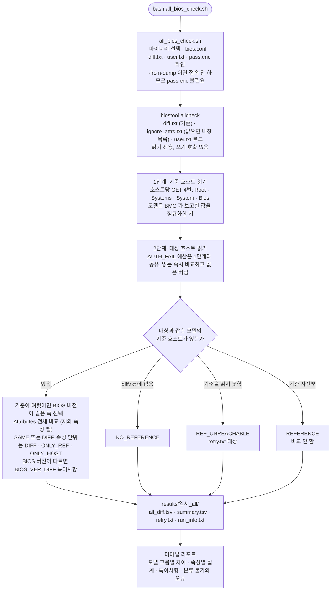
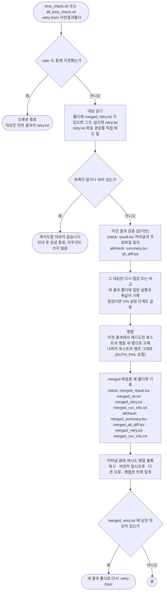
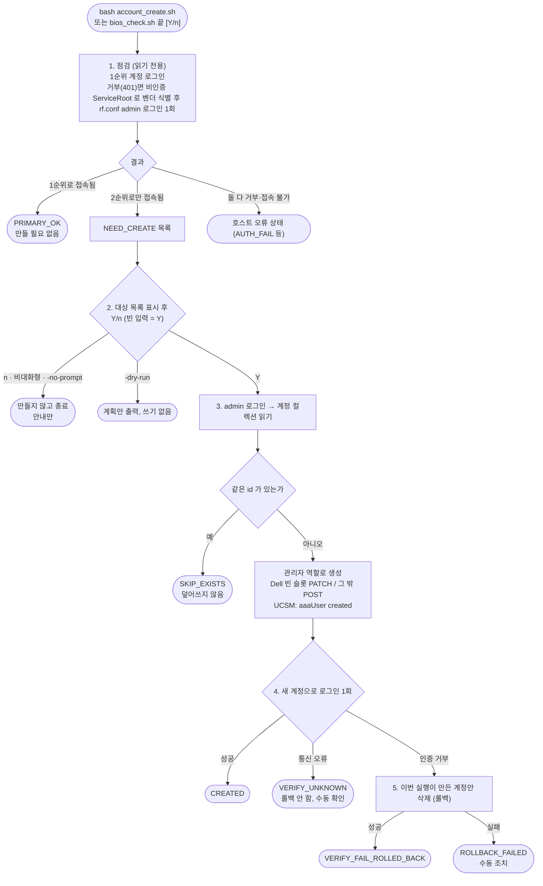

# 작업 흐름도 — redfish (BIOS 표준값 점검·설정 도구)

명령 한 번이 실행되는 주요 경로 6가지를 그렸습니다. 옵션 전체는 [README.md](README.md), 파일별 역할은 [ARCHITECTURE.md](ARCHITECTURE.md), 첫 실장비에서 사람이 확인할 것은 [FIRST_RUN.md](FIRST_RUN.md) 를 참고하세요.

각 흐름은 mermaid 로 그렸고(GitHub 에서 바로 렌더링됩니다), mermaid 를 렌더링한 그림을 같은 폴더에 함께 두었습니다: 1번 [workflow.svg](workflow.svg), 2번 [workflow_set.svg](workflow_set.svg), 3번 [workflow_dump.svg](workflow_dump.svg), 4번 [workflow_allcheck.svg](workflow_allcheck.svg), 5번 [workflow_retry.svg](workflow_retry.svg), 6번 [workflow_account.svg](workflow_account.svg). 글자는 `<text>` 로 들어 있어(foreignObject 아님) 뷰어 글꼴이 달라도 잘리지 않습니다. mermaid 를 보지 못하는 뷰어에서는 SVG 를 여십시오.

## 그림별 단계와 확인 순서

아래 번호는 이 문서의 그림 번호이고, **실제 운영에서 보는 순서는 오른쪽 “순서”** 입니다.

| 순서 | 그림 | 단계 | 명령 | 언제 보나 / 무엇을 확인하나 |
|---|---|---|---|---|
| 1 | 6. [workflow_account.svg](workflow_account.svg) | 준비: 1순위 계정 만들기 | `bash account_create.sh` (점검 끝 `[Y/n]`) | 점검에서 AUTH_FAIL 이 나오고 2순위(rf.conf)로만 접속될 때. 읽기 점검 → 목록 y/n → admin 로 생성 → 새 계정 로그인 검증 → 실패 시 롤백. 결과 상태가 `CREATED` 인지 |
| 2 | 3. [workflow_dump.svg](workflow_dump.svg) | 사전조사: 모델별 속성명·허용값 수집 | `bash xml.sh --compact 대상...` | 처음 보는 모델이거나 점검에서 `MAPPING_MISSING` 이 나올 때. 읽기 전용 덤프 → 요약 → `profiles/*.tsv` 에 `verified=N` 행 추가 |
| 3 | 1. [workflow.svg](workflow.svg) | 점검: 표준값과 대조 | `bash bios_check.sh --profile <이름>` | 기본 작업. 호스트마다 GET 만 하고 OK / FAIL / UNVERIFIED / MAPPING_MISSING 판정. 끝에서 FAIL 이 있으면 설정 여부를 묻는다 |
| 4 | 2. [workflow_set.svg](workflow_set.svg) | 설정: FAIL 항목을 Pending 으로 기록 | 점검 끝의 `Y` (먼저 `-dry-run` 권장) | 점검 결과가 맞고 `verified=Y` 행이 있을 때만. 호스트별 `APPLIED` / `ALREADY_OK` / `UNVERIFIED` / `REJECTED` 등. 재부팅은 하지 않으므로 반영 후 랜덤 서버 확인 |
| 5 | 5. [workflow_retry.svg](workflow_retry.svg) | 재시도: 일시 오류 호스트만 다시 | `-retry-from <이전결과폴더>` | 3~4번 결과에 `retry.txt` 대상이 남았을 때. 새 결과가 이전 결과와 병합되고 `merged_retry.txt` 가 비면 끝 |
| 6 | 4. [workflow_allcheck.svg](workflow_allcheck.svg) | 전체 비교: 같은 모델끼리 속성 전체 비교 | `bash all_bios_check.sh` | 표준값 표(프로파일) 밖의 차이를 찾을 때. 설정 흐름과 독립이며 읽기 전용. `diff.txt` 의 기준 호스트와 비교해 SAME / DIFF |

처음 도입할 때 권장 흐름: 1(계정) → 2(사전조사) → 3(점검) → 4(`-dry-run` 후 설정) → 5(재시도) → 6(전체 비교). 이미 계정과 프로파일이 있으면 3 → 4 → 5 만 반복합니다.

공통 약속: 재부팅은 하지 않습니다. 호스트당 로그인은 1회, 끝나면 자기 세션만 삭제합니다. 허용목록 밖 호출(로그 조회·ClearLog·Reset 등)은 전송 전에 코드가 막습니다.

## 1. 점검 — `bash bios_check.sh --profile VM`

## 2. 설정 (점검 후 Y) — 호스트 1대 기준

## 3. 사전조사 — `bash xml.sh [대상...]`

## 4. 모델별 전체 비교 — `bash all_bios_check.sh`

## 5. 재시도 — `-retry-from 이전결과폴더`

## 6. 계정 생성 — `bash account_create.sh` (또는 `bios_check.sh` 끝의 Y/n), 비밀번호 변경은 `bin/biostool account change`

`account change` 는 같은 4~5단계(새 비밀번호를 터미널에서 직접 2번 입력 → y → 변경 → 새 비밀번호 로그인 검증 → 인증 거부면 이전 비밀번호 복원)이며 `pass.enc` 는 자동으로 바꾸지 않고 `cd <폴더>; bash encrypt.sh` 를 안내합니다.