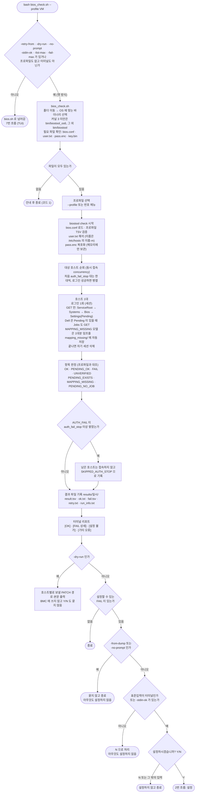
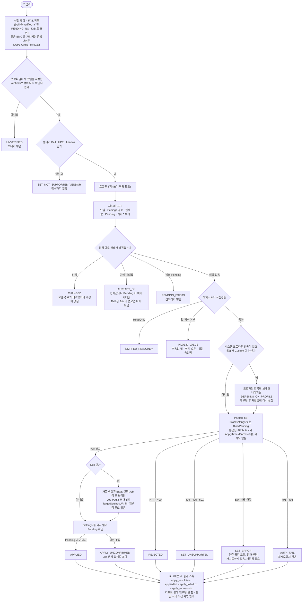
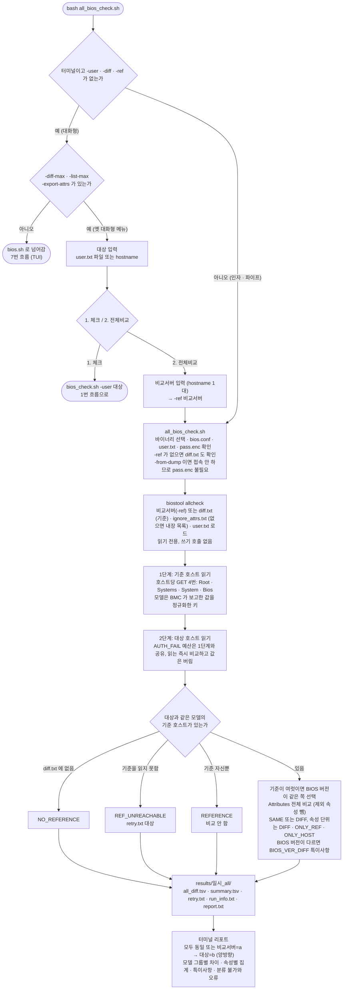
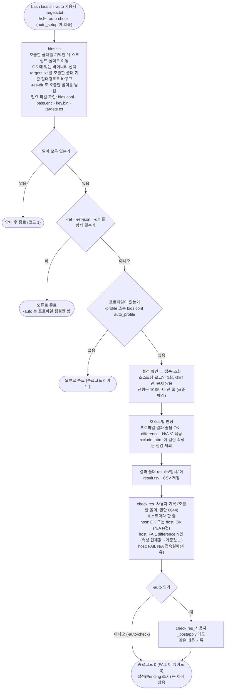

# 작업 흐름도 — redfish (BIOS 표준값 점검·설정 도구)

명령 한 번이 실행되는 주요 경로 8가지를 그렸습니다. 지금의 기본 진입점은 `bash bios.sh`(7번, TUI)이고 auto_setup 연동 경로는 8번입니다. 옵션 전체는 [README.md](README.md), 파일별 역할은 [ARCHITECTURE.md](ARCHITECTURE.md), 첫 실장비에서 사람이 확인할 것은 [FIRST_RUN.md](FIRST_RUN.md) 를 참고하세요.

각 흐름은 mermaid 로 그렸고(GitHub 에서 바로 렌더링됩니다), mermaid 를 렌더링한 그림을 같은 폴더에 함께 두었습니다: 1번 [workflow.svg](workflow.svg), 2번 [workflow_set.svg](workflow_set.svg), 3번 [workflow_dump.svg](workflow_dump.svg), 4번 [workflow_allcheck.svg](workflow_allcheck.svg), 5번 [workflow_retry.svg](workflow_retry.svg), 6번 [workflow_account.svg](workflow_account.svg), 7번 [workflow_bios.svg](workflow_bios.svg), 8번 [workflow_auto.svg](workflow_auto.svg). 글자는 `<text>` 로 들어 있어(foreignObject 아님) 뷰어 글꼴이 달라도 잘리지 않습니다. mermaid 를 보지 못하는 뷰어에서는 SVG 를 여십시오.

## 그림별 단계와 확인 순서

아래 번호는 이 문서의 그림 번호이고, **실제 운영에서 보는 순서는 오른쪽 “순서”** 입니다.

| 순서 | 그림 | 단계 | 명령 | 언제 보나 / 무엇을 확인하나 |
|---|---|---|---|---|
| 1 | 6. [workflow_account.svg](workflow_account.svg) | 준비: 1순위 계정 만들기 | `bash account_create.sh` (점검 끝 `[Y/n]`) | 점검에서 AUTH_FAIL 이 나오고 2순위(rf.conf)로만 접속될 때. 읽기 점검 → 목록 y/n → admin 로 생성 → 새 계정 로그인 검증 → 실패 시 롤백. 결과 상태가 `CREATED` 인지 |
| 2 | 3. [workflow_dump.svg](workflow_dump.svg) | 사전조사: 모델별 속성명·허용값 수집 | `bash xml.sh --compact 대상...` | 처음 보는 모델이거나 점검에서 `MAPPING_MISSING` 이 나올 때. 읽기 전용 덤프 → 요약 → `profiles/*.tsv` 에 `verified=N` 행 추가 |
| 3 | 7. [workflow_bios.svg](workflow_bios.svg) | **통합 점검(기본 진입점)**: 프로파일 점검 → 전체비교 → 수정까지 한 화면(TUI) | `bash bios.sh` | 기본 작업. 호스트당 1회 조회로 프로파일 결과와 전체비교를 함께 얻고, 같은 TUI 에서 `y` 로 전체비교, 마지막에 수정(Pending, 재부팅 없음)을 묻는다. 설정 후 랜덤 서버 확인 |
| 4 | 8. [workflow_auto.svg](workflow_auto.svg) | auto_setup 연동(비대화형): 점검만, 설정 없음 | `bash bios.sh -auto <user> targets.txt` (또는 `-auto-check`) | 묻지 않고 `check.res_<user>` 한 줄 결과만 만든다. 종료코드 0 이면 점검 완료(FAIL 이 있어도 0) |
| 5 | 1. [workflow.svg](workflow.svg) | 옛 방식 점검: 표준값과 대조(Y/N 줄 프롬프트) | `bash bios_check.sh --profile <이름> -no-prompt` 등 | `-dry-run`·`-no-prompt`·`-stdin-ok`·`-retry-from`·`-list-max`·`-fail-max` 를 줄 때의 동작. 호스트마다 GET 만 하고 OK / FAIL / UNVERIFIED / MAPPING_MISSING 판정. 이 옵션 없이 터미널에서 실행하면 bios.sh(7번)로 넘어간다 |
| 6 | 2. [workflow_set.svg](workflow_set.svg) | 설정: FAIL 항목을 Pending 으로 기록 | 점검 끝의 `Y` (먼저 `-dry-run` 권장) / TUI 의 수정 단계 | 점검 결과가 맞고 `verified=Y` 행이 있을 때만. 호스트별 `APPLIED` / `ALREADY_OK` / `UNVERIFIED` / `REJECTED` 등. 재부팅은 하지 않으므로 반영 후 랜덤 서버 확인 |
| 7 | 5. [workflow_retry.svg](workflow_retry.svg) | 재시도: 일시 오류 호스트만 다시 | `-retry-from <이전결과폴더>` | 옛 방식 결과에 `retry.txt` 대상이 남았을 때. 새 결과가 이전 결과와 병합되고 `merged_retry.txt` 가 비면 끝 |
| 8 | 4. [workflow_allcheck.svg](workflow_allcheck.svg) | 옛 방식 전체 비교: 같은 모델끼리 속성 전체 비교 | `bash all_bios_check.sh -ref <비교서버>` 등 | 목록 파일·`-from-dump`·`-retry-from` 방식. 설정 흐름과 독립이며 읽기 전용. 인자 없이 터미널에서 실행하면 bios.sh(7번)로 넘어간다 |

처음 도입할 때 권장 흐름(표의 순서 열): 1(계정) → 2(사전조사) → `bios_check.sh -dry-run`(5·6, 보낼 본문 확인) → 3(`bash bios.sh` 로 점검·전체비교·설정). 일시 오류 재시도는 7(옛 방식). 자동화는 4(`-auto`)가 `check.res_<user>` 를 만들어 auto_setup 이 읽습니다.

공통 약속: 재부팅은 하지 않습니다. 호스트당 로그인은 1회, 끝나면 자기 세션만 삭제합니다. 허용목록 밖 호출(로그 조회·ClearLog·Reset 등)은 전송 전에 코드가 막습니다.

## 1. 점검 — `bash bios_check.sh --profile VM`

## 2. 설정 (점검 후 Y) — 호스트 1대 기준

## 3. 사전조사 — `bash xml.sh [대상...]`

## 4. 모델별 전체 비교 — `bash all_bios_check.sh`

## 5. 재시도 — `-retry-from 이전결과폴더`

## 6. 계정 생성 — `bash account_create.sh` (또는 `bios_check.sh` 끝의 Y/n), 비밀번호 변경은 `bin/biostool account change`

`account change` 는 같은 4~5단계(새 비밀번호를 터미널에서 직접 2번 입력 → y → 변경 → 새 비밀번호 로그인 검증 → 인증 거부면 이전 비밀번호 복원)이며 `pass.enc` 는 자동으로 바꾸지 않고 `cd <폴더>; bash encrypt.sh` 를 안내합니다.

## 7. 통합 점검·전체비교·수정 — `bash bios.sh` (TUI)

대상은 점검 전에 접속 방식별로 나뉩니다: hostname 이 `xml_host_prefix`(기본 `c`)로 시작하거나 `-user-xml` 에 적은 대상은 Cisco UCSM/CIMC XML API(읽기 전용), 그 밖은 Redfish 입니다. XML 로그인 전에 실패한 호스트는 Redfish 로 1번 다시 점검하고, XML 호스트는 점검만 하며 전체비교·설정에서는 빠집니다([README.md](README.md) 2.0절 “Cisco(XML) 혼합 대상”). 아래 그림의 `분류 → XML / Redfish → 폴백` 가지가 이 부분입니다.

터미널에서 인자 없이 실행하면 대상·프로파일을 화면에서 고르고, 호스트당 1회 접속해 BIOS 전체 속성을 읽어 프로파일 결과와 전체비교에 함께 씁니다. 설정은 맨 끝에서 묻습니다: 확인 1(차이 항목 전부를 `현재값 -> 변경값 (수정대상)` / `(수정제외: 사유)` 로 보이고 “위 수정대상을 적용할까요?”), 수정제외가 있으면 확인 2(그 항목만 다시 보이고 “수정제외 항목을 확인했습니다. 진행할까요?”), 남의 Pending 이 있으면 포함 여부. 확인 1·2 에서 n/Esc/Ctrl+X 면 아무것도 쓰지 않고 결과 화면으로 돌아옵니다. Pending 까지만 설정하고 재부팅은 없습니다. 서버 고유값·부팅·보안·RAID·PXE·NIC 속성(보호 속성)은 어느 경우에도 설정하지 않고 수정제외로 보입니다. 키: Tab 화면 전환([프로파일 점검] ↔ [전체 설정 비교]) · ←→ 벤더(Enter 로 들어가면 관리망 그룹) · q 한 단계 뒤로(벤더 줄에서는 q 를 한 번 더 눌러야 끝, 설정할 항목이 있으면 끝내기 전에 수정 단계) · Esc 뒤로(벤더 줄에서는 종료 확인 취소) · ↑↓ · PgUp/PgDn · a/o/f/n 필터 · s 요약 · r 비교 기준 다시 선택 · e 수정 · ? 도움말 · Ctrl+X 진행 중 작업 취소 · Ctrl+C/Ctrl+Z 는 무시.

```mermaid
flowchart TD
    S(["bash bios.sh"]) --> W["bios.sh<br/>폴더 이동 → OS 에 맞는 바이너리 선택<br/>커널 3 미만은 bin/biostool_os6, 그 외 bin/biostool<br/>필요 파일 확인: bios.conf · pass.enc · key.bin<br/>user.txt 는 -plain · -user 를 줬을 때만 필요"]
    W --> M{"파일이 모두 있는가"}
    M -->|없음| X1(["안내 후 종료 (코드 1)"])
    M -->|있음| T{"표준출력이 터미널이고<br/>-plain · -auto 가 아닌가"}
    T -->|아니오| PL(["평문 출력 (색 없음, 읽기 전용)<br/>-profile 필수 · 설정 질문 없음<br/>-ref · -ref-json · -diff 를 주면 전체비교도 출력"])
    T -->|예| A["1. 대상 입력<br/>대상 파일 지정 또는 붙여넣기<br/>붙여넣기: Ctrl+D 완료 · Ctrl+X 취소"]
    A --> B["2. 프로파일 선택<br/>-profile 로 지정하면 생략"]
    B --> CL["대상 분류 (classifyTargets)<br/>hostname 이 bios.conf xml_host_prefix (기본 c) 로 시작 · -user-xml 목록 → XML<br/>그 밖의 hostname · IP → Redfish"]
    CL --> RT{"대상 접속 방식"}
    RT -->|Redfish| C
    RT -->|"XML (Cisco)"| XC["XML 점검 (읽기 전용, hostname-m 로 접속)<br/>aaaLogin → configResolveClass → aaaLogout<br/>서버 1대면 그 서버 · 여러 대면 서비스 프로파일 이름 = hostname 인 서버<br/>(없으면 모든 서버를 host/server dn 으로 보고)<br/>프로파일 # [xml] 구역으로 판정"]
    XC --> XF{"로그인 전 실패인가<br/>(연결 실패 · 타임아웃 · XML 아닌 응답)<br/>AUTH_FAIL 은 해당 없음 — 재시도 안 함"}
    XF -->|아니오| D
    XF -->|예| FB["그 호스트만 Redfish 로 1번 다시 점검<br/>비고: XML 실패 → Redfish"] --> C
    C["3. 접속·조회 (호스트당 로그인 1회, GET 만)<br/>BIOS 전체 속성을 한 번에 읽어<br/>프로파일 판정과 전체비교에 함께 사용<br/>진행 표시 · Ctrl+X 취소 (남은 호스트는 CANCELED)<br/>result.tsv · profile_ CSV 저장"]
    C --> D["4. 결과 TUI [프로파일 점검] 화면<br/>[OK] · [difference] · [N/A] 색상 줄<br/>←→ 벤더 · Enter 로 관리망 그룹 · q 한 단계 뒤로 · 필터 · 요약"]
    D --> E{"키"}
    E -->|"q 두 번 (설정할 항목 있음) 또는 e"| SET
    E -->|"q 두 번 (항목 없음 · 이미 거절·적용)"| SUM
    E -->|"Tab (처음)"| R{"기준 선택<br/>-ref · -ref-json · -diff 를 줬으면 묻지 않음<br/>r 키로 다시 고를 때는 항상 메뉴"}
    R -->|"비교서버 hostname<br/>(비우면 diff.txt)"| CP
    R -->|"refs 폴더의 JSON<br/>(bios_export 결과)"| CP
    R -->|"diff.txt (모델별 기준)"| CP
    R -->|"취소"| D
    CP["전체비교 (대상에는 다시 접속하지 않음)<br/>비교서버만 추가 조회 · 같은 모델끼리만 비교<br/>BIOS 버전이 달라도 속성 이름 목록이 같으면 허용<br/>기준 서버 자신은 자기 값으로 OK (REFERENCE)<br/>제외 = ignore_attrs.txt + exclude_attrs<br/>compare_ CSV 저장"] --> CT["[전체 설정 비교] 화면<br/>Tab 으로 두 화면을 오감 (화면마다 위치·필터 유지)"]
    CT -->|"Tab"| D
    CT -->|"r 기준 다시 선택"| R
    CT -->|"q 두 번 (설정할 항목 있음) 또는 e"| SET
    CT -->|"q 두 번 (항목 없음 · 이미 거절·적용)"| SUM
    SET{"-from-dump 인가"}
    SET -->|예| NS(["설정하지 않음 (접속 안 함)"])
    NS --> BK
    SET -->|아니오| PLAN["수정 계획 (BMC 접속 없음)<br/>프로파일 difference (verified=Y 행만)<br/>+ 전체비교 difference (allcheck_set=on · BIOS 버전이 같은 호스트만)<br/>같은 속성의 목표값이 다르면 설정 안 함 [충돌]<br/>보호 속성 (IQN · IP · ServerName · 부팅 · 보안 · RAID · PXE · NIC) 은 수정제외<br/>제외 속성 · 위험 속성 · N/A · Dell/HPE/Lenovo 외 · BIOS_VER_DIFF 제외<br/>시스템 프로파일 성격 속성이 여럿이면 프로파일 행만<br/>Dell 은 남의 Pending 이 있으면 호스트 제외<br/>XML 로 점검한 Cisco 호스트는 읽기 전용이라 제외 (전체비교도 N/A)"]
    PLAN --> EM{"설정할 항목이 있는가"}
    EM -->|없음| NI["설정할 항목이 없습니다<br/>(수정제외 · 충돌 사유가 있으면 미리보기를 보임)"]
    NI --> BK
    EM -->|있음| Q1{"확인 1: 차이 항목 전부를 보임<br/>현재값 -> 변경값 (수정대상) / (수정제외: 사유)<br/>위 수정대상을 적용할까요? y/n"}
    Q1 -->|"n · Esc · Ctrl+X"| BK
    Q1 -->|y| XQ{"수정제외 항목이 있는가"}
    XQ -->|있음| Q2{"확인 2: 수정제외 항목만 다시 보임<br/>아래 항목은 변경하지 않습니다<br/>수정제외 항목을 확인했습니다. 진행할까요? y/n"}
    XQ -->|없음| PQ
    Q2 -->|"n · Esc · Ctrl+X"| BK
    Q2 -->|y| PQ
    PQ{"남의 Pending 이 있는 장비가 있는가"}
    PQ -->|예| PA{"호스트 · 속성 · Pending 값 목록 표시<br/>y 포함 / n 제외 / Ctrl+X 취소"}
    PQ -->|아니오| AP
    PA -->|"y 또는 n"| AP
    PA -->|"Ctrl+X"| BK
    AP["Pending 설정 (재부팅 없음)<br/>보호 속성이 하나라도 섞인 호스트는 접속 없이 PROTECTED_ATTR<br/>호스트마다 재조회 · 레지스트리 검사 · PATCH 1회<br/>Dell 은 Job 최대 1회 · 재시도 없음<br/>호스트별 진행 줄 · Ctrl+X 취소 (시작 전 호스트는 CANCELED)"] --> RC["Pending 재조회로 반영 여부 표시<br/>설정 결과 화면"]
    RC --> BK2["결과 화면으로 돌아옴 (이후 다시 설정은 막힘)"]
    BK2 --> D
    BK(["아무것도 쓰지 않고 결과 화면으로 돌아옴"]) --> D
    SUM(["TUI 를 닫고 요약 출력<br/>OK · difference · N/A · 오류 건수<br/>결과 폴더 · CSV 목록 · 설정 결과"])
```

## 8. auto_setup 연동(비대화형) — `bash bios.sh -auto <user> targets.txt`

묻지 않고 프로파일 점검만 하며 설정은 하지 않습니다(`-auto` 도 점검만). 결과는 호출한 폴더의 `check.res_<user>` 입니다.

