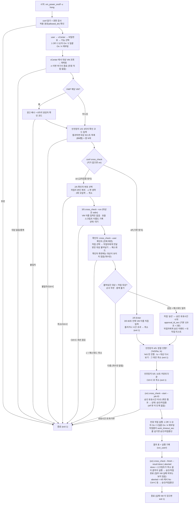
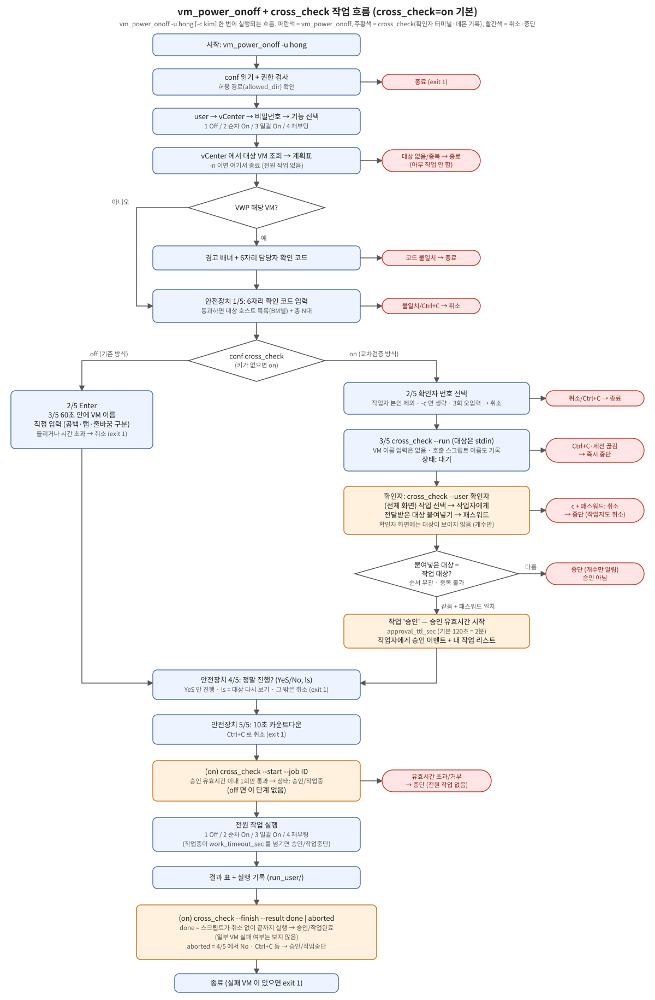

# 작업 흐름도 — vm_power_onoff + cross_check

`vm_power_onoff -u hong` 한 번이 실행되는 흐름입니다(`cross_check=on`, 0.3.0 부터 기본). 옵션 전체는 [README.md](README.md), 파일별 역할은 [ARCHITECTURE.md](ARCHITECTURE.md), 교차검증 데몬은 [cross_check/README.md](cross_check/README.md)를 참고하세요. 이 문서는 README.md 와 ARCHITECTURE.md 에서 링크됩니다.

위 그림(`workflow.svg`)은 같은 흐름을 손으로 그린 SVG 이고, 위 mermaid 와 내용이 같습니다(흐름을 바꾸면 둘 다 고칩니다).

## 읽는 법

- **파란색**은 vm_power_onoff 가 하는 일, **주황색**은 cross_check(확인자 터미널·데몬 기록)가 하는 일, **빨간색**은 취소·중단입니다. 취소는 모두 **전원 작업 없이 종료 코드 1** 입니다(전원 작업이 시작된 뒤 Ctrl+C 는 이미 vCenter 에 요청한 작업이 계속될 수 있음).
- 승인 유효시간(`approval_ttl_sec`, 기본 2분)은 **승인 → 4/5 → 카운트다운(10초) → `--start`** 를 덮습니다. 넘기면 데몬이 `승인 후 {TTL} 내 미진행` 으로 중단합니다.
- 작업의 상태: `대기` → `승인`(본 작업 전) → `승인/작업중`(`--start`) → `승인/작업완료`(`--finish --result done`) 또는 `승인/작업중단`(`--finish --result aborted`, 4/5 에서 No, Ctrl+C, `work_timeout_sec` 초과). `승인/작업완료` 는 **작업 스크립트가 취소 없이 끝까지 실행됐다**는 뜻이며 VM 별 성공·실패는 검사하지 않습니다. 대기·승인(시작 전) 중 확인자 취소, 대상 불일치, 작업자 종료, 유효시간 초과 등은 `중단` 입니다.
- `cross_check=off` 면 2/5 Enter → 3/5 VM 이름 입력 → 4/5 → 5/5 의 기존 방식이고 cross_check 는 호출하지 않습니다. `-n`, `--demo` 도 호출하지 않습니다.
- 데몬 내부(상태 전이·한도·인증)는 [cross_check/README.md](cross_check/README.md)의 1장 흐름도를 참고하세요.
