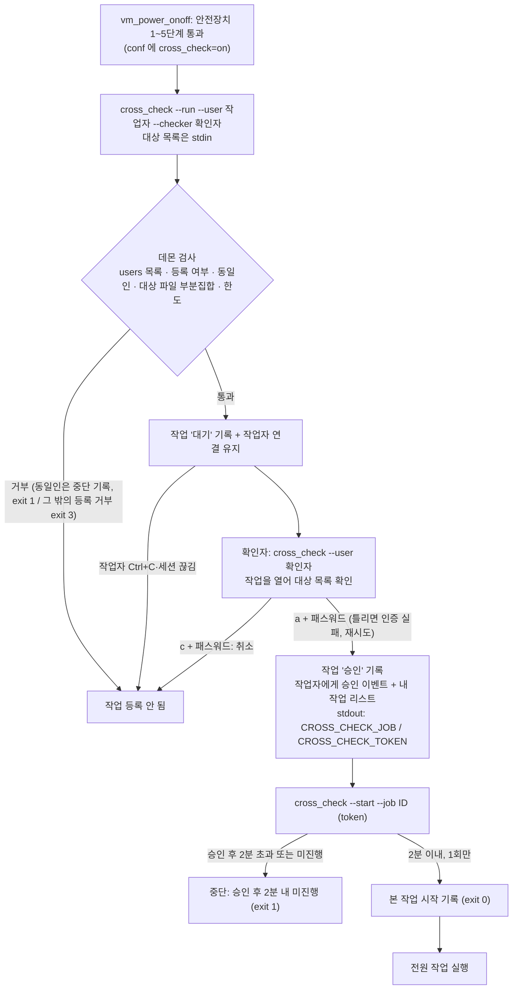

# cross_check — 원격 2인 1조 교차검증 데몬

> **[필수 정책]** `cross_check` 데몬을 사용하는 작업의 경우, 확인자의 **승인 완료 후 2분 내에 본 작업을 진행하지 않으면 해당 작업 승인은 자동으로 취소(중단)** 처리됩니다.

2인 1조 교차검증에서 확인자가 작업자 자리로 직접 이동하지 않아도, 각자 자기 터미널에서 `cross_check` 데몬을 통해 **작업자는 대기하고, 확인자는 작업 대상을 보고 본인 패스워드로 승인**하게 하는 도구입니다.
모든 요청의 상태(대기 / 승인 / 중단)와 중단 사유는 데몬이 기록합니다. [vm_power_onoff](../README.md) 와 연동하면 안전장치 5단계를 통과한 직후, 실제 전원 작업 직전에 확인자 승인을 받습니다.

| 항목 | 내용 |
|---|---|
| 대상 환경 | Red Hat 계열 Linux (RHEL / Rocky). OS6(RHEL·CentOS 6)는 미리 빌드한 실행파일 사용 — [7. OS6](#7-os6) |
| 구현 | Go, **표준 라이브러리만** 사용(별도 모듈 `cross_check/go.mod`, vendor 불필요, Go 1.20 이상) |
| 통신 | Unix 도메인 소켓 `/var/run/cross_check/cross_check.sock` (요청마다 JSON 한 줄) |
| 상시 구동 | root crontab `* * * * * /usr/local/bin/cross_check --ensure` (데몬이 없으면 매분 다시 띄움) |
| 설계 결정 | [PLAN.md](PLAN.md)(원 계획서), [INTERVIEW.md](INTERVIEW.md)(결정 기록 Q1~Q28 — Q8 은 폐지) |

> 폴더 안내: `cmd/cross_check/`(CLI), `internal/daemon/`(데몬·클라이언트·인증·설정), `internal/tui/`(사용자·관리자 화면), `internal/store/`(작업 기록 저장소), `scripts/`(crontab·관리자 패스워드 생성), `test/e2e.sh`(격리 E2E). 파일별 역할은 [../ARCHITECTURE.md](../ARCHITECTURE.md).

## 1. 동작 방식

### 역할

| 역할 | 하는 일 | 필요한 것 |
|---|---|---|
| **작업자** | `cross_check --run --user <나> --checker <확인자>` 로 작업을 올리고 승인될 때까지 대기. 승인되면 2분 안에 `--start` 후 본 작업 진행 | 등록된 패스워드(등록만 필요, `--run` 에서는 묻지 않음), 자기 대상 파일 |
| **확인자** | `cross_check --user <나>` 화면에서 자기에게 온 작업을 열어 **대상 목록을 확인**하고 패스워드로 승인(`a`) 또는 취소(`c`) | 등록된 본인 패스워드 |
| **관리자** | `cross_check --admin` 으로 잘못된 기록 정리, 상태 변경, 삭제, 전체 정리, 사용자 패스워드 재설정 | `auth.conf` 의 `admin=` 패스워드 |

- 작업자·확인자 이름은 **`cross_check.conf` 의 `users=` 목록**에 있어야 합니다(관리자가 관리). 이름 규칙은 영소문자·숫자·`_`, 64자 이하이며 `admin` 은 예약어라 쓸 수 없습니다.
- 작업자와 확인자가 **같은 이름이면 기다리지 않고 즉시 중단**(종료 코드 1)하고, 데몬이 떠 있으면 중단 기록을 남깁니다.
- 승인에는 확인자가 대상을 붙여넣지 않습니다. 확인자 화면에 **작업 대상 목록이 그대로 표시**되고, 확인자는 작업자와 대조한 뒤 **본인 패스워드**를 입력해 승인합니다(INTERVIEW Q23, 붙여넣기 대조는 폐지).

### 작업 상태와 중단 사유

상태는 3가지뿐입니다. 본 작업 시작 여부는 `started_at` 필드로 따로 기록하며 상태는 `승인` 으로 남습니다.

| 상태 | 의미 |
|---|---|
| **대기** | 작업자의 `--run` 이 등록되어 확인자 처리를 기다리는 상태 |
| **승인** | 확인자가 패스워드로 승인한 상태. 승인 시각부터 **2분** 안에 `--start` 가 와야 함 |
| **중단** | 아래 사유 중 하나로 끝난 상태. 한 번 중단되면 되살릴 수 없음(관리자도 불가) |

| 중단 사유(기록되는 문구) | 언제 |
|---|---|
| `작업자와 확인자가 동일` | `--user` 와 `--checker` 가 같음 |
| `확인자 <이름> 가 취소` | 확인자가 `c` 로 취소 |
| `작업자 스크립트 종료` | 대기 중 작업자의 `--run` 이 Ctrl+C·세션 끊김·`kill -9` 등으로 끝남(연결이 끊기면 데몬이 즉시 감지) |
| `승인 후 2분 내 미진행` | 승인 후 2분 안에 `--start` 가 없거나, 늦게 `--start` 함 |
| `데몬 재시작` | 데몬이 다시 뜰 때 남아 있던 대기/승인(미시작) 작업 |
| `데몬 종료` | 데몬이 종료될 때 열려 있던 대기/승인(미시작) 작업 |
| `관리자 변경: <사유>` | 관리자가 상태를 `중단` 으로 바꿈 |
| `관리자 삭제` / `관리자 전체 정리` | 대기 중인 작업이 관리자 삭제·전체 정리로 사라짐(작업자에게 알리는 이벤트 사유이며 기록은 지워짐) |

작업자의 `--run` 연결로는 **모든 상태 전이가 사유와 함께 즉시 전달**되어 화면에 출력됩니다.

### 흐름도



## 2. 설치 / 구성

이 폴더(`power_onoff/`)를 통째로 받아 `setup.sh` 한 번이면 빌드부터 데몬 기동까지 구성됩니다(폐쇄망 가능, 인터넷 접속 시도 없음).

```bash
cd power_onoff
bash setup.sh                         # vm_power_onoff + cross_check 빌드 → root(또는 sudo -n 가능)이면 install.sh 까지 자동 실행
bash setup.sh --enable-cross-check    # 위와 같고, 설치되는 pwonoff.conf 에 cross_check=on 까지 설정
bash setup.sh --skip-vm-power-onoff   # cross_check 만 (Go 1.26.5 미만 서버 등)
bash setup.sh --no-install            # 빌드만 → 이후 sudo bash install.sh [허용디렉터리] [--enable-cross-check]
```

| 구성 요소 | 내용 |
|---|---|
| 빌드 | `cross_check/bin/cross_check` (Go 1.20 이상, `GOPROXY=off`). vm_power_onoff 는 Go 1.26.5 이상 필요 |
| 실행파일 | `/usr/local/bin/cross_check` |
| `/etc/cross_check/cross_check.conf` | **없을 때만** 생성: `target_dir`=허용디렉터리(vm_power_onoff 의 `allowed_dir` 과 같은 값), `users`=설치된 `pwonoff.conf` 의 `users` **(처음 한 번만 복사 — 이후 `pwonoff.conf` 의 users 를 바꿔도 따라가지 않으므로 직접 수정)**, `auth=required`, `approval_ttl_sec=120` |
| `/etc/cross_check/auth.conf` | **없을 때만** 생성(0600, root): `admin=<무작위 16자>` — **관리자 패스워드는 이때 화면에 한 번만 출력**됩니다. 분실하면 root 가 이 파일의 `admin=` 줄을 확인/수정. 이미 있으면 권한만 0600 root 로 바로잡고 `admin=` 줄이 없으면 경고 |
| `/var/lib/cross_check` | 작업 기록 디렉터리(0700) |
| `/etc/tmpfiles.d/cross_check.conf` | 재부팅 후 `/run/cross_check`(소켓 디렉터리) 생성 |
| root crontab | `* * * * * /usr/local/bin/cross_check --ensure >/dev/null 2>&1 # cross_check` 정확히 한 줄(멱등) |
| 데몬 기동 | `cross_check --ensure` 로 띄우고 소켓·프로세스 확인. 실행파일이 바뀌었으면 데몬을 다시 띄움 |
| `--enable-cross-check` | `/etc/vcetner_pwon_off/pwonoff.conf` 의 `cross_check=on` (이미 있으면 그대로, 줄이 없으면 추가). **이 옵션이 없으면 `pwonoff.conf` 는 건드리지 않음**(기본 `off`) |

- 제거: `sudo bash install.sh -u` — 실행파일·crontab 줄 삭제, 데몬 중지. **설정·패스워드(`auth.conf`)·작업 기록은 남깁니다.**
- crontab 을 쓰려면 `cronie` 가 설치되어 `crond` 가 동작 중이어야 합니다(폐쇄망은 설치 미디어의 cronie RPM). crontab 줄만 따로 관리: `sudo bash cross_check/scripts/cc_cron.sh install|remove|status`.
- 시험·비표준 설치용으로 `install.sh` 는 `CC_ETC CC_STATE CC_BIN_DIR CC_SOCKET_DIR CC_PWONOFF_DIR CC_TMPFILES_DIR CC_LOG CC_CRON_BIN CC_SKIP_CRON=1 CC_SKIP_START=1` 환경변수로 경로를 바꿀 수 있습니다.

### 설정 후 해야 할 일

1. `/etc/cross_check/cross_check.conf` 의 `users=` 가 실제 작업자·확인자 전원을 포함하는지 확인합니다(**설정 파일은 데몬 시작 때 한 번 읽습니다.** 수정 후 데몬을 다시 띄워야 반영되며, 다시 뜨는 순간 열려 있던 대기/승인 작업은 `데몬 재시작` 으로 중단됩니다 — 작업이 없을 때 하세요: `sudo kill $(pgrep -f 'cross_check --daemon')` 후 최대 1분 안에 crontab 이 다시 띄움, 바로 띄우려면 `sudo cross_check --ensure`).
2. **각 사람이 한 번씩 등록**합니다(아래 3장). 등록은 선착순이므로 가능한 한 빨리.
3. 교차검증을 켜려면 `pwonoff.conf` 에 `cross_check=on` (또는 `install.sh --enable-cross-check`).

### 설정 파일 `/etc/cross_check/cross_check.conf`

`키=값` 형식, `#` 주석. **모르는 키·중복 키·형식 오류가 있으면 데몬이 시작하지 않습니다.** 파일이 아예 없으면 `auth=required`, 120초로 보지만 `target_dir`/`users` 가 없어 시작하지 못합니다(fail closed).

| 키 | 기본값 | 설명 |
|---|---|---|
| `target_dir` | (`auth=required` 면 필수) | 사용자별 대상 파일 `on_off_<user>.txt` 가 있는 절대경로. vm_power_onoff 의 `allowed_dir` 과 같게 |
| `users` | (`auth=required` 면 필수) | 쉼표로 구분한 작업자·확인자 이름 목록. 이 목록 밖의 이름은 등록·작업·승인·취소·패스워드 변경이 모두 거부됨. 빈 항목·중복·`admin` 은 오류 |
| `auth` | `required` | `required` = 패스워드·token·users 검사(fail closed). `off` = **검사 안 함(시험용)** — 관리자 기능도 누구에게나 열리므로 운영에서 쓰지 마세요 |
| `approval_ttl_sec` | `120` | 승인 후 `--start` 허용 시간(초). 필수 정책은 2분이므로 바꾸면 정책과 달라집니다(화면 안내에 `이 데몬 설정: N초` 가 붙음) |

## 3. 최초 등록 (패스워드)

처음 `cross_check --user <이름>` 을 실행하면 **패스워드 등록 화면**이 자동으로 나옵니다.

```bash
cross_check --user hong
# [첫 실행] 사용자 hong 은(는) 아직 cross_check 에 등록되지 않았습니다.
# 새 패스워드: ********      ← 화면에 표시되지 않음, 두 번 입력
# 새 패스워드 확인: ********
# [등록 완료] hong 의 패스워드가 등록되었습니다.
```

- 패스워드 규칙: **6~128자**, 앞뒤 공백·줄바꿈·NUL 금지. 입력은 3번까지 다시 할 수 있습니다.
- **`users=` 목록에 있는 이름만** 등록됩니다. 목록에 없으면 "관리자에게 추가를 요청하세요" 와 함께 거부됩니다.
- **선착순**: 먼저 등록한 사람이 그 이름의 패스워드를 갖습니다. 이미 등록된 이름은 덮어쓸 수 없고(`이미 등록됨`), 바꾸려면 화면의 `p` 명령(현재 패스워드 필요), 분실했으면 관리자가 재설정합니다.
- **`admin` 은 소켓으로 등록할 수 없습니다.** `install.sh` 가 `auth.conf` 에 직접 씁니다.
- `--run` 은 **작업자와 확인자 모두 등록되어 있어야** 동작합니다(`auth=off` 제외). 미등록이면 등록 방법을 안내하며 거부합니다.

## 4. 명령 레퍼런스

### CLI

`-x` 와 `--x` 형태 모두 됩니다. 항상 사용자를 지정합니다(`--user` 없이 TUI 를 열면 사용법 + 종료 코드 2).

| 명령 | 설명 |
|---|---|
| `cross_check --user <user>` | 사용자 화면(TUI). 첫 실행이면 패스워드 등록. 내 작업·내가 확인자인 작업 목록, 승인/취소 |
| `cross_check --run --user <작업자> --checker <확인자> [--targets-file <파일>]` | 작업 등록 후 확인자 승인까지 대기(작업 스크립트 안에서 호출). 대상 목록은 `--targets-file` 또는 stdin(줄바꿈·탭·공백 구분, `#` 주석). **`--cechker` 오타도 같은 뜻으로 받습니다** |
| `cross_check --start --job <ID> [--token <T>]` | 본 작업 직전 신호. 승인 후 2분 이내 1회만 통과. token 은 환경변수 `CROSS_CHECK_TOKEN` 으로 주는 것을 권장(`--token` 은 `ps` 에 보임) |
| `cross_check --admin` | 관리자 화면 |
| `cross_check --daemon` | 데몬을 포그라운드로 실행(보통 `--ensure` 가 대신 띄움) |
| `cross_check --ensure` | 데몬이 응답하면 조용히 종료, 없으면 `--daemon` 을 세션에서 떼어 띄우고 최대 3초 확인. 동시에 여러 번 불려도 잠금(flock) 때문에 데몬은 하나만 남음 |
| `cross_check --version`, `-h` | 버전 / 사용법 |

`--run` / `--start` / `--admin` / `--daemon` / `--ensure` / `--version` 은 하나만 지정할 수 있고, `--checker` `--job` `--token` `--targets-file` 은 `--run`/`--start` 와 함께만 씁니다.

### `--run` 출력 규약 (래퍼 스크립트용)

- 사람이 읽는 글(대기·상태 이벤트·내 작업 리스트·정책 안내)은 **모두 stderr** 로 나갑니다.
- **stdout 에는 승인됐을 때만 정확히 두 줄**이 나갑니다.

  ```text
  CROSS_CHECK_JOB=<작업ID>
  CROSS_CHECK_TOKEN=<1회용 token>
  ```

```bash
out="$(cross_check --run --user hong --checker kim < targets.txt)" || exit 1   # eval "$(...)" 로 바로 받으면 실패해도 종료 코드가 0 이 되므로 한 번 변수에 받습니다
eval "$out"
export CROSS_CHECK_TOKEN
# ... 본 작업 직전에 (승인 후 2분 이내) ...
cross_check --start --job "$CROSS_CHECK_JOB" || exit 1
```

### 종료 코드

| 코드 | 의미 |
|---|---|
| 0 | 성공 / 승인 / 정상 종료 |
| 1 | 중단·거부(`--run` 중 확인자 취소·작업자 동일·그 밖의 중단, `--start` 거부·승인 시간 초과, TUI 의 인증·등록 실패, `--ensure` 가 3초 안에 데몬을 띄우지 못함) |
| 2 | 사용법 오류(필수 인자 없음, token 없음 등) |
| 3 | 연결·데몬·입력 오류(데몬에 연결 불가, 대상 비어 있음, 이름 규칙 위반, **`--run` 작업 등록 거부** — 미등록·`users` 밖·대상 이탈·한도 등) |
| 130 | Ctrl+C (`--run` 은 이때 데몬에 중단을 알림) |

### 환경변수

기본값은 아래 경로이고, 시험·비표준 설치에서만 바꿉니다.

| 변수 | 기본값 | 용도 |
|---|---|---|
| `CROSS_CHECK_SOCKET` | `/var/run/cross_check/cross_check.sock` | 소켓 경로 |
| `CROSS_CHECK_CONF` | `/etc/cross_check/cross_check.conf` | 데몬 설정 |
| `CROSS_CHECK_AUTH` | `/etc/cross_check/auth.conf` | 패스워드 파일 |
| `CROSS_CHECK_STATE` | `/var/lib/cross_check/jobs.json` | 작업 기록 |
| `CROSS_CHECK_LOCK` | `/var/run/cross_check/daemon.lock` (소켓을 바꿨으면 그 디렉터리의 `daemon.lock`) | 데몬 단일 실행 잠금 |
| `CROSS_CHECK_LOG` | `/var/log/cross_check.log` | 데몬 로그 |
| `CROSS_CHECK_TOKEN` | — | `--start` 가 읽는 token |
| `CROSS_CHECK_COLOR` | (자동) | `never` / `always`. 그다음 `NO_COLOR`, 마지막으로 터미널 여부 |

### 사용자 화면(TUI) 명령

줄 입력 + ANSI 색상 방식이며 **입력 시간 제한이 없습니다**. 패스워드 입력은 화면에 표시되지 않습니다(터미널일 때 에코 끔).

| 화면 | 입력 | 동작 |
|---|---|---|
| 메인 | `<번호>` 또는 `o <번호\|ID>` | 작업 열기 (번호는 화면의 `[번호]`) |
| 메인 | `r` / Enter | 새로고침 |
| 메인 | `w` | 감시 모드: 2초마다 자동 갱신, Enter 로 종료(명령을 치면 바로 실행) |
| 메인 | `p` | 내 패스워드 변경(현재 패스워드 필요, 새 패스워드 두 번) |
| 메인 | `h` / `?` | 도움말 |
| 메인 | `q` | 종료 |
| 작업 열기 (내가 확인자이고 `대기`) | `a` | **승인** — 패스워드 입력. 틀리면 다시 시도 가능 |
| 작업 열기 (내가 확인자이고 `대기`) | `c` | **취소(중단)** — 패스워드 입력. 작업자의 스크립트도 중단됨 |
| 작업 열기 | Enter | 목록으로 |

메인 화면에는 **내 작업(작업자)** 과 **내가 확인자인 작업** 두 표가 최근 20건씩 나옵니다(ID, 상대방, 상태, 생성·승인 시각, 대상 수, 사유 / 승인 후 남은 시간). 새 요청·승인·중단은 알림 줄로 표시됩니다. 작업을 열면 대상 VM 목록이 번호와 함께 모두 보입니다.

### 관리자 화면 (`cross_check --admin`)

`auth.conf` 의 `admin=` 패스워드로 로그인합니다(최대 3번). `admin=` 줄이 없으면 안내 문구를 출력하고 종료 코드 1 로 끝나며(데몬도 관리자 기능을 모두 거부), `admin` 은 소켓으로 등록할 수 없으므로 `install.sh` 를 실행하거나 root 가 `admin=<패스워드>`(6자 이상, 파일 0600) 줄을 추가해야 합니다. admin 패스워드 변경도 root 가 파일을 직접 고칩니다.

| 메뉴 | 동작 |
|---|---|
| 1) 전체 목록 | 모든 작업과 대상(감사용 uid 포함) |
| 2) 상태 변경 | `대기`→`승인`/`중단`, `승인`→`중단` 만 가능. **`중단` 은 되살릴 수 없고**, `대기` 로 되돌릴 수 없음. 승인으로 바꾸면 그 시각부터 2분 규칙 적용. 사유는 `관리자 변경: <사유>` 로 기록 |
| 3) 작업 삭제 | `y` 확인 후 하나 삭제. 대기 중인 작업자에게는 중단으로 알림 |
| 4) 전체 정리 | `전체 정리` 를 그대로 입력해야 **모든 기록**(이력 포함)을 지움 |
| 5) 사용자 패스워드 재설정 | `users=` 목록의 이름만. 항목이 없으면 새로 만들고, 그 이름의 연속 인증 실패 기록도 지움 |
| 6) 등록된 사용자 보기 | 데몬에 사용자 목록 조회 기능이 없어, 작업 기록에 나온 이름만 참고용으로 표시 |

## 5. vm_power_onoff 연동

`pwonoff.conf` 에 아래 키가 있고(예시: [../pwonoff.conf.example](../pwonoff.conf.example)), 명령행에 `-c <확인자>` 옵션이 있습니다. 자세한 옵션은 [../README.md](../README.md#교차검증cross_check-연동).

| 설정 | 기본값 | 설명 |
|---|---|---|
| `cross_check` (conf) | `off` | `on` 이면 안전장치 1~5단계 통과 직후, 실제 전원 작업 직전에 교차검증 |
| `cross_check_bin` (conf) | `/usr/local/bin/cross_check` | 실행 파일 절대경로(비우면 기본값) |
| `-c <checker>` | — | 확인자 지정. `pwonoff.conf` 의 `users` 에 있고 본인이 아니어야 함. 생략하면 본인을 뺀 번호 목록에서 선택 |

동작 순서(코드 `crosscheck.go` / `main.go`):

1. `cross_check=on` 이고 계획만 보는 `-n` 이 아니면, 시작 직후 `cross_check_bin` 이 실행 가능한 파일인지 확인합니다(`-n`, `--demo` 에서는 호출하지 않음). `-c` 를 줬는데 `cross_check=off` 면 경고 후 무시합니다.
2. user·vCenter·기능 선택, 계획표, VWP 확인, **안전장치 1~5단계**를 모두 통과합니다. (작업자가 안전장치에서 취소하면 확인자를 부르지 않음)
3. **교차검증 관문**: 확인자를 정하고 2분 정책 안내를 출력한 뒤 `cross_check --run --user <user> --checker <확인자>` 를 실행합니다(대상 VM 이름을 stdin 으로 전달, 진행 출력은 그대로 화면에). 확인자가 승인할 때까지 대기합니다.
4. 승인되면 **곧바로** `cross_check --start --job <ID>` 로 승인 후 2분 창을 확인합니다(token 은 자식 프로세스 환경변수로만 전달하고 화면·감사 로그에 남기지 않음).
5. 통과하면 전원 작업을 실행합니다. 중단·거부·시간 초과·Ctrl+C·오류면 `[취소] 교차검증 미승인` 으로 **전원 작업 없이 종료 코드 1** 로 끝납니다. 모든 단계는 감사 로그(`run_<user>/`)에 남습니다.

연동 시 주의:

- vm_power_onoff 의 user(`-u`)가 그대로 cross_check 의 작업자 이름이 되므로, **cross_check.conf 의 `users=` 에 있고 등록되어 있어야** 합니다. 확인자도 마찬가지입니다. `pwonoff.conf` 와 `cross_check.conf` 의 `users` 는 **서로 다른 목록**입니다.
- 데몬은 대상이 `<target_dir>/on_off_<user>.txt` 의 부분집합인지 검사하므로 `target_dir` 이 `allowed_dir` 과 같아야 합니다.

## 6. 보안 모델과 한계

이 서버들은 **모두 root 로 로그인**하므로 OS 계정으로는 사람을 구분할 수 없습니다. 그래서 확인자 승인은 **사용자별 패스워드**(`auth.conf`)로 지킵니다. 소켓은 누구나 접속할 수 있고(0666), 권한 판단은 데몬이 패스워드·token·`users` 목록으로 합니다. OS uid(`SO_PEERCRED`)는 감사 기록용일 뿐 권한 판단에 쓰지 않습니다.

### 막아 주는 것

| 통제 | 막는 것 |
|---|---|
| 승인·취소에 **확인자 본인 패스워드** 요구 | 작업자가 자기 작업을 스스로 승인, 다른 사람 이름으로 승인·취소(패스워드를 모르면 불가) |
| `users=` 목록 + 작업자·확인자 모두 **등록 필수** | 작업자가 아무 이름(가짜 확인자)을 만들어 지정하고 자기가 등록해 승인하는 것 |
| 작업자 = 확인자 즉시 중단 | 같은 사람이 양쪽을 맡는 실수 |
| `register` 는 `users=` 의 이름만, `admin` 은 소켓으로 등록 불가 | 목록 밖 이름 선점, 관리자 이름 가로채기 |
| 대상은 `target_dir/on_off_<user>.txt` 의 **부분집합만**(요청마다 파일을 새로 읽음, 심볼릭 링크 거부) | 작업자가 자기에게 등록되지 않은 VM 을 올리는 것 |
| 오답 지연: 같은 이름 연속 5번 실패 후 시도마다 1초 지연, 전체 실패가 1분에 100번 초과면 실패 응답마다 1초 지연 | 패스워드 무차별 대입. 잠그지 않으므로(올바른 패스워드는 지연 중에도 통과) 남이 일부러 틀려 정당한 사용자를 막을 수도 없음 |
| `--start` token 은 `--run` 이 작업자에게만 준 **1회용**(성공하면 폐기), 승인 후 2분 이내, 중단된 작업은 되살릴 수 없음 | 승인 재사용, 늦은 시작, 관리자의 중단 건 부활 |
| 인증 실패 문구는 "인증 실패" 하나, 패스워드·token 은 로그·오류·`list`/`get` 에 넣지 않음 | 사용자·작업 존재 여부 추측, 비밀 유출 |
| `auth.conf` 가 없거나 group/other 가 읽을 수 있으면(권한 0600 아님) 아무도 인증 안 함 | 느슨한 권한 상태에서의 운영 |
| 자원 한도(아래) | 연결·작업 폭주로 데몬이 멈추는 것 |

### 알려진 한계 (정직하게)

- **root 는 우회할 수 있습니다.** 모두가 root 이므로 `auth.conf` 를 읽거나, `jobs.json`·설정·바이너리를 고치거나, 데몬을 직접 다루는 의도적 우회는 막을 수 없습니다. 이 인증은 사칭·실수·무단 승인을 막는 수준입니다.
- **패스워드는 평문으로 저장**됩니다(`/etc/cross_check/auth.conf`, 0600 root). 사용자 요구에 따른 설계이며 해시하지 않습니다.
- **`run` / `list` 는 패스워드가 없습니다.** `run` 은 스크립트에서 불러야 하기 때문이고, `list`·`get` 은 상태를 바꾸지 않는다는 이유입니다. 그래서 **사용자 이름만 알면 누구나 그 사람이 관련된 작업과 대상 VM 목록을 볼 수 있습니다.**
- **등록은 `users=` 에 적힌 이름 사이의 선착순**입니다. 다른 사람이 먼저 그 이름으로 등록하면 그 사람이 이름을 선점한 상태가 되며(관리자 재설정으로만 복구), 등록 직후 직접 확인하는 운영 절차가 필요합니다.
- 오답 지연은 **잠금이 아니라 지연**이므로, 패스워드가 짧거나 약하면 느리게나마 추측할 수 있습니다(최소 6자). 충분히 길게 정하세요.
- 확인자 지정은 작업자가 합니다. 협의한 두 사람이 서로 승인하는 것은 기술적으로 막을 수 없는 **운영상의 통제**입니다.
- 데몬은 승인된 작업과 **실제 전원 작업의 대상이 같은지** 검증하지 않습니다(`--start` 는 시간 창과 token 만 확인). 같은 이름 목록을 넘기는 것은 vm_power_onoff 쪽 구현에 의존합니다.
- 소켓은 0666 이므로 같은 서버의 누구나 연결을 시도할 수 있습니다(패스워드·token·`users` 로만 보호).
- `SO_PEERCRED` uid 는 Linux 에서만 기록되고 root 만 쓰는 환경에서는 사실상 항상 같은 값입니다.
- `auth.conf` 는 수정되면 다음 인증 때 자동으로 다시 읽지만, `cross_check.conf`(`users`, `target_dir`, `approval_ttl_sec`)는 데몬을 다시 띄워야 반영됩니다.

### 자원 한도

| 한도 | 값 |
|---|---|
| 동시 연결 | 256개 (넘으면 오류 한 줄 후 닫음) |
| `run` 이 아닌 연결의 요청 간 대기 | 60초 (넘으면 닫음) — 클라이언트는 필요하면 자동 재연결 |
| 한 사람의 대기 작업 | 50건 |
| 저장되는 작업 전체 | 20000건 (넘으면 새 작업 거부, 관리자 정리 필요) |
| 중단된 작업 보관 | 30일이 지난 `중단` 작업은 매시간 자동 삭제 (`대기`·`승인` 은 건드리지 않음) |
| 요청 한 줄 | 최대 1 MiB, 대상 최대 100000개, 대상 이름 255자 이하(영문·숫자·`.` `_` `-`), 중복 대상 거부 |

## 7. OS6

OS6(RHEL/CentOS 6, 커널 2.6.32)에서는 이 Go 로 만든 실행파일이 뜨지 않으므로 **Go 1.20 빌드 서버에서 정적 빌드한 파일**(`bin_os6/cross_check.gz`)을 풀어 씁니다.

```bash
# 빌드 서버(Go 1.20)에서
bash build_os6.sh                          # vm_power_onoff.gz 와 cross_check.gz 를 모두 bin_os6/ 에 생성
bash build_os6.sh --cross-check-only       # cross_check 만 (vendor 불필요)
# OS6 서버에서
bash setup.sh                              # 자동으로 bin_os6/*.gz 를 풀어 cross_check/bin/cross_check 로 설치 후 install.sh
```

- `cross_check` 는 표준 라이브러리만 쓰고 `go.mod` 는 `go 1.20` 이며, 정적 빌드(`CGO_ENABLED=0`, `linux/amd64`)합니다.
- `bin_os6/cross_check.gz` 는 Go 1.20.14 로 빌드한 정적 x86-64 ELF(version 0.2.0)이며, Rocky 8 에서 `--version` 실행과 `setup.sh --os6 --no-install` 의 풀기를 확인했습니다. 파일이 없으면 `setup.sh` 가 경고만 출력하고 cross_check 설치를 건너뛰며 vm_power_onoff 는 계속 진행합니다. **커널 2.6.32 인 OS6 실기에서의 동작은 아직 확인하지 못했습니다.**
- OS6 의 crond 는 `service crond start; chkconfig crond on` 으로 켭니다.

## 8. 시험

```bash
# 단위·통합 테스트 (cross_check 는 별도 모듈이라 cross_check/ 안에서 실행)
cd cross_check
go test ./...
GOOS=linux go vet ./...

# 격리 E2E (Linux, 빌드된 실행파일 필요)
bash cross_check/test/e2e.sh cross_check/bin/cross_check
```

- `go test` 는 순수 로직(저장소·인증·설정·상태 전이·TUI)과, 임시 소켓 경로로 고루틴 데몬을 띄우는 통합 시험을 돌립니다.
- `test/e2e.sh` 는 임시 디렉터리 하나 안에서 `CROSS_CHECK_*` 환경변수로 소켓·설정·패스워드·기록·잠금·로그 경로를 모두 바꿔 **실제 데몬 프로세스**를 띄우므로 `/etc`, `/var` 의 실제 파일을 건드리지 않습니다. 다루는 시나리오: 첫 실행 등록, 거부되는 `run`, 정상 흐름(대기→틀린 패스워드→제3자→승인→`--start`), 확인자 취소, 대기 중 작업자 `kill -9`/Ctrl+C, 승인 후 유효시간 초과, 관리자, 데몬 강제 종료 후 동시 `--ensure`. 하나라도 실패하면 0 이 아닌 코드로 끝납니다.

## 9. 문제 해결

| 증상 / 메시지 | 원인과 조치 |
|---|---|
| `cross_check 데몬에 연결할 수 없습니다` | 데몬이 없음. `sudo cross_check --ensure` 로 띄우고, `sudo bash cross_check/scripts/cc_cron.sh status` 로 crontab 줄과 `crond` 동작을 확인. 로그: `/var/log/cross_check.log` |
| 데몬이 계속 안 뜸 / 로그에 `설정 파일 … 줄` | `cross_check.conf` 오류(모르는 키·중복 키·`target_dir`/`users` 없음·`users` 에 `admin` 포함 등). `sudo cross_check --daemon` 을 터미널에서 직접 띄우면 원인이 화면에 나옴 |
| `인증 실패` | 패스워드 오타이거나, 해당 이름이 `users=` 목록에 없음(같은 문구로 답함). 같은 이름으로 5번 연속 실패하면 이후 시도는 한 번에 하나씩 약 1초 지연되며 올바른 패스워드는 그대로 통과. 분실 시 관리자가 5) 재설정(그 이름의 연속 실패 기록도 지워짐). 잠기는 것이 아니라 늦게 처리될 뿐입니다 |
| `인증 불가: 비밀번호 파일 … 권한이 … 라 다른 사용자가 읽을 수 있음` | `sudo chmod 600 /etc/cross_check/auth.conf; sudo chown root:root /etc/cross_check/auth.conf`. 고치면 자동으로 다시 읽음 |
| `작업자 미등록` / `확인자 미등록` | 해당 사람이 `cross_check --user <이름>` 으로 먼저 등록해야 함 |
| `… 는 cross_check.conf 의 users= 목록에 없음` | 관리자가 `cross_check.conf` 의 `users=` 에 추가하고 데몬 재시작 |
| `작업자 … 에게 등록되지 않은 대상 N개` (대상 이탈) | 요청한 VM 이 `<target_dir>/on_off_<user>.txt` 에 없음. 파일 내용과 `target_dir` 이 `allowed_dir` 과 같은지 확인 |
| `작업자 … 의 대상 파일이 없음/비어 있음` | `<target_dir>/on_off_<user>.txt` 를 만들거나 `target_dir` 확인(심볼릭 링크는 거부됨) |
| `승인 후 2분 내 미진행` (승인 만료) | 승인 후 2분 안에 `--start` 가 없었음. 작업을 다시 `--run` 으로 올려 재승인 필요 |
| `이미 시작 신호를 받은 작업` | token 은 1회용. 같은 작업을 다시 시작할 수 없음 |
| `작업자 스크립트 종료` | 대기 중 `--run` 이 끝났음(Ctrl+C·세션 끊김). 다시 올릴 것 |
| `데몬 재시작` / `데몬 종료` | 데몬이 다시 뜨면서 열려 있던 작업이 중단됨. 다시 올릴 것 |
| `대기 작업이 한도(50건)에 닿음` / `저장된 작업이 한도(20000건)에 닿아` | 기존 대기 작업을 끝내거나, 관리자가 정리 |
| `이미 등록됨` | 그 이름은 이미 등록됨. 본인이면 `p` 로 변경, 분실이면 관리자 재설정 |
| `관리자(admin) 항목이 auth.conf 에 없어 …` | `sudo bash install.sh` 를 실행하거나 root 가 `admin=<6자 이상>` 줄 추가(0600) |
| 스크립트 실행 시 `$'\r': command not found`, `bad interpreter` | 셸 스크립트가 CRLF 줄끝으로 받아진 것(Windows 에서 복사·zip 으로 받음). 저장소의 `.gitattributes`(`*.sh text eol=lf`)는 **`git clone` 으로 받을 때** LF 로 맞춰 주므로 폴더 복사 대신 `git clone` 으로 받거나, 급하면 `sed -i 's/\r$//' *.sh cross_check/scripts/*.sh cross_check/test/*.sh` |
| `crontab 명령이 없습니다` | `cronie` 설치 후 `systemctl enable --now crond` (OS6: `service crond start; chkconfig crond on`) |
