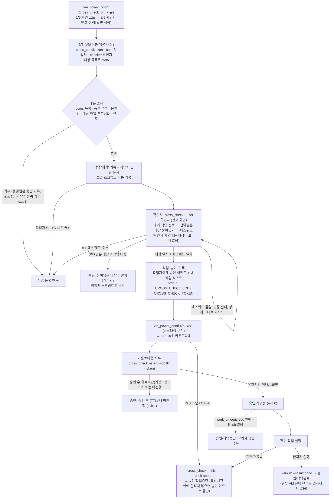

# cross_check — 원격 2인 1조 교차검증 데몬

> **[필수 정책]** `cross_check` 데몬을 사용하는 작업의 경우, 확인자의 **승인 완료 후 2분 내에 본 작업을 진행하지 않으면 해당 작업 승인은 자동으로 취소(중단)** 처리됩니다.
>
> 위 **2분은 기본값**입니다. `cross_check.conf` 의 `approval_ttl_sec`(초, 10~3600, 기본 120)로 바꿀 수 있으며, 바꾸면 화면·메시지·중단 사유에 설정한 시간이 표시됩니다 → [승인 유효시간 바꾸기](#승인-유효시간-바꾸기).

2인 1조 교차검증에서 확인자가 작업자 자리로 직접 이동하지 않아도, 각자 자기 터미널에서 `cross_check` 데몬을 통해 **작업자는 대기하고, 확인자는 작업자에게 전달받은 작업 대상을 자기 화면에 붙여넣고 본인 패스워드로 승인**하게 하는 도구입니다.
확인자 화면에는 작업 대상이 **보이지 않고**(개수만), 확인자가 붙여넣은 목록과 작업자가 올린 목록이 같을 때만(순서 무관) 승인됩니다. 다르면 작업이 **중단**됩니다.
모든 요청의 상태(대기 / 승인 / 중단, 승인 뒤에는 작업중 / 작업완료 / 작업중단)와 사유는 데몬이 기록합니다. [vm_power_onoff](../README.md) 0.3.0 부터는 **기본 on** 이며, 안전장치 **3/5(VM 이름 직접 입력)를 확인자 승인으로 대신**합니다(2/5 확인자 번호 선택 → 3/5 승인 대기 → 4/5 `YeS` → 5/5 카운트다운 → `--start` → 전원 작업 → `--finish`).

| 항목 | 내용 |
|---|---|
| 대상 환경 | Red Hat 계열 Linux (RHEL / Rocky). OS6(RHEL·CentOS 6)는 미리 빌드한 실행파일 사용 — [OS6](#os6) |
| 구현 | Go, **표준 라이브러리만** 사용(별도 모듈 `cross_check/go.mod`, vendor 불필요, Go 1.20 이상, 외부 인터넷 불필요) |
| 화면 | `--user`/`--admin` 은 터미널이면 **전체 화면**(raw 모드, 2초 자동 갱신, `auto_setup` 상태 리포트와 같은 방식), 파이프·`--plain` 이면 같은 동작의 줄 입력 화면 |
| 통신 | Unix 도메인 소켓 `/var/run/cross_check/cross_check.sock` (요청마다 JSON 한 줄) |
| 상시 구동 | root crontab `* * * * * /usr/local/bin/cross_check --ensure` (데몬이 없으면 매분 다시 띄움) |
| 설계 결정 | [PLAN.md](PLAN.md)(원 계획서), [INTERVIEW.md](INTERVIEW.md)(결정 기록 — Q8·Q23 의 "패스워드만 승인" 은 폐지) |

> 폴더 안내: `cmd/cross_check/`(CLI), `internal/daemon/`(데몬·클라이언트·인증·설정), `internal/tui/`(전체 화면·줄 입력 화면), `internal/verify/`(붙여넣은 대상 파싱·대조), `internal/store/`(작업 기록 저장소), `scripts/`(crontab·관리자 패스워드 생성), `test/`(격리 E2E·pty E2E·놀이터). 파일별 역할은 [../ARCHITECTURE.md](../ARCHITECTURE.md), 전체 흐름도는 [../WORKFLOW.md](../WORKFLOW.md).

## 1. 빌드 및 설치 방법

이 폴더(`power_onoff/`)를 통째로 받아 `setup.sh` 한 번이면 빌드부터 데몬 기동까지 구성됩니다(**폐쇄망 가능, 인터넷 접속 시도 없음**). `cross_check` 는 표준 라이브러리만 쓰므로 `vendor/` 가 필요 없고 Go 1.20 이상이면 빌드됩니다.

```bash
cd power_onoff
bash setup.sh                         # vm_power_onoff + cross_check 빌드 → root(또는 sudo -n 가능)이면 install.sh 까지 자동 실행
bash setup.sh --disable-cross-check   # 위와 같고, pwonoff.conf 를 cross_check=off 로 (교차검증 끄기. 0.3.0 부터 기본 on)
bash setup.sh --skip-vm-power-onoff   # cross_check 만 (Go 1.26.5 미만 서버 등)
bash setup.sh --approval-ttl 300      # 새로 만드는 cross_check.conf 의 승인 유효시간을 300초로 (기본 120초 = 2분, 10~3600)
bash setup.sh --no-install            # 빌드만 → 이후 sudo bash install.sh [허용디렉터리] [--disable-cross-check] [--approval-ttl 초]
```

`cross_check` 만 직접 빌드하려면(별도 모듈이라 이 폴더 안에서):

```bash
cd cross_check
GOPROXY=off GOFLAGS=-mod=mod go build -o bin/cross_check ./cmd/cross_check
```

| 구성 요소 | 내용 |
|---|---|
| 빌드 | `cross_check/bin/cross_check` (Go 1.20 이상, `GOPROXY=off`). vm_power_onoff 는 Go 1.26.5 이상 필요 |
| 실행파일 | `/usr/local/bin/cross_check` |
| `/etc/cross_check/cross_check.conf` | **없을 때만** 생성: `target_dir`=허용디렉터리(vm_power_onoff 의 `allowed_dir` 과 같은 값), `users`=설치된 `pwonoff.conf` 의 `users` **(처음 한 번만 복사 — 이후 `pwonoff.conf` 의 users 를 바꿔도 따라가지 않으므로 직접 수정)**, `auth=required`, `approval_ttl_sec=120`(또는 `--approval-ttl <초>` 로 준 값, 키 설명은 주석으로 들어감). `work_timeout_sec` 줄은 만들지 않으므로 기본값(86400초)이 쓰입니다 — 바꾸려면 직접 추가. **이미 파일이 있으면 `--approval-ttl` 을 줘도 덮어쓰지 않고** 고치는 방법만 출력 |
| `/etc/cross_check/auth.conf` | **없을 때만** 생성(0600, root): `admin=<무작위 16자>` — **관리자 패스워드는 이때 화면에 한 번만 출력**됩니다. 분실하면 root 가 이 파일의 `admin=` 줄을 확인/수정. 이미 있으면 권한만 0600 root 로 바로잡고 `admin=` 줄이 없으면 경고 |
| `/var/lib/cross_check` | 작업 기록 디렉터리(0700) |
| `/etc/tmpfiles.d/cross_check.conf` | 재부팅 후 `/run/cross_check`(소켓 디렉터리) 생성 |
| root crontab | `* * * * * /usr/local/bin/cross_check --ensure >/dev/null 2>&1 # cross_check` 정확히 한 줄(멱등) |
| 데몬 기동 | `cross_check --ensure` 로 띄우고 소켓·프로세스 확인. 실행파일이 바뀌었으면 데몬을 다시 띄움 |
| `--disable-cross-check` | `/etc/vcetner_pwon_off/pwonoff.conf` 의 `cross_check=off` (이미 off 면 그대로, 줄이 없으면 추가). **이 옵션이 없으면 `pwonoff.conf` 의 cross_check 는 건드리지 않음** — 새로 만드는 conf 와 키가 없는 conf 는 기본 `on` |
| `--enable-cross-check` | 0.3.0 부터 효과 없음(기본 on). 안내만 출력하고, 기존 conf 가 `cross_check=off` 면 직접 `on` 으로 고치라고 알림 |

- 제거: `sudo bash install.sh -u` — 실행파일·crontab 줄 삭제, 데몬 중지. **설정·패스워드(`auth.conf`)·작업 기록은 남깁니다.**
- crontab 을 쓰려면 `cronie` 가 설치되어 `crond` 가 동작 중이어야 합니다(폐쇄망은 설치 미디어의 cronie RPM). crontab 줄만 따로 관리: `sudo bash cross_check/scripts/cc_cron.sh install|remove|status`.
- 시험·비표준 설치용으로 `install.sh` 는 `CC_ETC CC_STATE CC_BIN_DIR CC_SOCKET_DIR CC_PWONOFF_DIR CC_TMPFILES_DIR CC_LOG CC_CRON_BIN CC_SKIP_CRON=1 CC_SKIP_START=1` 환경변수로 경로를 바꿀 수 있습니다.

### 설정 후 해야 할 일

1. `/etc/cross_check/cross_check.conf` 의 `users=` 가 실제 작업자·확인자 전원을 포함하는지 확인합니다(**설정 파일은 데몬 시작 때 읽습니다.** `users`·`target_dir`·`auth` 는 수정 후 데몬을 다시 띄워야 반영되며, 다시 뜨는 순간 열려 있던 대기/승인 작업은 `데몬 재시작` 으로 중단됩니다 — 작업이 없을 때 하세요: `sudo pkill -f 'cross_check --daemon'` 후 최대 1분 안에 crontab 이 다시 띄움, 바로 띄우려면 `sudo cross_check --ensure`. **`approval_ttl_sec`·`work_timeout_sec` 만은 재시작 없이** `sudo pkill -HUP -f 'cross_check --daemon'` 으로 반영할 수 있습니다 → [승인 유효시간 바꾸기](#승인-유효시간-바꾸기)).
2. **각 사람이 한 번씩 등록**합니다([최초 등록](#최초-등록-패스워드)). 등록은 선착순이므로 가능한 한 빨리.
3. 교차검증은 vm_power_onoff 에서 **기본 on** 입니다(`pwonoff.conf` 에 키가 없거나 `cross_check=on`). 끄려면 `cross_check=off` (또는 `install.sh --disable-cross-check`).

### 설정 파일 `/etc/cross_check/cross_check.conf`

`키=값` 형식, `#` 주석. **모르는 키·중복 키·형식 오류가 있으면 데몬이 시작하지 않습니다.** 파일이 아예 없으면 `auth=required`, 120초로 보지만 `target_dir`/`users` 가 없어 시작하지 못합니다(fail closed).

| 키 | 기본값 | 설명 |
|---|---|---|
| `target_dir` | (`auth=required` 면 필수) | 사용자별 대상 파일 `on_off_<user>.txt` 가 있는 절대경로. vm_power_onoff 의 `allowed_dir` 과 같게 |
| `users` | (`auth=required` 면 필수) | 쉼표로 구분한 작업자·확인자 이름 목록. 이 목록 밖의 이름은 등록·작업·승인·취소·패스워드 변경이 모두 거부됨. 빈 항목·중복·`admin` 은 오류 |
| `auth` | `required` | `required` = 패스워드·token·users 검사(fail closed). `off` = **검사 안 함(시험용)** — 관리자 기능도 누구에게나 열리므로 운영에서 쓰지 마세요 |
| `approval_ttl_sec` | `120` | **승인 유효시간**: 확인자 승인 후 `--start` 를 허용하는 시간(초). **10~3600 의 정수**(그 밖의 값은 데몬이 시작하지 않음). 필수 정책의 기준이 2분(=120)이므로 바꾸면 정책과 달라집니다. 화면·메시지는 이 값으로 표기됩니다(`2분`, `90초`→`1분 30초`, `3600`→`1시간`) |
| `work_timeout_sec` | `86400` | **본 작업 제한 시간**: `--start` 로 `승인/작업중` 이 된 뒤 `--finish` 가 이 시간(초) 안에 오지 않으면 데몬이 `승인/작업중단`(사유 `작업자 응답 없음`)으로 바꿉니다(작업자 `kill -9`·세션 끊김 등으로 `작업중` 이 영원히 남는 것을 막음). **600~604800 의 정수**(10분~7일, 그 밖은 데몬이 시작하지 않음). SIGHUP 으로도 반영 |

### 승인 유효시간 바꾸기

"확인자 승인 후 N 안에 본 작업을 시작하지 않으면 승인이 자동 취소" 의 N 을 서버 설정으로 바꿉니다. 기본은 120초(2분)입니다.

1. `/etc/cross_check/cross_check.conf` 의 `approval_ttl_sec=<초>` 를 고칩니다(10~3600). 처음 설치할 때는 `sudo bash install.sh --approval-ttl 300` 으로 새 conf 에 바로 넣을 수 있습니다(기존 conf 는 덮어쓰지 않음).
2. 반영합니다 — 둘 중 하나:
   - **재시작 없이(권장)**: `sudo pkill -HUP -f 'cross_check --daemon'` — 데몬이 `approval_ttl_sec` 와 `work_timeout_sec` **만** 다시 읽습니다. 값이 범위 밖이거나 파일에 오류가 있으면 **이전 값을 그대로 쓰고** 로그(`/var/log/cross_check.log`)에 이유를 남깁니다. 이미 승인되어 `--start` 를 기다리는 작업에도 새 값이 적용됩니다(만료 시각 = 승인 시각 + 새 값). `users`·`target_dir`·`auth` 의 변경은 이 방법으로 반영되지 않습니다(로그에 알림).
   - **재시작**: `sudo pkill -f 'cross_check --daemon'` 후 crontab 이 1분 안에 다시 띄우거나(`sudo cross_check --ensure` 로 바로). 다시 뜨는 순간 열려 있던 대기/승인(시작 전) 작업은 `데몬 재시작` 으로 중단되고 `작업중` 이던 작업은 `승인/작업중단` 이 됩니다.
3. 확인: 사용자·관리자 화면(`cross_check --user <나>`, `--admin`) 머리말의 `승인 유효시간 … (approval_ttl_sec=N)` 가 **데몬이 지금 쓰는 값**입니다(데몬에 물어서 표시).

통신 호환: `ping` 응답에 `ttl_sec`·`work_timeout_sec`·`pid`, `run` 응답과 승인 이벤트에 `ttl_sec`(+승인 이벤트·`list`/`get` 의 승인 후 미시작 작업에 만료 시각 `expires_at`)가 **선택 필드**로 들어 있습니다. 이 필드가 없는 구버전 데몬/클라이언트와도 그대로 동작하며, 클라이언트는 값이 없으면 설정 파일 → 기본 2분 순으로 대신 표시합니다.

### 최초 등록 (패스워드)

처음 `cross_check --user <이름>` 을 실행하면 **패스워드 등록 화면**이 자동으로 나옵니다.

```bash
cross_check --user hong
# [첫 실행] 사용자 hong 은(는) 아직 cross_check 에 등록되지 않았습니다.
# 새 패스워드: ********      ← 화면에 표시되지 않음(*), 두 번 입력
# 새 패스워드 확인: ********
# [등록 완료] hong 의 패스워드가 등록되었습니다.
```

- 패스워드 규칙: **6~128자**, 앞뒤 공백·줄바꿈·NUL 금지. 입력은 3번까지 다시 할 수 있습니다.
- **`users=` 목록에 있는 이름만** 등록됩니다. 목록에 없으면 "관리자에게 추가를 요청하세요" 와 함께 거부됩니다.
- **선착순**: 먼저 등록한 사람이 그 이름의 패스워드를 갖습니다. 이미 등록된 이름은 덮어쓸 수 없고(`이미 등록됨`), 바꾸려면 화면의 `p` 키(현재 패스워드 필요), 분실했으면 관리자가 재설정합니다.
- **`admin` 은 소켓으로 등록할 수 없습니다.** `install.sh` 가 `auth.conf` 에 직접 씁니다.
- `--run` 은 **작업자와 확인자 모두 등록되어 있어야** 동작합니다(`auth=off` 제외). 미등록이면 등록 방법을 안내하며 거부합니다.

### OS6

OS6(RHEL/CentOS 6, 커널 2.6.32)에서는 이 Go 로 만든 실행파일이 뜨지 않으므로 **Go 1.20 빌드 서버에서 정적 빌드한 파일**(`bin_os6/cross_check.gz`)을 풀어 씁니다.

```bash
# 빌드 서버(Go 1.20)에서
bash build_os6.sh                          # vm_power_onoff.gz 와 cross_check.gz 를 모두 bin_os6/ 에 생성
bash build_os6.sh --cross-check-only       # cross_check 만 (vendor 불필요)
# OS6 서버에서
bash setup.sh                              # 자동으로 bin_os6/*.gz 를 풀어 cross_check/bin/cross_check 로 설치 후 install.sh
```

- `cross_check` 는 표준 라이브러리만 쓰고 `go.mod` 는 `go 1.20` 이며, 정적 빌드(`CGO_ENABLED=0`, `linux/amd64`)합니다.
- 파일이 없으면 `setup.sh` 가 경고만 출력하고 cross_check 설치를 건너뛰며 vm_power_onoff 는 계속 진행합니다. **`bin_os6/cross_check.gz` 는 코드가 바뀔 때마다 Go 1.20 빌드 서버에서 다시 만들어야 하며(`bash build_os6.sh --cross-check-only`), 커널 2.6.32 인 OS6 실기에서의 동작은 아직 확인하지 못했습니다.**
- OS6 의 crond 는 `service crond start; chkconfig crond on` 으로 켭니다.

## 2. 사용 방법

### 역할

| 역할 | 하는 일 | 필요한 것 |
|---|---|---|
| **작업자** | `cross_check --run --user <나> --checker <확인자>` 로 작업을 올리고 승인될 때까지 대기. 승인되면 승인 유효시간(기본 2분) 안에 `--start` 후 본 작업을 하고, 끝나면 `--finish` 로 결과를 알림. **대상 목록은 확인자에게 따로(메신저·구두 등) 전달** | 등록된 패스워드(등록만 필요, `--run` 에서는 묻지 않음), 자기 대상 파일 |
| **확인자** | `cross_check --user <나>` 화면에서 자기에게 온 `대기` 작업을 골라 Enter → **작업자에게 전달받은 대상을 붙여넣기** → **본인 패스워드** 입력 → 승인. 또는 `c` + 패스워드로 취소. **확인자 화면에는 대상이 표시되지 않습니다** | 등록된 본인 패스워드 |
| **관리자** | `cross_check --admin` 으로 잘못된 기록 정리, 상태 변경, 삭제, 전체 정리, 사용자 패스워드 재설정 | `auth.conf` 의 `admin=` 패스워드 |

- 작업자·확인자 이름은 **`cross_check.conf` 의 `users=` 목록**에 있어야 합니다(관리자가 관리). 이름 규칙은 영소문자·숫자·`_`, 64자 이하이며 `admin` 은 예약어라 쓸 수 없습니다.
- 작업자와 확인자가 **같은 이름이면 기다리지 않고 즉시 중단**(종료 코드 1)하고, 데몬이 떠 있으면 중단 기록을 남깁니다.
- 승인은 **붙여넣기 대조**입니다: 확인자가 붙여넣은 이름들과 작업 대상을 **집합으로 비교**해 같으면 승인합니다(줄바꿈·탭·공백 어느 것으로 구분해도 되고 순서는 상관없음, 대소문자 구분, 중복이 하나라도 있거나 비어 있으면 불일치). **다르면 작업이 `중단`**(`붙여넣은 대상 불일치(빠짐 N·남음 N·중복 N)`)되고 작업자의 스크립트도 중단됩니다. 결과·사유·로그에는 **개수만** 들어가고 대상 이름은 확인자에게 돌려주지 않습니다.
- 확인자가 작업을 여는 단계에는 **입력 시간 제한이 없습니다**(승인 유효시간은 승인한 뒤부터 셉니다).

### 작업 상태, 단계, 중단 사유

상태는 3가지(`대기` / `승인` / `중단`)이고, **승인된 뒤의 본 작업 진행**은 단계(phase)로 이어 붙여 `승인/작업중` · `승인/작업완료` · `승인/작업중단` 으로 보입니다.

| 상태(화면 표기) | 의미 |
|---|---|
| **대기** | 작업자의 `--run` 이 등록되어 확인자 처리를 기다리는 상태 |
| **승인** | 확인자가 대상을 정확히 붙여넣고 패스워드로 승인한 상태(본 작업 전). 승인 시각부터 **승인 유효시간**(`approval_ttl_sec`, 기본 **2분**) 안에 `--start` 가 와야 함 |
| **승인/작업중** | `--start` 를 받아 작업자의 본 작업이 시작됨 |
| **승인/작업완료** | `--finish --result done`: **작업자 스크립트가 취소 없이 끝까지 실행됐다**는 뜻입니다. **일부 VM 의 실패 여부는 검사하지 않습니다**(그것은 작업 스크립트의 결과 표·로그에서 확인) |
| **승인/작업중단** | 승인은 됐지만 본 작업이 끝까지 가지 않음: 작업자가 `--finish --result aborted`(Ctrl+C·최종 확인에서 `No`·시작 전 포기 포함), 또는 `작업중` 인 채 `work_timeout_sec` 를 넘김(`작업자 응답 없음`), 데몬 재시작 때 `작업중` 이었음, 관리자 변경 |
| **중단** | 아래 사유 중 하나로 승인 전/승인 시간 안에 끝난 상태. 한 번 중단되면 되살릴 수 없음(관리자도 불가) |

| 중단 / 작업중단 사유(기록되는 문구) | 언제 |
|---|---|
| `작업자와 확인자가 동일` | `--user` 와 `--checker` 가 같음 |
| `확인자 <이름> 가 취소` | 확인자가 `c` + 패스워드로 취소 |
| `붙여넣은 대상 불일치(빠짐 N·남음 N·중복 N)` / `(붙여넣은 대상 없음)` | 확인자가 붙여넣은 대상이 작업 대상과 다름 |
| `작업자 스크립트 종료` | 대기 중 작업자의 `--run` 이 Ctrl+C·세션 끊김·`kill -9` 등으로 끝남(연결이 끊기면 데몬이 즉시 감지) |
| `승인 후 {TTL} 내 미진행` (기본 설정이면 `승인 후 2분 내 미진행`, 설정이 90초면 `승인 후 1분 30초 내 미진행`) | 승인 후 유효시간 안에 `--start` 가 없거나, 늦게 `--start` 함 |
| `작업자가 본 작업 전에 중단` | 승인 뒤 `--start` 전에 `--finish --result aborted` (→ `승인/작업중단`) |
| `작업자가 작업을 중단` | `작업중` 에서 `--finish --result aborted` (→ `승인/작업중단`) |
| `작업자 응답 없음` | `작업중` 인 채 `work_timeout_sec`(기본 24시간) 안에 `--finish` 가 없음(→ `승인/작업중단`) |
| `데몬 재시작` | 데몬이 다시 뜰 때 남아 있던 대기/승인(미시작) 작업은 `중단`, `작업중` 은 `승인/작업중단` |
| `데몬 종료` | 데몬이 종료될 때 열려 있던 대기/승인(미시작) 작업 |
| `관리자 변경: <사유>` | 관리자가 상태를 바꿈 |
| `관리자 삭제` / `관리자 전체 정리` | 대기 중인 작업이 관리자 삭제·전체 정리로 사라짐(작업자에게 알리는 이벤트 사유이며 기록은 지워짐) |

작업자의 `--run` 연결로는 **대기 → 승인 → (본 작업 시작) 또는 중단** 의 상태 전이가 사유와 함께 즉시 전달되어 화면(stderr)에 출력됩니다. 사용자 화면의 목록에는 사유 대신 **호출 스크립트**(`cross_check --run` 을 부른 스크립트·바이너리 이름, 예: `vm_power_onoff`) 칸이 있고, 사유는 상세 화면과 실시간 이벤트에 나옵니다. 호출 스크립트 이름은 `--caller`·환경변수 `CROSS_CHECK_CALLER`·부모 프로세스 감지 순으로 정하며 **정보용 표시값이라 작업자가 마음대로 바꿀 수 있습니다(권한 판단에 쓰지 않음)**.

### 흐름도



### 작업 스크립트에 넣는 법 (`--run` / `--start` / `--finish`)

작업 스크립트(예: vm_power_onoff 같은 도구)는 본 작업 전에 `--run` 으로 승인을 받고, 직전에 `--start`, 끝나면 `--finish` 를 부릅니다. vm_power_onoff 는 이 호출을 모두 자동으로 합니다.

```bash
out="$(cross_check --run --user hong --checker kim < targets.txt)" || exit 1   # eval "$(...)" 로 바로 받으면 실패해도 종료 코드가 0 이 되므로 한 번 변수에 받습니다
eval "$out"
export CROSS_CHECK_TOKEN
# ... 확인자에게 targets.txt 의 내용을 전달해 붙여넣어 승인받은 뒤 ...
# 본 작업 직전에 (승인 후 유효시간 이내 — 기본 2분):
cross_check --start --job "$CROSS_CHECK_JOB" || exit 1
# ... 본 작업 ...
cross_check --finish --job "$CROSS_CHECK_JOB" --result done        # 스크립트가 끝까지 실행됨 → 승인/작업완료
# 중간에 멈추면(Ctrl+C·No 등): cross_check --finish --job "$CROSS_CHECK_JOB" --result aborted   → 승인/작업중단
```

`--finish` 의 token 은 `--start` 와 같은 `CROSS_CHECK_TOKEN` 환경변수를 씁니다(`--start` 후에도 `--finish` 까지 유효, `--finish` 를 하면 폐기). 시작 전(승인만 받은 상태)에도 `--result aborted` 는 할 수 있습니다.

### 확인자 화면(전체 화면 TUI) 사용

`cross_check --user <나>` 를 터미널에서 실행하면 `auto_setup` 상태 리포트와 같은 **전체 화면**이 열립니다(raw 모드, 대체 화면, 2초마다 자동 갱신, 종료 시 터미널 복원). 머리말에 갱신 시각과 `● 데몬 실행 (pid N)`(또는 `○ 데몬 중지`), 그 아래 카운터(`전체 · 대기 · 승인 · 작업중 · 작업완료 · 작업중단 · 중단`)와 `승인 유효시간 2분` 이 보입니다. 첫 실행이면 먼저 [패스워드 등록](#최초-등록-패스워드) 화면이 나옵니다.

1. **작업 구역**: `내 작업`(내가 작업자)과 `내가 확인자인 작업` 두 구역을 `←→` 로 전환(`a` 는 전체 보기). 표에는 ID, 작업자, 확인자, 상태, **호출 스크립트**, 시각(승인 후 미시작이면 남은 시간)이 나옵니다. 새 요청은 알림 줄로 표시됩니다.
2. 내가 확인자인 `대기` 작업에서 `Enter` → **승인 화면**.
   - **1/3 대상 붙여넣기**: 작업자에게 전달받은 대상을 붙여넣습니다(줄바꿈·탭·공백 구분, 순서 무관). 화면에는 **인식한 이름 수만** 보이고 판정(맞는지)은 보이지 않습니다. `Ctrl+D` 또는 빈 줄에서 `Enter` 로 끝내고, `Esc` 는 승인하지 않고 돌아갑니다.
   - **2/3 패스워드**: 확인자 본인 패스워드(`*` 로 표시). 틀리면 `인증 실패` 로 상태는 그대로이고 다시 입력합니다(5번 연속 틀리면 이후 시도는 1초씩 지연).
   - **3/3 결과**: 대상이 일치하면 **승인**(작업자에게 즉시 전달), 다르면 **작업 중단**(작업자에게도 알림, 빠짐·남음·중복 **개수만** 표시).
3. 취소: 작업을 고르고 `c` → 패스워드 → 중단(작업자의 스크립트도 취소). 취소에도 **패스워드가 필요**합니다.
4. 터미널이 아니거나(`|`, 리다이렉션) `--plain`, `TERM=dumb`, raw 모드 전환 실패면 **줄 입력 화면**(같은 동작, `명령>` 프롬프트)이 열립니다.

전체 키 목록은 [사용자 화면 키](#사용자-화면-키)를 보세요.

### 관리자 화면

`cross_check --admin`: `auth.conf` 의 `admin=` 패스워드로 로그인(최대 3번) 후 전체 작업 목록(대상 수 포함)에서 상태 변경(`s`), 삭제(`d`), 전체 정리(`x`), 사용자 패스워드 재설정(`p`)을 합니다. 자세한 내용은 [관리자 화면 키](#관리자-화면-키).

### vm_power_onoff 연동

`pwonoff.conf` 에 아래 키가 있고(예시: [../pwonoff.conf.example](../pwonoff.conf.example)), 명령행에 `-c <확인자>` 옵션이 있습니다. 자세한 옵션은 [../README.md](../README.md#교차검증cross_check-연동).

| 설정 | 기본값 | 설명 |
|---|---|---|
| `cross_check` (conf) | **`on`** (0.3.0~, 키가 없어도 on) | `on` 이면 안전장치 2/5 확인자 번호 선택, **3/5 VM 이름 입력 대신 확인자 승인**, 5/5 카운트다운 직후 `--start`, 전원 작업 뒤 `--finish`. `off` 면 기존 방식(2/5 Enter, 3/5 VM 이름 입력) |
| `cross_check_bin` (conf) | `/usr/local/bin/cross_check` | 실행 파일 절대경로(비우면 기본값). 없으면 vm_power_onoff 가 시작하자마자 `cross_check 가 설치되어 있지 않습니다: <경로> — bash setup.sh 로 설치하거나 pwonoff.conf 에 cross_check=off 를 지정하세요` 로 종료 |
| `-c <checker>` | — | 확인자 미리 지정(2/5 메뉴 생략). `pwonoff.conf` 의 `users` 에 있고 본인이 아니어야 함. 생략하면 2/5 에서 본인을 뺀 번호 목록에서 선택(3회 오입력 시 취소) |

cross_check 는 원래 안전장치 3단계(작업자가 VM 이름을 직접 입력해 대조)를 **대신**하려고 만든 것입니다. 동작 순서(코드 `guard.go` 의 `RunGuard` + `crosscheck.go` 의 `CrossCheckGate`, `main.go`):

1. `cross_check=on` 이고 계획만 보는 `-n` 이 아니면, 시작 직후(vCenter 를 묻기 전) `cross_check_bin` 이 실행 가능한 파일인지, conf `users` 에 작업자 외 확인자 후보가 있는지, `-c` 가 올바른지 확인합니다(`-n`, `--demo` 에서는 호출하지 않음). `-c` 를 줬는데 `cross_check=off` 면 경고 후 무시합니다.
2. user·vCenter·기능 선택, 계획표, VWP 확인 → **1/5 확인 코드**(대상 목록·`총 N대` 출력).
3. **2/5 확인자 선택**: `확인자를 선택하세요` 번호 메뉴(작업자 본인 제외, 틀리면 다시 묻고 3번 틀리면 취소, Ctrl+C 취소). `-c` 면 `[2/5] 확인자: <checker> (-c)`.
4. **3/5 승인 대기**(VM 이름 입력 없음): 승인 유효시간 정책 안내를 출력한 뒤 `cross_check --run --user <user> --checker <확인자>` 를 실행합니다(대상 VM 이름을 stdin 으로 전달, 진행 출력은 그대로 화면에). **작업자는 화면에 나온 대상 목록을 확인자에게 전달**하고, 확인자는 자기 화면에서 그것을 붙여넣어 승인합니다. 확인자가 승인할 때까지 대기하고, 거부·확인자 취소·대상 불일치·데몬 오류·Ctrl+C 면 `[취소] 교차검증 미승인`. 호출 스크립트 이름은 vm_power_onoff 가 `--caller` 로 자기 실행 파일 이름(`vm_power_onoff`)을 넘깁니다.
5. **4/5 `YeS`**(`ls` 를 입력하면 대상 목록·`총 N대` 를 다시 보여 주고 취소 없이 다시 물음) → **5/5 10초 카운트다운**. 여기서 취소(`No`·Ctrl+C)하면 vm_power_onoff 는 `--finish --result aborted` 로 데몬에 알려 `승인/작업중단` 으로 남깁니다(알리지 못하면 승인 유효시간이 지나 데몬이 `승인 후 {TTL} 내 미진행` 으로 중단).
6. 카운트다운이 끝나자마자 `cross_check --start --job <ID>` 로 승인 유효시간 창을 확인합니다(token 은 관문 안에만 두고 자식 프로세스 환경변수로만 전달, 화면·감사 로그에 남기지 않음, 1회용). 거부되면 사유 한 줄과 `[취소] 교차검증 승인 유효시간 초과 또는 거부`.
7. 통과하면 전원 작업을 실행하고, 끝나면 `cross_check --finish --result done`(스크립트가 취소 없이 끝까지 실행됨 → `승인/작업완료`; **일부 VM 이 실패했는지는 검사하지 않음**), 중단(Ctrl+C 등)이면 `--result aborted` 로 알립니다. 취소된 경우는 모두 **전원 작업 없이 종료 코드 1** 입니다. 확인자 선택·승인 여부·`ls` 횟수·`--start` 결과는 감사 로그(`run_<user>/`)에 남습니다.

승인 유효시간(기본 2분)은 **승인 → 4/5 → 카운트다운(10초) → `--start`** 를 덮습니다. 승인 직후 `--run` 이 `승인 유효시간: 2분 — HH:MM:SS 까지 …` 를 출력하므로 그 안에 `YeS` 를 입력하면 됩니다.

연동 시 주의:

- vm_power_onoff 의 user(`-u`)가 그대로 cross_check 의 작업자 이름이 되므로, **cross_check.conf 의 `users=` 에 있고 등록되어 있어야** 합니다. 확인자도 마찬가지입니다. `pwonoff.conf` 와 `cross_check.conf` 의 `users` 는 **서로 다른 목록**입니다.
- 데몬은 대상이 `<target_dir>/on_off_<user>.txt` 의 부분집합인지 검사하므로 `target_dir` 이 `allowed_dir` 과 같아야 합니다.

### 손으로 직접 해 보기 — 놀이터(playground)

`test/playground.sh` 는 `/etc`·`/var`·`/usr/local`·crontab 을 건드리지 않고 한 폴더(`$CC_PLAY_DIR`, 기본 `$HOME/cc_playground`) 안에 데몬·설정·시험용 계정(alice/bob/carol, 관리자 admin — 고정 시험 패스워드)·대상 파일을 만들어, 터미널 두 개로 작업자와 확인자 역할을 직접 해 볼 수 있게 합니다. root 권한은 필요 없습니다(실행파일이 없으면 `go build`, 오프라인).

```bash
cd cross_check/test
bash playground.sh start [--ttl 20]      # 데몬 기동 (승인 유효시간 기본 120초)
bash playground.sh help                  # 그대로 따라 하는 시험 안내(한국어)
# 터미널 1(작업자):  bash playground_worker.sh alice bob
# 터미널 2(확인자):  eval "$(bash playground.sh env)"; cross_check --user bob   → 작업 선택 → Enter → 대상 붙여넣기 → 패스워드(시험 계정 안내는 help)
bash playground.sh ttl 300 | reload | restart | status | reset [--hard] | stop
```

## 3. 옵션별 상세 설명

### CLI

`-x` 와 `--x` 형태 모두 됩니다. 항상 사용자를 지정합니다(`--user` 없이 TUI 를 열면 사용법 + 종료 코드 2).

| 명령 | 설명 |
|---|---|
| `cross_check --user <user> [--plain]` | 사용자 화면. 첫 실행이면 패스워드 등록. 내 작업·내가 확인자인 작업 목록, 승인(대상 붙여넣기 → 패스워드)/취소. 터미널이면 전체 화면, `--plain`·파이프면 줄 입력 화면 |
| `cross_check --run --user <작업자> --checker <확인자> [--targets-file <파일>] [--caller <이름>]` | 작업 등록 후 확인자 승인까지 대기(작업 스크립트 안에서 호출). 대상 목록은 `--targets-file` 또는 stdin(줄바꿈·탭·공백 구분, `#` 주석). **`--cechker` 오타도 같은 뜻으로 받습니다.** `--caller` 는 호출 스크립트 이름(정보용, 생략하면 환경변수 `CROSS_CHECK_CALLER` → 부모 프로세스 감지 → `(알 수 없음)`, 64자까지) |
| `cross_check --start --job <ID> [--token <T>]` | 본 작업 직전 신호. 승인 후 유효시간(`approval_ttl_sec`, 기본 2분) 이내 1회만 통과 → `승인/작업중`. token 은 환경변수 `CROSS_CHECK_TOKEN` 으로 주는 것을 권장(`--token` 은 `ps` 에 보임) |
| `cross_check --finish --job <ID> --result done\|aborted [--token <T>]` | 본 작업 결과. `done` = 작업중 → `승인/작업완료`(스크립트가 취소 없이 끝까지 실행됨), `aborted` = 시작 전 또는 작업중 → `승인/작업중단`(Ctrl+C·최종 확인에서 No). 끝나면 token 폐기 |
| `cross_check --admin [--plain]` | 관리자 화면 |
| `cross_check --daemon` | 데몬을 포그라운드로 실행(보통 `--ensure` 가 대신 띄움). SIGHUP 을 받으면 종료하지 않고 `approval_ttl_sec`·`work_timeout_sec` 만 다시 읽음 |
| `cross_check --ensure` | 데몬이 응답하면 조용히 종료, 없으면 `--daemon` 을 세션에서 떼어 띄우고 최대 3초 확인. 동시에 여러 번 불려도 잠금(flock) 때문에 데몬은 하나만 남음 |
| `cross_check --version`, `-h` | 버전 / 사용법 |

`--run` / `--start` / `--finish` / `--admin` / `--daemon` / `--ensure` / `--version` 은 하나만 지정할 수 있습니다. `--checker` `--job` `--token` `--targets-file` 은 `--run`/`--start`/`--finish` 와, `--caller` 는 `--run` 과, `--result` 는 `--finish` 와, `--plain` 은 `--user`/`--admin` 과만 씁니다.

### `--run` 출력 규약 (래퍼 스크립트용)

- 사람이 읽는 글(대기·상태 이벤트·내 작업 리스트·정책 안내)은 **모두 stderr** 로 나갑니다. 대기 중에는 확인자에게 전달할 **대상 목록**도 stderr 로 출력합니다.
- **stdout 에는 승인됐을 때만 정확히 두 줄**이 나갑니다.

  ```text
  CROSS_CHECK_JOB=<작업ID>
  CROSS_CHECK_TOKEN=<1회용 token>
  ```

### 종료 코드

| 코드 | 의미 |
|---|---|
| 0 | 성공 / 승인 / 정상 종료 |
| 1 | 중단·거부(`--run` 중 확인자 취소·대상 불일치·작업자 동일·그 밖의 중단, `--start`·`--finish` 거부·승인 시간 초과, TUI 의 인증·등록 실패, `--ensure` 가 3초 안에 데몬을 띄우지 못함) |
| 2 | 사용법 오류(필수 인자 없음, token 없음, 옵션 조합 오류 등) |
| 3 | 연결·데몬·입력 오류(데몬에 연결 불가, 대상 비어 있음, 이름 규칙 위반, **`--run` 작업 등록 거부** — 미등록·`users` 밖·대상 이탈·한도 등) |
| 130 | Ctrl+C (`--run` 은 이때 데몬에 중단을 알림) |

### 환경변수

기본값은 아래 경로이고, 시험·비표준 설치에서만 바꿉니다.

| 변수 | 기본값 | 용도 |
|---|---|---|
| `CROSS_CHECK_SOCKET` | `/var/run/cross_check/cross_check.sock` | 소켓 경로 |
| `CROSS_CHECK_CONF` | `/etc/cross_check/cross_check.conf` | 데몬 설정 |
| `CROSS_CHECK_AUTH` | `/etc/cross_check/auth.conf` | 패스워드 파일 |
| `CROSS_CHECK_STATE` | `/var/lib/cross_check/jobs.json` | 작업 기록 |
| `CROSS_CHECK_LOCK` | `/var/run/cross_check/daemon.lock` (소켓을 바꿨으면 그 디렉터리의 `daemon.lock`) | 데몬 단일 실행 잠금 |
| `CROSS_CHECK_LOG` | `/var/log/cross_check.log` | 데몬 로그 |
| `CROSS_CHECK_TOKEN` | — | `--start`/`--finish` 가 읽는 token |
| `CROSS_CHECK_CALLER` | — | `--run` 의 호출 스크립트 이름(`--caller` 의 대체) |
| `CROSS_CHECK_COLOR` | (자동) | `never` / `always`. 그다음 `NO_COLOR`, 마지막으로 터미널 여부 |

### 사용자 화면 키

전체 화면(터미널)의 키입니다. **입력 시간 제한이 없습니다**. 패스워드 입력은 `*` 로 표시되고(줄 입력 화면에서는 터미널 에코를 끔), 붙여넣기는 터미널의 붙여넣기 구간 표시(bracketed paste)를 지원하는 터미널이면 한 번에 들어갑니다.

| 화면 | 키 | 동작 |
|---|---|---|
| 목록 | `↑` `↓` (`k` `j`), PgUp/PgDn, Home/End | 작업 이동 |
| 목록 | `←` `→` | 구역 전환: 내 작업(작업자) ↔ 내가 확인자인 작업 |
| 목록 | `a` | 전체 보기(두 구역 함께) ↔ 구역별 보기 |
| 목록 | `Enter` | 내가 확인자인 `대기` 작업이면 **승인 화면**, 아니면 상세 화면 |
| 목록 | `c` | **취소(중단)** — 내가 확인자인 대기 작업, 패스워드 필요. 작업자의 스크립트도 중단됨 |
| 목록 | `r` | 즉시 새로고침(화면은 2초마다 자동 갱신) |
| 목록 | `p` | 내 패스워드 변경(현재 패스워드 필요, 새 패스워드 두 번) |
| 목록 | `?` | 도움말 |
| 목록 | `q` / `Esc` | 종료 (Ctrl+C 는 종료하지 않고 안내만 표시) |
| 상세 | `↑` `↓` | 스크롤 (작업자에게는 대상 목록 포함, **확인자에게는 대상 미표시**) |
| 상세 | `Enter` (확인자·대기) / `c` | 승인 화면 / 취소 |
| 상세 | `Esc` / `←` / `q` | 목록으로 |
| 승인 1/3 | (붙여넣기) | 전달받은 대상을 붙여넣음. 인식한 이름 수만 표시 |
| 승인 1/3 | `Ctrl+D` 또는 빈 줄에서 `Enter` | 입력 끝 → 2/3 |
| 승인 1/3 | `Esc` | 승인하지 않고 목록으로 |
| 승인 2/3 | (패스워드) `Enter` | 승인 요청. 틀리면 2/3 에 머묾 |
| 승인 2/3 | `Esc` | 1/3(붙여넣기)로 돌아감 |

줄 입력 화면(`--plain`·파이프)에서는 `<번호>` 또는 `o <번호|ID>` 로 작업을 열고(확인자·대기면 `a` 승인 → 붙여넣기 → 패스워드, `c` 취소), `r`/Enter 새로고침, `w` 감시(2초 자동 갱신, Enter 로 종료), `p` 패스워드 변경, `h`/`?` 도움말, `q` 종료입니다.

### 관리자 화면 키

`auth.conf` 의 `admin=` 패스워드로 로그인합니다(최대 3번). `admin=` 줄이 없으면 안내 문구를 출력하고 종료 코드 1 로 끝나며(데몬도 관리자 기능을 모두 거부), `admin` 은 소켓으로 등록할 수 없으므로 `install.sh` 를 실행하거나 root 가 `admin=<패스워드>`(6자 이상, 파일 0600) 줄을 추가해야 합니다. admin 패스워드 변경도 root 가 파일을 직접 고칩니다. 화면 머리말에 데몬이 지금 쓰는 **승인 유효시간**(`approval_ttl_sec=120`)과 **작업 제한**(`work_timeout_sec=86400`)이 표시됩니다.

| 키 | 동작 |
|---|---|
| `↑` `↓`, `Enter` | 목록 이동 / 상세(대상 목록·감사용 uid 포함) |
| `s` | 상태 변경 — 선택한 작업에 허용된 전이만 번호로 고른 뒤 사유(선택) 입력. `대기`→`승인`/`중단`, `승인`(시작 전)→`중단`/`작업중단`, `승인/작업중`→`작업완료`/`작업중단`/`중단`. **`중단` 은 되살릴 수 없고 `대기` 로 되돌릴 수 없음**, 끝난 작업(작업완료·작업중단)은 다시 바꿀 수 없음. 승인으로 바꾸면 그 시각부터 승인 유효시간 규칙 적용. 사유는 `관리자 변경: <사유>` 로 기록 |
| `d` | 작업 삭제(`y` 확인). 대기 중인 작업자에게는 중단으로 알림 |
| `x` | 전체 정리 — `전체 정리` 를 그대로 입력해야 **모든 기록**(이력 포함)을 지움 |
| `p` | 사용자 패스워드 재설정 — `users=` 목록의 이름만, 새 패스워드 두 번. 항목이 없으면 새로 만들고 그 이름의 연속 인증 실패 기록도 지움 |
| `r`, `?`, `q` | 새로고침 / 도움말 / 종료 |

### 자원 한도

| 한도 | 값 |
|---|---|
| 동시 연결 | 256개 (넘으면 오류 한 줄 후 닫음) |
| `run` 이 아닌 연결의 요청 간 대기 | 60초 (넘으면 닫음) — 클라이언트는 필요하면 자동 재연결 |
| 한 사람의 대기 작업 | 50건 |
| 저장되는 작업 전체 | 20000건 (넘으면 새 작업 거부, 관리자 정리 필요) |
| 중단된 작업 보관 | 30일이 지난 `중단` 작업은 매시간 자동 삭제 (`대기`·`승인` 은 건드리지 않음) |
| 요청 한 줄 | 최대 1 MiB, 대상 최대 100000개, 대상 이름 255자 이하(영문·숫자·`.` `_` `-`), 중복 대상 거부, 붙여넣기 화면은 입력 길이 상한이 있음 |
| 인증 실패 지연 | 같은 이름 연속 5번 실패 후 시도마다 1초 지연, 전체 실패가 1분에 100번 초과면 실패 응답마다 1초 지연 |

### 문제 해결

| 증상 / 메시지 | 원인과 조치 |
|---|---|
| `cross_check 데몬에 연결할 수 없습니다` | 데몬이 없음. `sudo cross_check --ensure` 로 띄우고, `sudo bash cross_check/scripts/cc_cron.sh status` 로 crontab 줄과 `crond` 동작을 확인. 로그: `/var/log/cross_check.log` |
| 데몬이 계속 안 뜸 / 로그에 `설정 파일 … 줄` | `cross_check.conf` 오류(모르는 키·중복 키·`target_dir`/`users` 없음·`users` 에 `admin` 포함 등). `sudo cross_check --daemon` 을 터미널에서 직접 띄우면 원인이 화면에 나옴 |
| `approval_ttl_sec 는 10~3600 사이의 정수(초)여야 함` / `work_timeout_sec 는 600~604800 사이의 정수(초)여야 함` (데몬 기동 실패 / SIGHUP 후 로그의 `설정 다시 읽기(SIGHUP) 실패`) | `cross_check.conf` 의 값이 범위 밖이거나 숫자가 아님. 범위 안의 정수(초)로 고치세요(기본 120 = 2분 / 86400 = 24시간). SIGHUP 으로 다시 읽다 실패하면 데몬은 **이전 값을 그대로** 쓰고 있으므로 고친 뒤 다시 `pkill -HUP -f 'cross_check --daemon'` |
| `인증 실패` | 패스워드 오타이거나, 해당 이름이 `users=` 목록에 없음(같은 문구로 답함). 같은 이름으로 5번 연속 실패하면 이후 시도는 한 번에 하나씩 약 1초 지연되며 올바른 패스워드는 그대로 통과. 분실 시 관리자가 `p` 로 재설정(그 이름의 연속 실패 기록도 지워짐). 잠기는 것이 아니라 늦게 처리될 뿐입니다 |
| `붙여넣은 대상 불일치(빠짐 N·남음 N·중복 N)` | 확인자가 붙여넣은 목록이 작업 대상과 다름(작업은 이미 중단됨). 작업자가 화면(stderr)에 출력한 대상 목록을 **그대로** 전달받아 붙여넣고, 작업자는 다시 `--run` 으로 올려야 함. 대소문자 구분, 중복도 불일치 |
| `인증 불가: 비밀번호 파일 … 권한이 … 라 다른 사용자가 읽을 수 있음` | `sudo chmod 600 /etc/cross_check/auth.conf; sudo chown root:root /etc/cross_check/auth.conf`. 고치면 자동으로 다시 읽음 |
| `작업자 미등록` / `확인자 미등록` | 해당 사람이 `cross_check --user <이름>` 으로 먼저 등록해야 함 |
| `… 는 cross_check.conf 의 users= 목록에 없음` | 관리자가 `cross_check.conf` 의 `users=` 에 추가하고 데몬 재시작 |
| `작업자 … 에게 등록되지 않은 대상 N개` (대상 이탈) | 요청한 VM 이 `<target_dir>/on_off_<user>.txt` 에 없음. 파일 내용과 `target_dir` 이 `allowed_dir` 과 같은지 확인 |
| `작업자 … 의 대상 파일이 없음/비어 있음` | `<target_dir>/on_off_<user>.txt` 를 만들거나 `target_dir` 확인(심볼릭 링크는 거부됨) |
| `승인 후 {TTL} 내 미진행` (승인 만료) | 승인 후 유효시간(`approval_ttl_sec`, 기본 2분) 안에 `--start` 가 없었음. 작업을 다시 `--run` 으로 올려 재승인 필요. 시간이 너무 짧다면 [승인 유효시간 바꾸기](#승인-유효시간-바꾸기) |
| `이미 시작 신호를 받은 작업` | token 은 1회용. 같은 작업을 다시 시작할 수 없음 |
| `작업자 응답 없음` (`승인/작업중단`) | `작업중` 인 채 `work_timeout_sec`(기본 24시간) 안에 `--finish` 가 없었음. 작업자가 죽었거나 스크립트가 `--finish` 를 부르지 못함. 실제 작업 결과는 작업 스크립트의 로그로 확인 |
| `작업자 스크립트 종료` | 대기 중 `--run` 이 끝났음(Ctrl+C·세션 끊김). 다시 올릴 것 |
| `데몬 재시작` / `데몬 종료` | 데몬이 다시 뜨면서 열려 있던 작업이 중단됨. 다시 올릴 것 |
| `대기 작업이 한도(50건)에 닿음` / `저장된 작업이 한도(20000건)에 닿아` | 기존 대기 작업을 끝내거나, 관리자가 정리 |
| `이미 등록됨` | 그 이름은 이미 등록됨. 본인이면 `p` 로 변경, 분실이면 관리자 재설정 |
| `관리자(admin) 항목이 auth.conf 에 없어 …` | `sudo bash install.sh` 를 실행하거나 root 가 `admin=<6자 이상>` 줄 추가(0600) |
| 전체 화면이 깨지거나 열리지 않음 | `cross_check --user <나> --plain` 으로 줄 입력 화면을 쓰세요(`TERM=dumb`·파이프에서는 자동). 화면은 raw 모드를 쓰며 종료·오류·Ctrl+C 때 터미널을 원래대로 되돌립니다 |
| 스크립트 실행 시 `$'\r': command not found`, `bad interpreter` | 셸 스크립트가 CRLF 줄끝으로 받아진 것(Windows 에서 복사·zip 으로 받음). 저장소의 `.gitattributes`(`*.sh text eol=lf`)는 **`git clone` 으로 받을 때** LF 로 맞춰 주므로 폴더 복사 대신 `git clone` 으로 받거나, 급하면 `sed -i 's/\r$//' *.sh cross_check/scripts/*.sh cross_check/test/*.sh` |
| `crontab 명령이 없습니다` | `cronie` 설치 후 `systemctl enable --now crond` (OS6: `service crond start; chkconfig crond on`) |

## 4. 문서별 설명

| 문서/폴더 | 내용 |
|---|---|
| [README.md](README.md) | 이 문서: 설치, 사용법, 옵션, 문제 해결, 주의사항(보안 모델과 한계) |
| [PLAN.md](PLAN.md) | 원 계획서(수정하지 않음) |
| [INTERVIEW.md](INTERVIEW.md) | 결정 기록(Q1~): 계획서와 달라진 점, 폐지된 결정(Q8·Q23), TUI·단계·`--finish` 결정, 계획서 지시사항 점검표 |
| [../README.md](../README.md), [../ARCHITECTURE.md](../ARCHITECTURE.md), [../WORKFLOW.md](../WORKFLOW.md) | vm_power_onoff 사용법 / 폴더·파일 역할 / 전체 흐름도(mermaid·`workflow.svg`) |
| [../사용법.txt](../사용법.txt) | 수동 시험에 쓸 명령어 모음(cross_check 포함) |
| `cmd/cross_check/` | CLI: 옵션·종료 코드·`--run` 출력 규약·`--finish`·`--caller` 감지(`caller.go`)·데몬 분리 기동 |
| `internal/daemon/` | 데몬(상태 전이·단계·한도·승인 만료·작업 제한 시간), 프로토콜·사유 상수, 인증(`auth.go`), 설정(`conf.go`), 클라이언트 |
| `internal/tui/` | 전체 화면(`screen*.go`, `render.go`, `keys.go`, `flow.go`)과 줄 입력 화면(`user.go`, `admin.go`, `session.go`), 터미널 제어(`tty_linux.go`, `term_*.go`) |
| `internal/verify/` | 붙여넣은 대상 파싱(줄바꿈·탭·공백)과 집합 대조 |
| `internal/store/` | 작업 기록 `jobs.json`(원자적 저장) |
| `scripts/` | `cc_cron.sh`(root crontab 줄 관리), `cc_admin_pw.sh`(admin 무작위 패스워드) |
| `test/e2e.sh` | 격리 E2E: 임시 디렉터리에서 실제 데몬을 띄워 전체 시나리오 시험(`/etc`·`/var` 불사용) |
| `test/pty_e2e.sh` | 전체 화면 TUI 를 실제 pty 에서 시험(붙여넣기·패스워드·터미널 복원) |
| `test/playground.sh`, `test/playground_worker.sh` | 손으로 해 보는 격리 놀이터(데몬·시험 계정·작업자 시뮬레이터) |
| `.github/workflows/ci.yml` (상위 폴더) | 커밋마다 vm_power_onoff(vendor)와 cross_check(별도 모듈)를 각각 빌드·vet·테스트 |

### 시험

```bash
# 단위·통합 테스트 (cross_check 는 별도 모듈이라 cross_check/ 안에서 실행)
cd cross_check
go vet ./...
go test ./...
GOOS=linux go vet ./...                  # Windows 개발 PC 에서

# 격리 E2E (Linux, 빌드된 실행파일 필요)
bash cross_check/test/e2e.sh cross_check/bin/cross_check
bash cross_check/test/pty_e2e.sh cross_check/bin/cross_check     # 전체 화면 TUI (python3 필요)
```

- `go test` 는 순수 로직(저장소·인증·설정·상태 전이·단계·TUI 화면)과, 임시 소켓 경로로 고루틴 데몬을 띄우는 통합 시험을 돌립니다.
- `test/e2e.sh` 는 임시 디렉터리 하나 안에서 `CROSS_CHECK_*` 환경변수로 소켓·설정·패스워드·기록·잠금·로그 경로를 모두 바꿔 **실제 데몬 프로세스**를 띄우므로 `/etc`, `/var` 의 실제 파일을 건드리지 않습니다. 첫 실행 등록, 거부되는 `run`, 정상 흐름(대기→틀린 패스워드→제3자→붙여넣기 불일치→승인→`--start`→`--finish`), 확인자 취소, 대기 중 작업자 `kill -9`/Ctrl+C, 승인 후 유효시간 초과, 작업 제한 시간 초과, 관리자, 데몬 강제 종료 후 동시 `--ensure`, 승인 유효시간·작업 제한 설정(SIGHUP 반영·범위 검증)을 다루며 하나라도 실패하면 0 이 아닌 코드로 끝납니다. (시험 전용 환경변수 `CROSS_CHECK_TEST_MIN_TTL_SEC`·`CROSS_CHECK_TEST_MIN_WORK_TIMEOUT_SEC` 로 최소값 검증만 낮춰 짧은 시간으로 시험하며, 운영 설정이 아닙니다.)

## 주의사항 (Disclaimer)

> 본 로그 분석 관련 스크립트 및 툴은 100% 신뢰하기보다는 참고용(보조 도구)으로 사용하는 것을 권장합니다.
> 설정 변경·전원 작업 스크립트의 경우, 작업 후 무작위로 서버 몇 대를 골라 실제로 변경(전원 상태·부팅 완료)되었는지 직접 확인하는 절차가 반드시 필요합니다.

- 이 도구(`cross_check`)는 **서버 설정을 바꾸지 않고**, 작업의 승인·상태를 **관문(gate)으로 통제하고 기록**할 뿐입니다. 그러나 vm_power_onoff 처럼 전원을 조작하는 작업 앞에서 쓰이므로, **vm_power_onoff 로 전원 작업을 한 뒤에는 무작위로 서버 몇 대를 골라 전원 상태·부팅 완료를 직접 확인하세요.**
- **`승인/작업완료` 는 "작업 스크립트가 취소 없이 끝까지 실행되었다"는 뜻일 뿐, 모든 VM 의 작업이 성공했다는 뜻이 아닙니다.** 일부 VM 의 실패는 검사하지 않으므로 결과 표·로그와 실제 서버 상태를 확인해야 합니다.
- 호출 스크립트(caller) 이름은 **정보용이며 위조할 수 있습니다.** 이 값으로 권한을 판단하지 마세요.

### 보안 모델과 한계

이 서버들은 **모두 root 로 로그인**하므로 OS 계정으로는 사람을 구분할 수 없습니다. 그래서 확인자 승인은 **사용자별 패스워드**(`auth.conf`)로 지킵니다. 소켓은 누구나 접속할 수 있고(0666), 권한 판단은 데몬이 패스워드·token·`users` 목록으로 합니다. OS uid(`SO_PEERCRED`)는 감사 기록용일 뿐 권한 판단에 쓰지 않습니다.

#### 막아 주는 것

| 통제 | 막는 것 |
|---|---|
| 승인·취소에 **확인자 본인 패스워드** 요구 | 작업자가 자기 작업을 스스로 승인, 다른 사람 이름으로 승인·취소(패스워드를 모르면 불가) |
| 승인에 **전달받은 대상 붙여넣기 대조**(확인자 화면에는 대상이 안 보임, 불일치는 개수만 알리고 작업 중단) | 대상 목록을 보지 않고 패스워드만 눌러 통과시키는 기계적 승인, 작업자가 올린 대상과 확인자가 확인한 대상의 불일치 |
| `users=` 목록 + 작업자·확인자 모두 **등록 필수** | 작업자가 아무 이름(가짜 확인자)을 만들어 지정하고 자기가 등록해 승인하는 것 |
| 작업자 = 확인자 즉시 중단 | 같은 사람이 양쪽을 맡는 실수 |
| `register` 는 `users=` 의 이름만, `admin` 은 소켓으로 등록 불가 | 목록 밖 이름 선점, 관리자 이름 가로채기 |
| 대상은 `target_dir/on_off_<user>.txt` 의 **부분집합만**(요청마다 파일을 새로 읽음, 심볼릭 링크 거부) | 작업자가 자기에게 등록되지 않은 VM 을 올리는 것 |
| 오답 지연: 같은 이름 연속 5번 실패 후 시도마다 1초 지연, 전체 실패가 1분에 100번 초과면 실패 응답마다 1초 지연 | 패스워드 무차별 대입. 잠그지 않으므로(올바른 패스워드는 지연 중에도 통과) 남이 일부러 틀려 정당한 사용자를 막을 수도 없음 |
| `--start`/`--finish` token 은 `--run` 이 작업자에게만 준 **1회용**(`--finish` 로 폐기), 승인 후 유효시간(기본 2분) 이내, 중단된 작업은 되살릴 수 없음 | 승인 재사용, 늦은 시작, 관리자의 중단 건 부활 |
| 인증 실패 문구는 "인증 실패" 하나, 패스워드·token·**대상 이름(확인자에게)** 은 로그·오류·`list`/`get` 에 넣지 않음 | 사용자·작업 존재 여부 추측, 비밀 유출 |
| `auth.conf` 가 없거나 group/other 가 읽을 수 있으면(권한 0600 아님) 아무도 인증 안 함 | 느슨한 권한 상태에서의 운영 |
| 자원 한도(위 [자원 한도](#자원-한도)) | 연결·작업 폭주로 데몬이 멈추는 것 |

#### 알려진 한계 (정직하게)

- **root 는 우회할 수 있습니다.** 모두가 root 이므로 `auth.conf` 를 읽거나, `jobs.json`·설정·바이너리를 고치거나, 데몬을 직접 다루는 의도적 우회는 막을 수 없습니다. 이 인증은 사칭·실수·무단 승인을 막는 수준입니다.
- **패스워드는 평문으로 저장**됩니다(`/etc/cross_check/auth.conf`, 0600 root). 사용자 요구에 따른 설계이며 해시하지 않습니다.
- **`run` / `list` 는 패스워드가 없습니다.** `run` 은 스크립트에서 불러야 하기 때문이고, `list`·`get` 은 상태를 바꾸지 않는다는 이유입니다. 그래서 **사용자 이름만 알면 누구나 그 사람이 작업자인 작업과 대상 VM 목록을 볼 수 있습니다**(확인자에게는 대상이 표시되지 않지만, 작업자 이름으로 조회하면 보입니다).
- **호출 스크립트(caller) 이름은 정보용·위조 가능**합니다(`--caller`·환경변수로 누구나 정할 수 있고, 자동 감지도 부모 프로세스 이름일 뿐).
- **`승인/작업완료` 는 스크립트가 끝까지 실행됐다는 기록**이며 VM 별 성공 여부를 검사하지 않습니다. `--finish` 를 부르지 않는 작업자는 `work_timeout_sec` 뒤에 `승인/작업중단` 으로 남습니다.
- **등록은 `users=` 에 적힌 이름 사이의 선착순**입니다. 다른 사람이 먼저 그 이름으로 등록하면 그 사람이 이름을 선점한 상태가 되며(관리자 재설정으로만 복구), 등록 직후 직접 확인하는 운영 절차가 필요합니다.
- 오답 지연은 **잠금이 아니라 지연**이므로, 패스워드가 짧거나 약하면 느리게나마 추측할 수 있습니다(최소 6자). 충분히 길게 정하세요.
- 확인자 지정은 작업자가 합니다. 협의한 두 사람이 서로 승인하는 것은 기술적으로 막을 수 없는 **운영상의 통제**입니다. 대상 목록을 확인자에게 전달하는 경로(메신저 등)도 이 도구 밖입니다.
- 데몬은 승인된 작업과 **실제 전원 작업의 대상이 같은지** 검증하지 않습니다(`--start` 는 시간 창과 token 만 확인). 같은 이름 목록을 넘기는 것은 vm_power_onoff 쪽 구현에 의존합니다.
- 소켓은 0666 이므로 같은 서버의 누구나 연결을 시도할 수 있습니다(패스워드·token·`users` 로만 보호).
- `SO_PEERCRED` uid 는 Linux 에서만 기록되고 root 만 쓰는 환경에서는 사실상 항상 같은 값입니다.
- `auth.conf` 는 수정되면 다음 인증 때 자동으로 다시 읽지만, `cross_check.conf` 의 `users`·`target_dir`·`auth` 는 데몬을 다시 띄워야 반영됩니다(`approval_ttl_sec`·`work_timeout_sec` 만은 `pkill -HUP -f 'cross_check --daemon'` 으로 재시작 없이 반영 — [승인 유효시간 바꾸기](#승인-유효시간-바꾸기)).
- 커널 2.6.32 인 OS6 실기에서의 동작과, Linux 가 아닌 환경(개발용 Windows)에서의 전체 화면·소켓 동작은 확인하지 못했습니다(Linux 에서 `go test`·`test/e2e.sh`·`test/pty_e2e.sh` 로 확인).

## 5. 전역 명령어로 사용하기 (선택 사항)

빌드된 실행 파일을 PATH에 포함된 디렉터리로 복사하거나, 실행 파일이 있는 경로를 PATH에 추가하면 어디서든 명령어처럼 쓸 수 있습니다.

```bash
sudo cp /home/power_onoff/cross_check/bin/cross_check /usr/local/bin/
```

(`sudo bash install.sh` 가 같은 일을 하면서 설정·crontab·데몬 기동까지 구성합니다. 데몬 소켓·설정 경로는 [환경변수](#환경변수)로 바꾸지 않는 한 `/var/run/cross_check`, `/etc/cross_check` 로 고정이므로 어느 디렉터리에서 실행해도 같은 데몬에 연결됩니다.)
