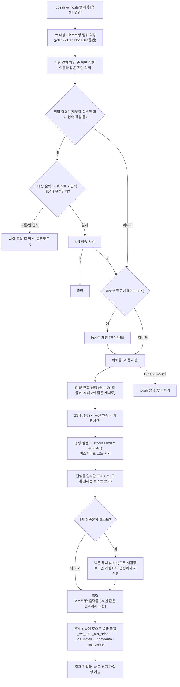

# 작업 흐름도 — gossh (pdsh 스타일 병렬 SSH)

`gossh -w <hosts> "명령"` 한 번이 실행되는 흐름입니다. 옵션 전체는 [README.md](README.md)의 "4. 옵션 전체 목록"을 참고하세요.

`gossh -sv -w <hosts>`(조사)는 위 흐름과 별도 경로입니다: 호스트 목록을 읽은 뒤 명령어 질문 → 미리보기(첫 호스트 또는 지정 호스트 1대에서 실행) → 전체 실행(호스트마다 SSH 1회, 명령어마다 세션 1개, DNS·동시성·재검증은 위와 같음) → 표 출력과 `_survey.tsv`/`_survey.txt` 저장 (`survey.go`, README 3.16).

`gossh -lu -w <hosts>`(접속 user 조회)도 별도 경로입니다: 호스트 목록을 읽은 뒤 시작·끝 시간(`YYYYMMDDHH`)을 묻고(잘못 입력하면 다시 질문), 모든 호스트에 같은 조회 스크립트를 원격 `bash -s` 표준입력으로 보내 `/var/log/secure*` 의 범위 안 성공한 SSH 로그인(root 제외)을 계정별 마지막 시각으로 집계하며(접속·동시성·재검증은 `-sv` 와 같음), 결과를 계정마다 한 줄 `호스트|접속성공시간|계정`(접속불가 `-|-`, 로그인 없음 빈 칸, 로그 못 읽음 `!|!`)으로 표준출력과 `<hosts>_loginuser.txt` 에 씁니다.

SVG 이미지로 보기 (workflow.svg)

