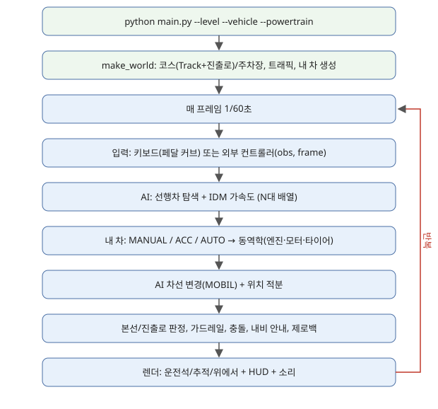

# 자율주행 도로 시뮬레이터 (CUDA 자율주행용 베이스)

나중에 CUDA로 자율주행을 붙이기 위한 **도로·차량·트래픽 시뮬레이터**입니다. 지금 단계에는 CUDA 코드가 없고,
CUDA 컨트롤러가 꽂힐 자리(관측값 API, 화면 프레임 캡처, 행동 입력)만 준비되어 있습니다.

- 다차선 순환 고속도로(직선 + 곡선 + S자), 진출로(IC) 와 목적지 내비게이션
- AI 트래픽: 차간거리 유지(IDM) + 차선 변경(MOBIL), 승용차/트럭/버스, 앞차 급제동 이벤트
- 내 차: 승용차/버스/트럭 × 내연기관 자동/수동, 전기, 하이브리드 — 마력·토크·브레이크·질량·타이어 설정 가능
- 난이도 초급/중급/고급, 30 km 직선 코스(제로백 0-100/200/300 측정), 주차장(직각/평행 주차)
- 1인칭 운전석 / 3인칭 추적 / 위에서 보기, HUD(속도계, RPM/기어, 제한속도, 미니맵, 경로 안내)
- 운전 감각 연출(시야각, 카메라 쏠림, 코너 시선, 진동, 차체 롤) + 코드로 만든 엔진/타이어/바람 소리

**사실적인 그래픽 버전(CARLA)** 은 [carla_sim/README.md](carla_sim/README.md) — Windows + NVIDIA GPU 필요, 설치·실행·이식 현황 정리.

작업 흐름도는 [WORKFLOW.md](WORKFLOW.md), 파일별 역할은 [ARCHITECTURE.md](ARCHITECTURE.md) 참고.



---

## 1) 빌드 및 설치 방법

필요한 것: **Python 3.11** (Windows / Linux x86_64). 인터넷 없이 설치되도록 `wheels/` 폴더에
numpy, pygame 설치 파일(Windows용, Linux용)이 들어 있습니다.

### Windows (폐쇄망 가능)
```bat
cd 자율주행-도로시뮬레이터
setup.bat
```
`.venv` 가상환경을 만들고 `wheels\` 에서만 설치한 뒤, 60초 자동주행 확인을 실행합니다.

### Linux (폐쇄망 가능)
```bash
cd 자율주행-도로시뮬레이터
bash setup.sh            # python3 가 3.11 이 아니면: PYTHON=python3.11 bash setup.sh
```

### 인터넷이 되는 환경 / 다른 Python 버전
```bash
pip install -r requirements.txt
```

---

## 2) 사용 방법

```bash
python main.py                                        # 중급 코스, 승용차, 직접 운전
python main.py --level hard --vehicle bus --powertrain hybrid
python main.py --level long --cars 0                  # 30 km 직선, 트래픽 없이 제로백 측정
python main.py --level parking                        # 주차장
python main.py --controller examples/nav_follow.py    # 외부 컨트롤러(내비 방식)가 운전
python main.py --controller examples/vision_lane.py   # 외부 컨트롤러(화면 캡처 방식)가 운전
python main.py --headless --seconds 600               # 화면 없이 자동주행 통계
python tests/test_sim.py                              # 기능 테스트 (pytest 있으면 python -m pytest tests)
```
(가상환경을 쓰면 `python` 대신 Windows `.venv\Scripts\python`, Linux `.venv/bin/python`)

### 키보드 조작

| 키 | 동작 |
|---|---|
| W / ↑ | 가속 (서서히 깊게 밟힘) |
| S / ↓ | 브레이크 |
| A D / ← → | 조향 (고속일수록 조금만 꺾임) |
| G | 정차 중 D ↔ R(후진) |
| Z / X | 기어 내림 / 올림 (수동 변속기) |
| M | 모드: MANUAL(직접) → ACC(속도만 자동) → AUTO(완전 자동) |
| Q / E | AUTO 모드에서 왼쪽 / 오른쪽 차로 변경 |
| [ / ] | ACC 설정 속도 -10 / +10 km/h |
| N | 목적지 변경 (도착 후 누르면 고속도로로 복귀) · 주차장에서는 다음 주차칸 |
| T | 차종: 승용차 → 버스 → 트럭 |
| P | 파워트레인: 자동 → 수동 → 전기 → 하이브리드 |
| V | 시점: 운전석 → 추적 → 위에서 |
| F1~F5 | 초급 / 중급 / 고급 / 30 km 직선 / 주차장 |
| C | 카메라 연출 on/off · O 소리 on/off |
| K | 외부 컨트롤러 on/off · Backspace 차 위치 초기화 |
| Tab / Esc | **설정 메뉴** (코스·난이도·트래픽·차로·차종·파워트레인·마력/토크/브레이크/무게/타이어/조향/리미터·EV/하이브리드 제원·시점·소리). ↑↓ 선택, ←→ 변경(Shift 크게), Enter 실행, 메뉴의 Save 로 `config/vehicles.json` 저장. 열려 있는 동안 일시정지 |
| H 도움말 · Space 일시정지 | 종료는 설정 메뉴의 Quit 또는 창 닫기 |

---

## 3) 옵션별 상세 설명

### 실행 옵션 (`main.py`)

| 옵션 | 기본값 | 설명 |
|---|---|---|
| `--level` | normal | `easy` 초급, `normal` 중급, `hard` 고급, `long` 30 km 직선 코스, `parking` 주차장 |
| `--vehicle` | car | `car` 승용차, `bus` 버스, `truck` 트럭 |
| `--powertrain` | auto | `auto` 내연기관 자동, `manual` 내연기관 수동, `ev` 전기, `hybrid` 하이브리드 |
| `--cars` | 난이도별 | AI 트래픽 차량 수 (0 이면 빈 도로) |
| `--lanes` | 3 | 차로 수 |
| `--view` | cockpit | `cockpit` 운전석, `chase` 추적, `top` 위에서 |
| `--controller` | - | `Controller` 클래스가 든 파이썬 파일. K 로 켜고 끔 |
| `--headless` | - | 화면 없이 AUTO 모드로 `--seconds` 만큼 돌리고 통계 출력 (충돌 있으면 종료코드 1) |
| `--screenshot` | - | `--seconds` 만큼 자동주행 후 PNG 한 장 저장 |
| `--dest` | - | 헤드리스/스크린샷에서 목적지 번호 |
| `--seed` | 0 | 트래픽 배치 난수 |
| `--renderer` | gl | `gl` OpenGL 3D(조명·그림자·안개), `classic` 예전 2D 폴리곤. OpenGL 이 안 되면 자동으로 classic |
| `--menu` | - | 스크린샷에 설정 메뉴를 띄운 상태로 저장 |

### 난이도

| | 초급 | 중급 | 고급 |
|---|---|---|---|
| 코스 | 큰 타원 (반경 400 m) | S자 + 반경 200/250 m | 반경 120~180 m 급곡선 |
| 제한속도 | 100 | 70~100 | 50~100 |
| 트래픽 | 25대 | 60대 | 110대 |
| AI 성향 | 차간 1.4~2.0초, 양보 | 1.0~1.6초 | 0.7~1.2초, 공격적 끼어들기 |
| 앞차 급제동 | 없음 | 약 60초마다 | 약 15초마다 |
| 시야(안개) | 900 m | 520 m | 260 m |

설정 위치: `sim/scenario.py`

### 차량 제원 (`config/vehicles.json`)

차종(`car`/`bus`/`truck`)별로 아래 값을 바꾸면 바로 반영됩니다.

| 키 | 의미 |
|---|---|
| mass, length, width, height, wheelbase, front_weight | 질량[kg], 치수[m], 앞축 하중 비율 |
| power_hp, torque_nm, torque_peak_rpm, idle_rpm, redline_rpm | 엔진 마력/토크 곡선 |
| gears, final_drive, shift_up_rpm, shift_down_rpm | 변속기 기어비, 자동변속 시점 |
| brake_force_n | 최대 브레이크 힘 [N] (클수록 강함, 타이어 한계 넘으면 ABS) |
| tire_mu, cornering_front/rear | 타이어 마찰계수, 코너링 강성 (작을수록 잘 미끄러짐) |
| cd_a, c_roll | 공기저항(Cd×면적), 구름저항 |
| max_steer_deg, steer_rate_deg | 최대 조향각, 조향 속도 |
| speed_limiter_kmh | 속도 제한장치 (0 = 없음, 버스 110 / 트럭 90) |
| ev.* | 전기: 모터 kW/토크, 감속비, 회생제동 힘, 배터리 kWh |
| hybrid.* | 하이브리드: **engine_hp, motor_hp 각각**, 모터 토크, EV 전용 속도, 배터리 |

예: 0-300 km/h 를 재 보려면 `car.power_hp` 를 600 정도로 올리고 `--level long --cars 0` 으로 실행.

### 내비게이션
- 목적지 = 각 진출로(IC) 끝. N 키로 선택, 화면 위쪽에 안내("1.2 km 직진", "출구 800 m 전 3차로로 이동" 등), 미니맵에 경로(주황)·목적지(초록) 표시
- AUTO 모드면 자동으로 오른쪽 차로로 옮겨 진출로로 나가고 끝에서 정차
- 출구를 놓치면 한 바퀴 돌아 다시 안내

### 주차장
- 직각 주차칸(위쪽 줄), 평행 주차칸(아래쪽 줄), 초록 테두리가 목표 칸 (N 으로 변경)
- 성공 조건: 차체 네 모서리가 칸 안 + 칸 방향과 ±6도 이내(앞/뒤 방향 모두 허용) + 정차 → `PARKED!`
- 칸 크기는 내 차 크기에 맞춰 생성 (버스/트럭도 가능)

### 외부 컨트롤러 (나중에 CUDA 가 들어갈 곳)

`env.py` 의 `DrivingEnv` 또는 `main.py --controller 파일.py` 로 연결합니다. 컨트롤러는
`Controller` 클래스 하나이고 `__call__(obs, frame) -> (throttle 0~1, brake 0~1, steer -1~1, +는 왼쪽)` 입니다.

1. **내비게이션(경로 데이터) 방식** — `needs_frame = False`, `obs` 만 사용
   `route`(목적지까지 경로 좌표), `lane_center/left/right`, `curvature`, `speed_limit`, `recommended_speed`,
   `lead_gap/lead_speed`, `vehicles`(주변 차 상대위치·속도), `nav`(안내 문구·남은 거리·필요 차로) 등.
   좌표는 모두 내 차 기준(x 전방, y 왼쪽, m). 예제: `examples/nav_follow.py`
2. **순수 화면 캡처 방식** — `needs_frame = True`, `frame` = HUD 없는 운전석 영상 `(H, W, 3) uint8`
   예제: `examples/vision_lane.py` (흰색/황색 차선 픽셀로 차로 중심 추정)
3. **주차** — `level="parking"` 이면 `obs` 가 목표 칸 꼭짓점, 장애물(주차된 차) 꼭짓점, 위치/각도 오차, 성공 여부

```python
from env import DrivingEnv
env = DrivingEnv(level="normal", vehicle="car", powertrain="ev", frame_size=(640, 360))
obs, frame = env.reset()
env.world.nav.set_destination(0)
for _ in range(3000):
    obs, frame = env.step(my_cuda_controller(obs, frame))
```

AI 트래픽의 계산(`sim/controllers.py`)은 "차량 N대 배열 → 가속도 배열" 형태라 CuPy / Numba CUDA 커널로
같은 시그니처를 유지한 채 바꿀 수 있습니다(`World(ai_controller=...)`).

### 물리 모델 범위
외부 물리엔진 없이 가벼운 자체 모델입니다: 엔진 토크 곡선 + 변속기 / 전기모터, 공기·구름 저항,
타이어 마찰 한계(휠스핀·ABS), 동적 자전거 모델(고속 급조향 시 미끄러짐). 서스펜션·노면 요철·차량 간 충돌
반발은 계산하지 않고, 충돌은 감지 + 감속으로만 처리합니다. AI 차량은 운동학 모델(IDM)입니다.

---

## 4) 문서별 설명

| 문서 | 내용 |
|---|---|
| README.md | 설치, 사용법, 옵션, 주의사항 (이 문서) |
| [ARCHITECTURE.md](ARCHITECTURE.md) | 폴더/파일별 역할 — 어디를 고치면 되는지 |
| [WORKFLOW.md](WORKFLOW.md) / workflow.svg | 실행 한 번의 단계별 흐름도 |
| [CHANGELOG.md](CHANGELOG.md) | 변경 이력 |
| [PR_CHECKLIST.md](PR_CHECKLIST.md) | 수정·배포 전 확인 목록 |
| 사용법.txt | 수동 테스트용 명령어 모음 |
| [carla_sim/README.md](carla_sim/README.md) | CARLA 버전: GPU 요구사항, Windows 설치, 실행, 이식된/안 된 기능 |

## 5) 전역 명령어로 사용하기 (선택 사항)

Linux: `~/.bashrc` 에 추가
```bash
alias autodrive='cd /경로/자율주행-도로시뮬레이터 && .venv/bin/python main.py'
```
Windows: `autodrive.bat` 을 PATH 폴더에 만들고
```bat
@echo off
cd /d C:\경로\자율주행-도로시뮬레이터 && .venv\Scripts\python main.py %*
```

## 주의사항 (Disclaimer)

본 시뮬레이터와 예제 컨트롤러는 학습·실험용 **참고(보조) 도구**이며 100% 신뢰하기보다는 참고용으로 사용하는 것을
권장합니다. 차량 동역학은 단순화된 모델이라 실제 차량의 거동과 다르며, 여기서 검증한 자율주행 로직을 실제 차량에
그대로 적용해서는 안 됩니다. 설정값(`config/vehicles.json`, `sim/scenario.py`)을 바꾼 뒤에는
`python tests/test_sim.py` 와 몇 가지 코스를 직접 주행해 의도대로 바뀌었는지 확인하십시오.
