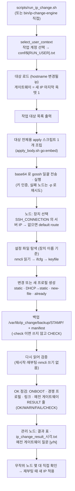
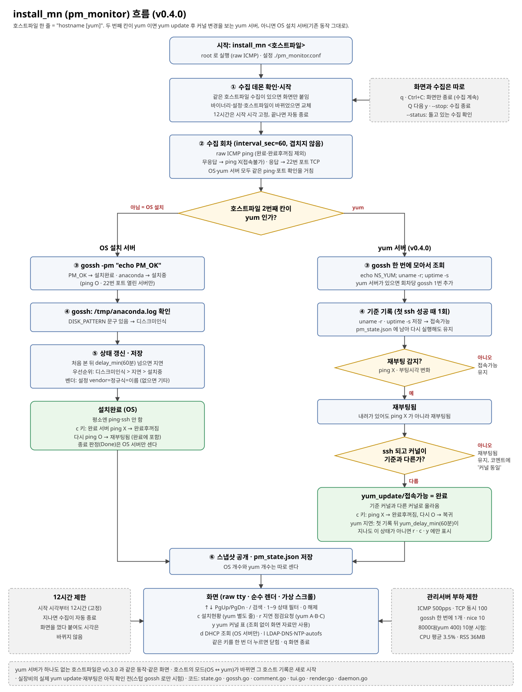

# ARCHITECTURE.md — ip_change

| 폴더/파일 | 역할 |
|---|---|
| `setup.sh` | 폐쇄망 오프라인 빌드. `GOPROXY=off`, `CGO_ENABLED=0` 정적 빌드 |
| `cmd/ip-change-engine/main.go` | CLI 진입점. 플래그·위치 인자(목록 파일) 파싱 → 대상 로드 → apply 스크립트 생성 → gossh 호출 → 결과 표·결과 파일(`ip_change_result_*.txt`)·예전 게이트웨이 질문 |
| `internal/target/target.go` | `{user}.txt`(`hostname 변경될ip`) 파싱, 중복/형식 검증, 게이트웨이(마지막 옥텟 `.1`) 계산 |
| `internal/config/config.go` | `ip_change.conf`(평문 key=value) 파싱. 파일이 없어도 기본값으로 동작 |
| `internal/render/render.go` | 대상 전체를 담은 apply 스크립트 한 벌 조립. `apply_body.sh` 를 `go:embed` 하고 헤더에 `NETWORK_SCRIPTS_DIR`/`RHEL9_PATH`/`FORCED_DIR`/`CHECK_ONLY`/`BOND_MODE`/호스트→IP 표를 삽입. 예전 게이트웨이용 스크립트(`fixgw_body.sh`)도 조립 |
| `internal/render/apply_body.sh` | **실제 설정을 바꾸는 본체.** 장치 선택(`SSH_CONNECTION`→default route) → 설정 파일 탐색(nmcli 읽기→ifcfg→keyfile) → 변경 또는 새 프로필 생성 → 다시 읽어 검증 → OK 점검 → `RESULT|...` 줄 |
| `internal/render/fixgw_body.sh` | 예전 게이트웨이 정리 본체. `/etc/sysconfig/network`·`route-<장치>` 만 백업 후 고침 (`-fix-gateway` 또는 사용자 응답 `y`) |
| `internal/render/rollback_body.sh` | **롤백 본체.** `/var/lib/ip_change/backup/<STAMP>/manifest` 기준으로 `modified` 복원, `created` 는 `<이름>.removed` 로 이동. 백업 디렉토리가 없으면 예전 `.bak.<STAMP>` 방식 |
| `internal/remote/remote.go` | gossh 탐색(`-gossh`→`IP_CHANGE_GOSSH`→바이너리 옆→PATH)·호출. base64(spaceOut 포함)로 인코딩해 원격 주입하고 `<host>: <내용>` 출력을 파싱 |
| `internal/remote/runner.go` | 키 인증 실패 노드 감지, `-p` 로 받은 패스워드로 실패 노드만 두 번째 실행 |
| `internal/remote/tty_linux.go`, `tty_other.go` | 패스워드 숨김 입력(`ReadPassword`). Linux 외 OS 는 미지원 오류 |
| `internal/color/color.go` | 관리 노드 출력 전용 ANSI 색상. 대상 노드로 전송되는 스크립트에는 관여하지 않음 |
| `scripts/run_ip_change.sh` | 관리자용 래퍼. 계정 선택(`select_user_context`, 의도적으로 빈 자리) → 목록 파일을 위치 인자로, `-check`/`-fix-gateway`/`-bond-mode`/`-p` 를 넘겨 엔진 실행 |
| `conf/*.sample` | 설정·대상 목록 예시. 실제 값 파일은 `.gitignore` 로 커밋 차단 |

## 수정 요청별로 볼 곳

| 요청 | 볼 파일 |
|---|---|
| "IP/GATEWAY 갱신·새 프로필 양식 변경" | `internal/render/apply_body.sh` (RHEL 10 keyfile 양식은 잠정안) |
| "예전 게이트웨이 정리 변경" | `internal/render/fixgw_body.sh` + `cmd/ip-change-engine/main.go` |
| "-p 패스워드·gossh 탐색 변경" | `internal/remote/runner.go`, `internal/remote/remote.go` |
| "장치 선택·설정 파일 탐색 방식 변경" | `internal/render/apply_body.sh` 의 장치 선택·파일 탐색 블록 |
| "conf 스키마에 키 추가" | `internal/config/config.go`, `conf/ip_change.conf.sample`, 필요 시 `internal/render/render.go` (헤더 변수 추가) |
| "{user}.txt 형식 변경" | `internal/target/target.go` |
| "CLI 옵션 추가" | `cmd/ip-change-engine/main.go` |
| "롤백 로직 변경" | `internal/render/rollback_body.sh` + `cmd/ip-change-engine/main.go` 의 `runRollback`/`formatRollbackLine` |
| "gossh 호출 방식 변경" | `internal/remote/remote.go` |
| "출력 색상/화면 표시 형식 변경" | `internal/color/color.go`, `cmd/ip-change-engine/main.go` 의 `formatResultLine` |
| "결과 줄에 값 추가(기계용 포맷 변경)" | `internal/render/apply_body.sh` 의 `RESULT|...` 줄 + `cmd/ip-change-engine/main.go` 의 `formatResultLine` 둘 다 |
| "계정 선택 로직 채우기" | `scripts/run_ip_change.sh` 의 `select_user_context()` |

## 반드시 지킬 것

1. **기존 설정 파일을 통째로 덮어쓰지 마십시오.** 필요한 줄(IPADDR/NETMASK/GATEWAY/BOOTPROTO, keyfile 은 `[ipv4]`)만 바꿉니다. 운영자가 넣은 다른 지시자와 주석, IPv6·DHCP 전용 줄은 그대로 둡니다. 새 프로필은 설정 파일이 없을 때만 만듭니다.
2. **awk 에 데이터를 `-v` 로 넘기지 마십시오.** awk 가 `\t`, `\[` 같은 이스케이프를 해석해
   값이 깨질 수 있습니다. 반드시 환경변수 + `ENVIRON[]` 을 쓰십시오(`set_ifcfg_key` 참고).
3. **백업은 `/var/lib/ip_change/backup/<STAMP>/`(원래 전체 경로) + `manifest` 에만 둡니다.** 설정 디렉토리에 `.bak` 파일을 두면 NetworkManager·network 서비스가 추가 프로필로 읽을 수 있습니다. 이미 바뀐 노드는 백업을 만들지 않습니다.
4. **네트워크 서비스·NetworkManager 를 재시작하지 말고, 재부팅하지 말고, `nmcli` 쓰기 명령(modify/load/reload/up/down)을 쓰지 마십시오.** 읽기 조회만 허용합니다. 계획서에서 명시적으로 제외한 항목입니다.
5. **게이트웨이는 항상 `.1` 로 고정합니다.** 넷마스크를 검증하지 않습니다(모든 대상이
   `/24` 라는 전제). 서브넷이 다른 대상이 생기면 `internal/target/target.go` 의
   `Gateway()` 와 계획서를 함께 갱신해야 합니다.
6. **ifcfg 와 keyfile 은 별도 경로로 다룹니다.** RHEL 10 keyfile 양식(새 프로필 생성·keyfile 변경)은 잠정안이라 사용자 요청에 따라 바뀔 수 있습니다. 바꿀 때는 `apply_body.sh` 의 keyfile 함수와 README·CHANGELOG 의 양식 설명을 함께 고치십시오. `rhel9_path` 는 강제 경로이며 ifcfg 와 keyfile 을 모두 찾습니다.
7. **`apply_body.sh` 의 결과 줄 형식(`RESULT|<상태>|host|기존IP|새IP|GW|장치|방식|OS|파일|비고`)을 깨지 마십시오.** 앞 여섯 필드 순서는 예전과 같습니다. `cmd/ip-change-engine/main.go` 의 파서·`formatResultLine` 이 이 형식을 읽습니다. 필드가 바뀌면 두 곳을 함께 고치십시오. 상태는 OK/WARN/FAIL/CHECK 이며 다른 브랜치의 소비자는 WARN 을 모를 수 있습니다.
8. **`ROOT` 는 테스트 fixture 전용입니다.** `internal/render/apply_body.sh` 의
   `detect_os_major` 만 이 값을 씁니다. 운영 실행에서는 항상 비어 있어 실제 `/etc` 를 봅니다.

## 백업 구조

```
/var/lib/ip_change/backup/<STAMP>/
  manifest                                   # "<modified|created> <경로>" 한 줄씩
  etc/sysconfig/network-scripts/ifcfg-eth0   # modified 파일의 원본(원래 전체 경로)
```

롤백은 최근 STAMP(또는 `-rollback-to`)를 골라 `modified` 는 원래 경로로 복사하고, `created` 는 `<이름>.removed` 로 백업 디렉토리에 옮깁니다.

## 작업 흐름도

단계별 설명은 [WORKFLOW.md](WORKFLOW.md)를 참고하세요.



<details><summary>SVG 이미지로 보기 (workflow.svg, 이전 흐름 기준이므로 위 도표를 우선하십시오)</summary>



</details>
