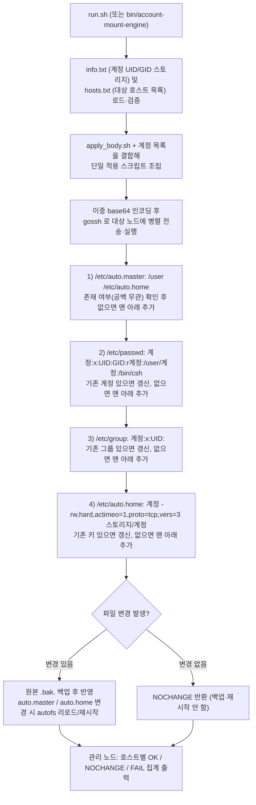

# ARCHITECTURE.md — 계정 수동 마운트 자동화 (account-mount)

| 폴더/파일 | 역할 |
|---|---|
| `run.sh` | 실행 편의를 위한 bash 래퍼 스크립트. 바이너리 점검·자동 빌드 후 `bin/account-mount-engine` 실행 |
| `setup.sh` | 폐쇄망(오프라인) 정적 빌드 스크립트 (`GOPROXY=off`, `CGO_ENABLED=0`) |
| `bin/account-mount-engine` | 사전 빌드된 Linux amd64 정적 바이너리 (Go 미설치/RHEL6 폐쇄망 환경에서 즉시 실행 가능) |
| `cmd/account-mount-engine/main.go` | CLI 진입점. 플래그 파싱 → `info.txt`/`hosts.txt` 로드 → 스크립트 렌더링 → `gossh` 원격 실행(또는 로컬 실행) → 결과 집계 |
| `internal/info/info.go` | `info.txt` (`계정 UID/GID 스토리지`) 및 `hosts.txt` 파싱·유효성 검증, 각 설정 파일 포맷 문자열 생성 |
| `internal/render/render.go` | `lib_common.sh`, `apply_body.sh`, `rollback_body.sh` 를 `go:embed` 로 내장해 노드 실행용 스크립트 조립 |
| `internal/render/lib_common.sh` | 공통 로깅, 변경 파일 추적, `autofs` 조건부 리로드/재시작 함수(`reload_or_restart_autofs`) |
| `internal/render/apply_body.sh` | **실제 설정 적용 본체.** `/etc/auto.master`, `/etc/passwd`, `/etc/group`, `/etc/auto.home` 백업 및 수술적 갱신·검증 |
| `internal/render/rollback_body.sh` | **롤백 본체.** `<파일>.bak.<STAMP>` 시점 목록 조회(`-list-backups`) 및 원복(`-rollback`, `-rollback-to`) |
| `internal/remote/remote.go` | `gossh` 호출. 스크립트를 이중 base64(spaceOut 적용)로 감싸 원격 셸 종류(`bash`/`csh`/`tcsh`)와 무관하게 주입하고 출력 파싱 |
| `internal/color/color.go` | 관리 노드 터미널 출력용 ANSI 색상 처리 |
| `info.txt.example`, `hosts.txt.example` | 입력 파일 양식 예시 (`info.txt`, `hosts.txt` 실물은 `.gitignore` 로 커밋 제외) |

> **수정 팁**:
> - 새로운 파일 양식이나 마운트 옵션을 변경하려면 `internal/info/info.go` 와 `internal/render/apply_body.sh` 두 곳만 확인하고 수정하면 됩니다.
> - CLI 플래그나 출력 요약을 변경하려면 `cmd/account-mount-engine/main.go` 를 수정하십시오.
> - 소스 수정 후에는 반드시 `./setup.sh` 를 실행해 `bin/account-mount-engine` 정적 바이너리도 함께 갱신하여 커밋하십시오.

## 처리 흐름도

