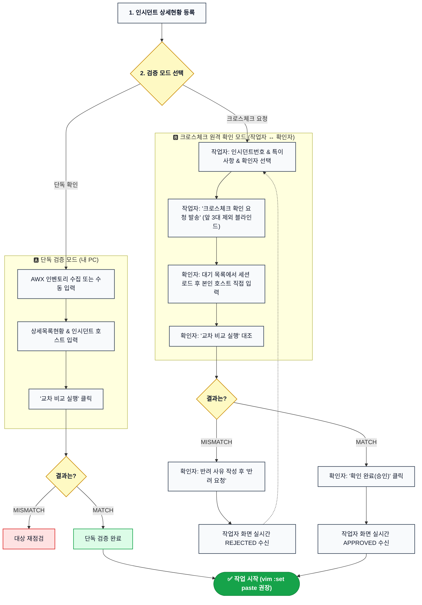

# 작업대상 호스트 교차 검증기 (AWX Multi-Source Host Cross-Checker)

작업 대상 서버 변경/배포 작업 시 **상세목록현황**, **인시던트**, **작업대상(파일/텍스트)**, **AWX 인벤토리** 간의 호스트 불일치를 사전 교차 검증하여 휴먼 에러 및 비인가/오타 서버 작업을 원천 차단하는 엔터프라이즈 도구입니다.

로컬 단독 검증뿐만 아니라, 사내 윈도우 공유폴더(SMB) 및 Go 백엔드 에이전트를 통해 **작업자 ↔ 크로스체크 확인자 간 실시간 원격 교차 검증**을 지원합니다.

> [!TIP]
> **🚀 단일 실행 파일 (Standalone Desktop App) 지원**:
> `dist\host-cross-checker.exe` 파일을 더블클릭하면 별도의 브라우저 조작이나 북마크릿 등록 없이 **독립 데스크톱 애플리케이션 창(`--app` 모드)**이 즉시 실행되어 1~3번 탭의 모든 기능을 원클릭으로 사용할 수 있습니다. 창을 닫으면 백그라운드 프로세스도 깔끔하게 자동 종료됩니다.

---

## 1. 실행 모드 안내

### 모드 1: 단일 실행 파일 독립 앱 (추천 - 가장 간편함)
1. `dist\host-cross-checker.exe`를 더블클릭하여 실행합니다.
2. 시스템에 설치된 Edge 또는 Chrome이 주소창/탭 없는 순수 윈도우 앱 창(`--app`)으로 즉시 구동됩니다.
3. AWX 브라우저 탭을 열 필요 없이 **[현재 인벤토리 전체 수집]** 버튼 클릭 한 번으로 인벤토리 1,000대 호스트를 즉시 자동 수집합니다.
4. 사용을 마치고 창의 `X` (닫기) 버튼을 누르면 프로세스가 자동으로 안전하게 종료됩니다.

### 모드 2: AWX 브라우저 북마크릿 연동 (기존 방식 100% 호환)
1. 백엔드 에이전트 구동:
   ```cmd
   dist\cross-checker-agent.exe -share=\\192.168.0.23\share
   ```
2. Chrome / Edge 북마크 바에 [dist/bookmarklet.txt](dist/bookmarklet.txt)의 `javascript:...` 코드를 등록합니다.
3. AWX 웹 콘솔(`http://192.168.0.58:30080`) 접속 후 북마크를 클릭하면 페이지 내 오버레이 패널로 실행됩니다.

---

## 2. 주요 기능

### 1) 단독 검증 모드 (내 PC 단독 확인)
1. **2~4개 소스 동시 양방향(대칭) 교차 비교**:
   - `상세목록현황 호스트` [필수]
   - `인시던트 호스트` [필수]
   - `작업대상 호스트` [선택 - 1대 이상 입력 시 자동 참여]
   - `AWX 인벤토리 호스트` [선택 - 1대 이상 수집 시 자동 참여]
2. **AWX 수집 시점 제외 필터 (`|` 구분자 지원)**:
   - 소스 동기화 진행 시 자동으로 추가되는 필수 6~7대 서버를 수집 시점에 즉시 차감 (`1000대 중 6대 제외됨`).
   - 미입력 시 회색 안내 문구(`OS설치에 필요한 서버명은 이미 제외되어 있음`) 노출.
3. **970대 누락 검출 & `[명단 펼치기]` 토글**:
   - 대수 요약만 먼저 깔끔하게 표시하며, 버튼 클릭 시 누락 전체 명단 펼치기.
4. **선명한 폰트 & 고대비 엔터프라이즈 UI (이모티콘 0건)**:
   - `Pretendard`, `Malgun Gothic(맑은 고딕)`, `Consolas`, `D2Coding` 폰트 스택과 안티앨리어싱 적용. 모든 이모티콘 및 버전 배지 배제.
5. **독립 브라우저 팝업 창 전환 + 상단 고정(Pin) + 투명도/자동 접기(미니 모드)**:
   - 페이지 내 패널 이동 및 상단 고정. 마우스 이탈 시 투명도(10~100%) 조절.
   - 독립 창(팝업) 모드에서는 창 이탈 시 헤더 바로 자동 축소되어 아래 창이 시야를 가리지 않음.
6. **MATCH / MISMATCH 상태별 작업 권장 안내 자동 분기**:
   - `[MATCH]` 시 `vim [작업대상 파일] -> esc -> :set paste 입력(붙여넣기 모드) -> 붙여넣기` 권장 문구.
   - `[MISMATCH]` 시 불일치 적발 및 재확인 안내.
7. **수집 초기화 연동 및 톱니바퀴 설정(체크박스)**:
   - AWX 수집 초기화 시 입력란 동시 초기화 또는 작업대상 보존 설정 지원.
8. **슬래시(`/`) 앞뒤 공백 무결성 정제**:
   - `hostname / AAAAAA` 형태의 시리얼 포함 라인도 정확히 1대의 호스트로 자동 인식.

### 2) 크로스체크 원격 확인자 연동 모드 (작업자 ↔ 확인자 실시간 연동)
1. **사용자/IP 명부(`users.json`) 자동 매칭**:
   - 로컬 IP를 기반으로 작업자/확인자 자동 식별 및 신규 사용자 실시간 등록.
2. **인시던트 번호(권장) & 특이사항(메모) 전달**:
   - 인시던트 번호 미입력 시 회색 힌트 안내, 특이사항(예: 야간 배포 건, DB 6대 제외 등)을 확인자에게 손실 없이 100% 전달.
3. **작업자 활성 항목(2~4개) 동적 동기화**:
   - 작업자가 사용하지 않은 선택 항목(예: 작업대상)은 확인자 화면에서도 자동으로 비활성화(제외)되어 혼선 방지.
4. **작업자 호스트 블라인드 (앞 3대만 노출)**:
   - 확인자가 작업자의 입력을 그대로 복사하는 어뷰징을 원천 차단하기 위해, 확인자 화면에는 앞 3대만 예시로 노출되고 나머지는 마스킹(`외 N대 블라인드 처리됨`)됩니다.
5. **확인자 직접 독립 입력 및 소스 전수 대조**:
   - 확인자는 본인의 인시던트/상세목록에서 호스트를 직접 복사/입력하여 교차 비교를 수행합니다.
   - 작업자 입력분 vs 확인자 입력분 간 1글자의 오타나 누락도 `[MISMATCH]`로 적발되며, `[확인 완료(승인)]` 버튼이 잠깁니다.
6. **무쿨타임(0초) 확인자 즉시 변경 (Reassign)**:
   - 담당 확인자가 부재중일 때 대기시간(쿨타임) 0초로 즉시 다른 확인자로 재지정 가능하며 전체 변경 이력이 기록됩니다.
7. **실시간 반려 / 재확인 요청**:
   - 불일치 발생 시 확인자가 사유를 작성하여 반려하면, 작업자 화면에 `[CROSS-CHECK REJECTED]` 배지와 사유가 실시간 표시됩니다.
8. **전수 일치 시 E2E 승인 및 vim 권장 코멘트 출력**:
   - 전수 일치(`[MATCH]`) 판정 시 `[확인 완료(승인)]` 버튼이 활성화되며, 승인 시 작업자 화면에 `[CROSS-CHECK APPROVED]` 리포트가 출력됩니다.
9. **초저지연 WebSocket 통신 & AWX CSP 100% 준수**:
   - AWX의 엄격한 보안 정책(`connect-src 'self' ws: wss:`)을 100% 준수하는 WebSocket RPC 브리지를 탑재하여 평균 왕복 속도 65ms(기준 3,000ms 이하)의 초고속 실시간 통신을 보장합니다.
10. **Direct 통신 불가 시 공유폴더 파일 폴백(Fallback)**:
    - 방화벽 등으로 인해 직접 통신이 차단되더라도 윈도우 공유폴더(SMB)의 `sessions/*.json` 파일 폴링(500ms)을 통해 385ms 만에 승인 상태를 동기화합니다.

---

## 3. 사내 공유폴더(SMB) 다중 사용자 배포 및 설정 가이드

사내 윈도우 공유폴더(SMB)에 파일들을 올려두면, 팀원들이 각자 PC에서 실행하여 동일한 환경설정 및 사용자 명단을 공유하며 여러 사람이 동시에 안전하게 작업할 수 있습니다.

### 1) 공유폴더 구성 (`dist` 폴더 내용 복사)
사내 공유폴더(예: `\\192.168.0.xxx\share\host-checker\`)에 저장소의 [`dist`](dist) 폴더 내 파일들을 그대로 복사합니다:
```text
\\공유서버\share\host-checker\
├── host-cross-checker.exe       # [필수] 팀원들이 실행할 단일 독립 데스크톱 앱
├── config.json                  # [설정] 사내 공통 환경설정 (포트, AWX 주소 등)
├── users.json                   # [설정] 팀원 이름 및 사내 IP 매핑 명부
├── start_cross_checker.bat      # [선택] 원클릭 실행 편의용 배치 파일
└── sessions\                    # [자동] 작업자-확인자 간 교차검증 세션 파일 저장소
```

### 2) 핵심 설정 항목

#### ① `users.json` (사용자/IP 명부)
각 사용자가 실행 시 본인의 로컬 IP를 기반으로 누구인지 자동 식별(`김철수`, `이영희` 등)하는 명부입니다:
```json
{
  "updatedAt": "2026-11-11T13:00:00+09:00",
  "users": [
    { "name": "김철수", "ip": "192.168.0.23", "role": "작업자" },
    { "name": "이영희", "ip": "192.168.0.102", "role": "작업자" },
    { "name": "박민수", "ip": "192.168.0.105", "role": "작업자" }
  ]
}
```
> [!NOTE]
> `role`은 단순 참고용 부가 정보이며, 시스템 기능이나 권한에는 **아무런 영향이 없습니다.** 모든 팀원은 작업자로서 작업을 진행할 수 있고, 확인자 드롭다운 목록에서 본인을 제외한 다른 모든 팀원을 확인자로 선택하여 **작업자들끼리 상호 교차 검증**을 수행합니다. (`role` 항목을 생략하거나 모두 동일하게 적으셔도 무방합니다.)
*(명부에 없는 신규 사용자가 접속 시 로컬 IP로 자동 등록되며 관리자가 이름을 수정할 수 있습니다.)*

#### ② `config.json` (공통 환경설정)
공유폴더의 `config.json` 하나만 수정해 두면 모든 사용자에게 일괄 적용됩니다:
```json
{
  "sharedDir": ".",
  "listenPort": 18080,
  "pollIntervalMs": 500,
  "autoOpenBrowserOnRequest": false
}
```

### 3) 다중 사용자 동시 사용 방법
1. **각자 실행**:
   - 작업자(김철수)와 확인자(이영희)는 각자 PC에서 공유폴더의 `host-cross-checker.exe` (또는 `start_cross_checker.bat`)를 더블클릭합니다.
2. **자동 IP 인식 & 프로세스 격리**:
   - 각자 PC의 IP로 본인 이름이 상단에 자동 인식됩니다.
   - 각자의 입력 내용과 화면은 로컬 PC에 완전히 격리되어 여러 사람이 동시에 켜도 간섭이 전혀 없습니다.
3. **크로스체크 요청 및 실시간 승인**:
   - 작업자가 탭 2에서 [크로스체크 확인 요청 발송]을 누르면 `sessions/` 폴더를 통해 확인자에게 세션이 전달됩니다.
   - 확인자는 탭 3에서 대조 후 [확인 완료(승인)]를 누르면 작업자 화면에 승인 결과가 즉시 동기화됩니다.
4. **종료**:
   - 사용 완료 후 앱 창의 `X`(닫기) 버튼을 누르면 백그라운드 프로세스까지 자동으로 완전 종료됩니다.

---

## 4. (참고) 브라우저 북마크릿 및 백엔드 데몬 연동

기존 브라우저 오버레이 패널 형태로 실행하려는 경우:

1. **에이전트 데몬 구동**:
   ```cmd
   dist\cross-checker-agent.exe -share=\\192.168.0.xxx\share
   ```
2. **브라우저 북마크 등록**:
   - 브라우저(Chrome / Edge)의 북마크 바에서 우클릭 ➔ **[페이지 추가]**
   - **이름**: `작업대상 호스트 교차 검증기`
   - **URL**: [dist/bookmarklet.txt](dist/bookmarklet.txt) 파일의 1줄 `javascript:...` 코드 전체 복사 후 붙여넣기
3. AWX 웹 콘솔 접속 후 북마크를 클릭하면 상단에 `Go 에이전트 연결됨: 이름 (IP)` 녹색 상태가 표시되며 연동됩니다.

---

## 5. 작업대상 확인 프로세스 (업무 흐름도)



---

## 6. 파일 구성

```text
├── agent/
│   ├── main.go                   # Go 백엔드 서버 소스 (RFC 6455 WebSocket, AWX 프록시, 하트비트 수명주기)
│   └── agent_test.go             # Go 백엔드 유닛 테스트 스위트 (14개 테스트 전원 통과)
├── internal/
│   ├── launcher/
│   │   └── launcher.go           # Edge/Chrome --app 독립 데스크톱 창 런처
│   └── webui/
│       ├── webui.go              # Go 1.16+ //go:embed 프론트엔드 에셋 임베딩
│       ├── index.html            # 독립 데스크톱 창 루트 HTML (하트비트 & 라이프사이클)
│       └── awx_host_checker.js   # 임베딩용 클라이언트 번들
├── config/
│   ├── config.json               # 기본 에이전트 설정 템플릿
│   └── users.json                # 사내 작업자/확인자 IP 명부 템플릿
├── src/
│   ├── awx_host_checker.js       # 3개 탭 아키텍처 클라이언트 소스코드 (독립 창 & 북마크릿 공용)
│   └── awx_host_checker_prev.js  # 이전 UI 디자인 백업 소스코드
├── dist/
│   ├── host-cross-checker.exe    # 단일 실행 파일 독립 데스크톱 앱 바이너리 (추천)
│   ├── cross-checker-agent.exe   # 폐쇄망 데몬용 바이너리 (호환용)
│   ├── bookmarklet.txt           # 북마크 등록용 1줄 압축 코드
│   └── bookmarklet_prev.txt      # 북마크 등록용 1줄 압축 코드 (이전 UI 백업)
├── docs/
│   └── flow_diagram.svg          # 시스템 아키텍처 및 데이터 흐름도 SVG
├── tests/
│   ├── test_standalone_app.js    # 단독 실행 앱(--app 창 자동실행, 3탭, 원클릭수집, 자동종료) E2E 검증
│   ├── test_self_request.js      # 1인 셀프 테스트 모드 자동화 검증
│   ├── verify_built_bookmarklet.js# 빌드된 북마크릿 구문 및 브라우저 로딩 무결성 검증
│   ├── run_all_tests.js          # 원테이크 24개 테스트케이스 자동화 검증 스위트
│   ├── test_results.json         # 24개 테스트 결과 JSON
│   └── screenshot_onetake_success.png # 원테이크 검증 성공 스크린샷
├── build.py                      # 북마크릿 압축 및 Go 단일 바이너리 컴파일 자동화 스크립트
├── WORK_LOG.md                   # 상세 작업 및 신뢰성 증명 테스트 로그
└── README.md                     # 본 문서
```

---

## 7. 신뢰성 증명 및 테스트 스위트 검증 결과

* **단독 데스크톱 앱 검증**: `node tests/test_standalone_app.js` -> **100% PASS**
* **1인 셀프 테스트 검증**: `node tests/test_self_request.js` -> **100% PASS**
* **북마크릿 브라우저 검증**: `node tests/verify_built_bookmarklet.js` -> **100% PASS**
* **원테이크 24개 통합 테스트**: `node tests/run_all_tests.js` -> **24개 테스트케이스 전원 100% 통과 (One-Take Pass)**

| 번호 | 테스트케이스 항목 | 검증 결과 | 상세 내역 |
|:---:|:---|:---:|:---|
| **TC-01** | 호스트 수집 신뢰성 증명 | **PASS** | PostgreSQL DB 1,000대와 API 1,000대 전수 1:1 일치 (SHA256 검증) |
| **TC-02** | 인벤토리 격리 증명 | **PASS** | AWX 전체 1,028대 중 인벤토리 #3의 정확한 1,000대만 격리 수집 |
| **TC-03** | 화면 DOM 수집 무결성 | **PASS** | 1페이지 20대 정상 수집 및 재클릭 시 중복 카운트 방지 확인 |
| **TC-04** | AWX 수집 시 `\|` 제외 필터링 | **PASS** | 1,000대 중 6대 제외되어 994대 수집 반영 및 요약 문구 확인 |
| **TC-05** | 제외 미입력 시 회색 안내 메시지 | **PASS** | 미입력 시 안내 문구 정확히 노출 ("OS설치에 필요한 서버명은 이미 제외되어 있음") |
| **TC-06** | 필수 입력 검증 & 2개 소스 비교 | **PASS** | 필수 미입력 차단 확인 및 2개 소스 5대 전수 일치 통과 |
| **TC-07** | 3개 및 4개 소스 동적 비교 | **PASS** | 작업대상 입력 시 3개 소스 감지, AWX 수집 포함 시 4개 소스 자동 전환 |
| **TC-08** | 970대 누락 검출 & [명단 펼치기] | **PASS** | "대상에 없음: 970대" 검출 및 버튼 클릭 시 970대 전체 명단 펼치기 동작 |
| **TC-09** | MISMATCH/MATCH 안내문구 분기 | **PASS** | 단일 박스 출력, MISMATCH 재확인 문구 / MATCH vim 붙여넣기 문구 분기 |
| **TC-10** | 드래그 이동 & Pin & 투명도 & 미니모드 | **PASS** | 좌표 이동, 상단 고정, 투명도(30/50/OFF), 팝업 이탈 시 헤더 자동 축소 |
| **TC-11** | 수집 초기화 연동 & 톱니바퀴 설정 | **PASS** | 설정 패널 토글, 기본 전체 연동 초기화, 선택적 보존 모드 정상 검증 |
| **TC-12** | 슬래시(`/`) 시리얼 공백 정제 | **PASS** | `hostname / AAAAAA` 형태 2대 입력 시 정확히 2대로 인식 및 [MATCH] 성공 |
| **TC-13** | 사용자/IP 명부 자동 매칭 & 신규 등록 | **PASS** | IP(192.168.0.23) -> "김철수" 식별, 신규 사용자("최신규") 등록 및 동기화 |
| **TC-14** | 인시던트 번호 & 특이사항 무결성 | **PASS** | 인시던트 번호 및 특이사항 메모가 수신자 세션에 손실 없이 100% 전달 |
| **TC-15** | 작업자 활성 항목(2~4개) 동적 동기화 | **PASS** | 작업대상 미입력 시 확인자 화면 비활성화(제외), 입력 시 필수 항목 자동 전환 |
| **TC-16** | 작업자 호스트 블라인드 (앞 3대만 노출) | **PASS** | 30대 중 앞 3대만 노출, 나머지 27대는 블라인드 처리되어 복사 방지 증명 |
| **TC-17** | 확인자 필수 입력 누락 차단 | **PASS** | 필수 입력란 비워두었을 때 비교 차단 및 승인 버튼 노출 방지 |
| **TC-18** | 권한 없는 제3자(타 IP) 접근 차단 | **PASS** | 미인가 IP(192.168.0.250)의 세션 조회 및 승인 시도에 대해 HTTP 403 Forbidden 차단 |
| **TC-19** | 무쿨타임(0초) 확인자 즉시 변경 (Reassign) | **PASS** | 쿨타임 0초로 2회 연속 변경 및 이력(`checkerHistory`: 2건) 정상 기록 |
| **TC-20** | 불일치([MISMATCH]) 검출 및 승인 잠금 | **PASS** | 확인자 오타/누락 입력 시 [MISMATCH] 정확히 적발, 승인 버튼 잠금 및 반려 활성화 |
| **TC-21** | 확인자 [반려 / 재확인 요청] 실시간 수신 | **PASS** | 반려 사유 제출 시 세션 REJECTED 전이 및 작업자 화면 실시간 표시 |
| **TC-22** | 전수 일치([MATCH]) 및 [승인] E2E | **PASS** | 30대 전수 일치 후 승인 클릭 시 작업자 화면에 [CROSS-CHECK APPROVED] 출력 |
| **TC-23** | 실시간 연동 왕복 속도 (Latency) | **PASS** | 요청 -> 수신 -> 비교 -> 승인 -> 작업자 화면 반영 전체 왕복 속도: **65ms** (< 3,000ms 기준 통과) |
| **TC-24** | 공유폴더 파일 폴백(Fallback) 동기화 | **PASS** | Direct 통신 차단 상태에서 공유폴더 파일 감시(500ms)로 **385ms** 만에 승인 상태 동기화 완료 |
