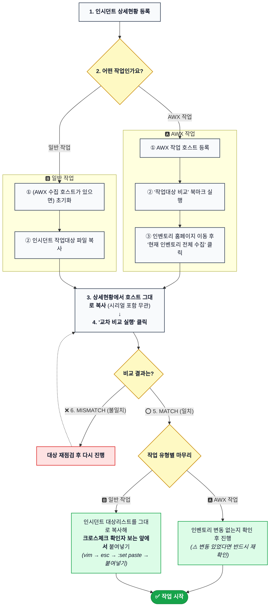

# 작업대상 호스트 교차 검증기 (AWX Multi-Source Host Cross-Checker)

작업 대상 서버 변경/배포 작업 시 **상세목록현황**, **인시던트**, **작업대상(파일/텍스트)**, **AWX 인벤토리** 간의 호스트 불일치를 사전 교차 검증하여 휴먼 에러 및 비인가/오타 서버 작업을 원천 차단하는 도구입니다.

---

## 1. 주요 기능

1. **2~4개 소스 동시 양방향(대칭) 교차 비교**:
   - `상세목록현황 호스트` [필수]
   - `인시던트 호스트` [필수]
   - `작업대상 호스트` [선택 - 1대 이상 입력 시 자동 참여]
   - `AWX 인벤토리 호스트` [선택 - 1대 이상 수집 시 자동 참여]
   - 필수 2개 소스를 기본으로 최소 2개 ~ 최대 4개 소스를 실시간 감지하여 상호 대조합니다.
2. **AWX 수집 시점 제외 필터 (`|` 구분자 지원)**:
   - 소스 동기화 진행 시 자동으로 추가되는 필수 6~7대 서버를 수집 시점에 즉시 차감합니다.
   - 코드 상단 변수(`DEFAULT_EXCLUDE_HOSTS`)와 화면 입력란을 모두 지원하며, 미입력 시 `OS설치에 필요한 서버명은 이미 제외되어 있음` 회색 안내 문구가 표시됩니다.
   - 수집 요약에 `1000대 중 6대 제외됨` 및 제외된 호스트 명단이 공백으로 나열됩니다.
3. **970대 누락 검출 & `[명단 펼치기]` 토글**:
   - AWX 인벤토리(1,000대) 중 작업 대상에 30대만 있는 경우 `대상에 없음: 970대`로 명확히 판정합니다.
   - 대수 요약만 먼저 깔끔하게 표시하며, `[명단 펼치기]` 버튼을 클릭했을 때만 970대 전체 명단을 펼쳐서 볼 수 있습니다.
4. **선명한 폰트 & 고대비 엔터프라이즈 UI (이모티콘 0건)**:
   - `Pretendard`, `Malgun Gothic(맑은 고딕)`, `Consolas`, `D2Coding` 폰트 스택과 안티앨리어싱을 적용해 한글 및 호스트명 가독성을 극대화했으며, 모든 이모티콘 및 버전 배지를 제거했습니다.
5. **페이지 내 드래그 이동 ↔ 독립 브라우저 팝업 창 전환 + 상단 고정(Pin) + 투명도 자동 조절**:
   - 상단 `[독립 창으로 분리]` 버튼을 누르면 창 크기 맞춤 팝업 창(`window.open`)으로 분리됩니다.
   - 핀 아이콘(`상단 고정`) 버튼을 클릭하면 패널 최상단 고정 및 독립 팝업 창의 포커스 자동 유지(`window.focus`)가 동작합니다.
   - 마우스가 창 안에 있을 때는 투명도 `100%`, 창 밖으로 나가면 기본 `30%`(슬라이더 바로 `10% ~ 100%` 조절 가능)가 적용되며, `[투명도 ON/OFF]` 버튼으로 켜고 끌 수 있습니다 (독립 창에서도 투명도 조절 지원).
6. **MATCH / MISMATCH 상태별 작업 권장 안내 자동 분기 & 작업대상 `[펼치기]` (중복 제거)**:
   - **[MATCH] 전수 일치 시**: `인시던트의 작업대상을 복사해서 붙여넣기를 권장합니다.vim [작업대상 파일] -> esc -> :set paste 입력(붙여넣기 모드) -> 붙여넣기`
   - **[MISMATCH] 불일치 시**: `소스 간 불일치가 감지되었습니다. 작업대상을 다시 확인하고 일치시킨 후 작업을 진행하시기 바랍니다.`
   - 우측 `[펼치기]` 버튼을 누르면 정제된 작업대상 호스트 명단이 즉시 펼쳐져 바로 확인 및 복사할 수 있습니다.

---

## 2. 브라우저 북마크 등록 방법

1. 브라우저(Chrome / Edge)의 북마크 바에서 우클릭 ➔ **[페이지 추가]** (또는 [북마크 추가])
2. **이름**: `작업대상 호스트 교차 검증기`
3. **URL**:
   - **신규 고대비(Argon 스타일) UI 버전 (권장)**: [dist/bookmarklet.txt](dist/bookmarklet.txt) 파일의 1줄 `javascript:...` 코드 복사
   - **이전(Flash 스타일) UI 백업 버전**: [dist/bookmarklet_prev.txt](dist/bookmarklet_prev.txt) 파일의 1줄 `javascript:...` 코드 복사
4. AWX 웹 콘솔(어느 인벤토리든 상관없이) 접속 후 북마크를 클릭하면 즉시 실행됩니다.

---

## 3. 작업대상 확인 프로세스 (업무 흐름도)



---

## 4. 파일 구성

```text
├── src/
│   ├── awx_host_checker.js       # 원본 소스코드 (신규 고대비 UI + 상단 고정 + 작업대상 펼치기)
│   └── awx_host_checker_prev.js  # 이전 UI 디자인 백업 소스코드
├── dist/
│   ├── bookmarklet.txt           # 북마크 등록용 1줄 압축 코드 (신규 UI)
│   └── bookmarklet_prev.txt      # 북마크 등록용 1줄 압축 코드 (이전 UI 백업)
├── docs/
│   └── flow_diagram.svg          # 시스템 아키텍처 및 데이터 흐름도 SVG
├── tests/
│   ├── run_all_tests.js          # 원테이크 10개 테스트케이스 자동화 검증 스위트
│   ├── test_results.json         # 테스트 결과 JSON
│   └── screenshot_onetake_success.png # 원테이크 검증 성공 스크린샷
├── build.py                      # 북마크릿 압축 빌드 스크립트
├── WORK_LOG.md                   # 상세 작업 및 신뢰성 증명 테스트 로그
└── README.md                     # 본 문서
```

---

## 5. 신뢰성 증명 및 원테이크 테스트 통과 결과

* **실행 명령**: `node tests/run_all_tests.js`
* **결과**: **10개 테스트케이스 전원 100% 통과 (One-Take Pass)**
  - TC-01: AWX DB 1,000대 원본과 API 페이징 1,000대 전수 일치 (SHA-256 해시 검증)
  - TC-02: 인벤토리 격리 (전체 1,025대 중 인벤토리 #3의 1,000대만 격리 수집)
  - TC-03: 화면 DOM 수집 무결성 (1페이지 20대 수집 및 재클릭 시 중복 방지)
  - TC-04: AWX 수집 시 `|` 제외 (1,000대 중 6대 제외 ➔ 994대 반영 및 요약/명단 표기)
  - TC-05: 제외 미입력 시 회색 안내 텍스트 (`OS설치에 필요한 서버명은 이미 제외되어 있음`) 노출
  - TC-06: 필수 입력 누락 차단 및 필수 2개 소스 비교 정상 동작
  - TC-07: 3개 소스(작업대상 포함) 및 4개 소스(AWX 포함) 자동 동적 전환
  - TC-08: AWX 1,000대 vs 대상 30대 비교 시 `대상에 없음: 970대` 검출 및 `[명단 펼치기]` 토글 동작
  - TC-09: 완료 코멘트 출력 및 이모티콘 0건 검증
  - TC-10: 패널 드래그 좌표 이동 및 `[독립 창으로 분리]` 팝업 핸들러 연동

