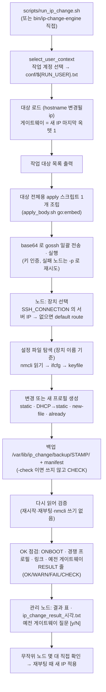
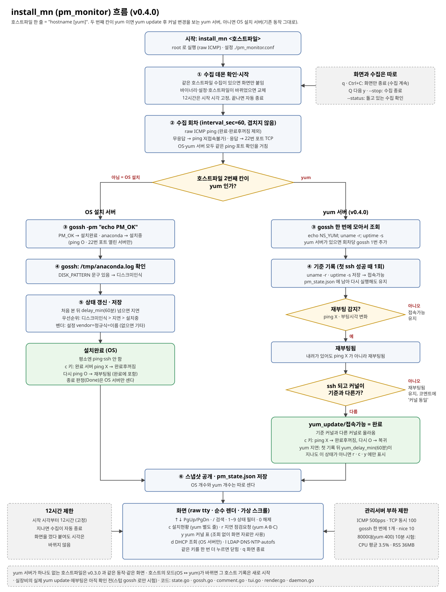

# 작업 흐름도 — ip_change (RHEL 노드 IP · 게이트웨이 일괄 변경)

관리 노드에서 apply 스크립트 하나를 만들어 `gossh`로 대상 노드에 보내고, 노드에서 설정 파일(ifcfg·keyfile)의 필요한 줄만 바꾸는 흐름입니다. 재시작·재부팅은 하지 않으며 새 IP 는 다음 재부팅 때 적용됩니다.
자세한 설명은 [README.md](README.md)의 "실행 흐름"을 참고하세요.

SVG 이미지로 보기 (workflow.svg, 이전 흐름 기준이므로 위 도표를 우선하십시오)

