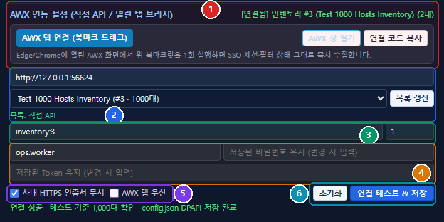

# 작업대상 호스트 교차 검증기 (`host-cross-checker.exe`) 설정 및 사용 가이드

작업 전 AWX 호스트 대상 오류를 사전에 방지하고, 작업자와 확인자가 서로 교차 검증(Cross-Check)을 진행할 수 있도록 구성된 **작업대상 호스트 교차 검증기(`host-cross-checker.exe`)**의 설치·초기 설정 및 실제 실행 화면 기준 사용 방법입니다.

## 0. 설치·실행 및 초기 설정 요약

| 구성 파일 / 항목 | 설명 및 설정 방법 |
|---|---|
| `host-cross-checker.exe` | 팀원 각자 로컬 PC에서 더블클릭으로 실행하는 단일 독립 앱 실행 파일입니다. (Edge/Chrome `--app` 창 자동 실행, 닫기 시 안전 종료) |
| `config.json` (`sharedDir`) | 실행 파일 옆에 위치합니다. 원격 교차 검증 시 `"sharedDir"`에 사내 공유폴더 경로(예: `\\\\공유서버\\share\\cross_checker`)를 지정하면 PC 간 방화벽 설정 없이도 `sessions/` 폴더(500ms 폴링)를 통해 실시간 승인 동기화가 이루어집니다. |
| `users.json` | 공유폴더(또는 실행 폴더) 내 사용자 IP 명부(`name`, `ip`, `role`)입니다. 실행 시 로컬 IP를 자동 인식해 상단 사용자 배지(`● 이름`)와 확인자 선택 목록을 구성합니다. |
| AWX 자격증명 (DPAPI 유지) | `⚙ 환경설정 → AWX 연동 설정`에서 **[연결 테스트 & 저장]**을 1회 성공하면 URL·계정·기본 범위는 `config.json`에, **비밀번호와 API Token은 Windows DPAPI(현재 PC/사용자 전용 암호화)로 암호화**되어 저장되므로 프로그램 재실행 시에도 재입력 없이 유지됩니다. (타 PC 복사 시 복호화 차단 · `다시 입력 필요` 안내) |
| `bookmarklet.txt` (선택) | AWX 웹 콘솔 브라우저 탭의 SSO 세션이나 검색/필터 상태를 그대로 가져와야 할 때는 북마크 바에 `bookmarklet.txt` 코드를 등록하거나 ⚙ 설정의 **[AWX 탭 연결]** 버튼을 드래그해 브리지로 연결할 수 있습니다. |

> **한눈에 보는 전체 사용 흐름**
> 1. **초기 1회 AWX 설정**: 상단 `⚙` 패널 → AWX URL·인벤토리·계정/비밀번호/Token 입력 후 **[연결 테스트 & 저장]** (`config.json` DPAPI 영구 유지)
> 2. **1. 작업 전 자체확인**: 선택 인벤토리 기준 **[현재 화면 수집]** / **[현재 인벤토리 전체 수집]** 후 상세/인시던트/작업대상과 1차 대조 (`경로: 직접 API(...)` 또는 `AWX 탭` 표시)
> 3. **2. 작업자 요청/승인대기**: 인시던트 번호·특이사항·동료 확인자를 지정해 크로스체크 요청 발송
> 4. **3. 확인자 검증/승인**: 확인자가 블라인드 요약 확인 후 본인 데이터를 직접 붙여넣고 대조하여 **[확인 완료 (승인)]** 또는 반려
> 5. **하단 6시 상태 바**: 어느 탭에서나 승인 대기·완료·반려 결과를 즉시 확인 후 작업 착수

---

## 1. 공통 상단 헤더 및 환경설정 (⚙)

*▲ 상단 공통 제어 영역(접속 사용자·설정·상단 고정) 및 ⚙ 환경설정 패널 주요 항목*

- **① 현재 접속 사용자 표시**: 현재 실행 중인 본인 이름과 에이전트 연결 상태(초록색 점)가 상단 헤더에 표시됩니다.
- **② 환경설정 (⚙) 버튼**: 클릭 시 알림, 마우스 이탈 시 자동 숨김, AWX 연동 설정(직접 API/브리지), 1인 셀프 테스트, 알림 테스트 패널을 엽니다.
- **③ 상단 고정 / 상단 고정됨 버튼**: 클릭 시 다른 작업 창(터미널·브라우저·메신저 등) 위에 앱 창이 항상 떠 있도록 OS 레벨 최상위 고정을 켜고 끕니다.
- **④ 승인요청 / 승인완료 알림**: 창을 최소화하거나 내려두더라도 새 요청 또는 승인/반려 완료 시 Windows 우측 하단 알림과 작업표시줄 깜빡임으로 즉시 알립니다. (동일 PC 셀프 테스트 시에는 'skipped'로 구분 표시)
- **⑤ 마우스 이탈 시 자동 숨김(접기)**: 상단 고정과 함께 켜 두면 마우스가 창 밖으로 벗어날 때 지정한 높이 비율(기본 30%)만 남기고 자동 축소되어 아래 작업 화면을 가리지 않습니다.
- **⑥ 1인 셀프 크로스체크 테스트**: 타인에게 잘못 발송되지 않도록 일반 확인자 목록에는 본인이 숨겨져 있으며, 혼자 동작을 검증하고 싶을 때 이 버튼으로 본인에게 테스트 요청을 보낼 수 있습니다.
- **⑦ 알림 테스트 버튼**: 현재 PC에서 Windows 토스트 및 작업표시줄 깜빡임 알림이 정상 동작하는지 즉시 시험해 볼 수 있습니다.

---

## 2. AWX 연동 설정 (직접 API 우선 · DPAPI 암호화 · 열린 탭 브리지)

*▲ ⚙ 환경설정 내 AWX 연동 설정 — 직접 API 자격증명 저장 및 열린 AWX 탭 브리지 연동*

- **① AWX 열린 탭 브리지 연동**: 직접 API 대신 Edge/Chrome의 열린 AWX 탭(SSO 세션·검색/필터 적용 화면)과 WebSocket으로 실시간 연결합니다. 상단 상태에 연결된 탭 수(예: '연결됨 1개' 또는 현재 인벤토리·호스트 수)가 표시되며, 여러 탭이 열려 있어도 로그인된 정상 탭의 응답을 우선 채택합니다. [AWX 창 열기]·[AWX 탭 연결]·[연결 코드 복사]를 지원합니다.
- **② AWX 서버 URL · 인벤토리 선택 · 목록 출처**: 접속할 AWX 주소(예: http://awx.example.com:30080)를 입력하고 [목록 갱신]을 누르면 인벤토리 목록(이름·ID·호스트 수)을 불러옵니다. 목록 아래에는 출처가 '목록: 직접 API' 또는 '목록: AWX 탭(직접 API 실패: …)' 형태로 표시됩니다.
- **③ 수집 범위 & 기본 페이지**: 인벤토리 드롭다운을 바꾸면 범위가 자동 반영되며(예: inventory:3), [현재 화면 수집] 버튼 클릭 시 조회할 페이지 번호(기본 1)도 지정할 수 있습니다. 범위나 인벤토리만 변경할 때는 기존 인증 세션을 불필요하게 초기화하지 않습니다.
- **④ 계정 · 비밀번호 · Token 입력 (DPAPI 암호화 유지)**: AWX 계정·비밀번호·API Token을 입력해 둡니다. 저장 성공 시 비밀번호와 Token은 실행 파일 옆 config.json에 Windows DPAPI(현재 PC/사용자 전용 암호화)로 암호화(awxPasswordEnc, awxTokenEnc)되어 기록되므로, 프로그램을 껐다 다시 켜도 재입력 없이 유지됩니다. (타 PC로 config.json 복사 시 복호화가 차단되어 '다시 입력 필요' 표시)
- **⑤ HTTPS 인증서 무시 & AWX 탭 우선 옵션**: 사내 사설/자체 서명 HTTPS 인증서를 사용할 때는 '사내 HTTPS 인증서 무시'를 체크합니다. 기본 수집 순서는 '직접 API 우선 → 실패 시 AWX 탭 폴백'이며, AWX 웹 화면의 검색/필터 상태 그대로 수집하고 싶을 때만 'AWX 탭 우선'을 체크하세요.
- **⑥ [초기화] 및 [연결 테스트 & 저장]**: [연결 테스트 & 저장]을 누르면 입력한 URL·자격증명으로 실제 호스트 조회 시험과 성공 인증 방식(세션/Token/Basic) 기억, config.json DPAPI 저장을 한 번에 수행합니다. [초기화]는 에이전트 및 config.json의 AWX 설정·암호화 자격증명까지 함께 지웁니다.

---

## 3. [1번 탭] 작업 전 자체확인 (AWX 수집 및 4중 교차 비교)

![3. [1번 탭] 작업 전 자체확인 (AWX 수집 및 4중 교차 비교)](./fig3_tab1_selfcheck.png)
*▲ AWX 호스트 수집(직접 API / 탭 브리지)과 3개 입력 소스의 교차 비교 및 [MATCH] 판정 화면*

- **① 제외 호스트 설정 (| 구분)**: AWX 인벤토리에는 포함되지만 실제 작업 대상에서 빼야 하는 서버(예: prd-db-0295|prd-db-0296|...)를 입력하면 수집 단계에서 자동 차감됩니다.
- **② [현재 화면 수집] / [현재 인벤토리 전체 수집]**: 직접 API 자격증명이 설정된 경우 에이전트가 직접 API(/api/awx/hosts)로 먼저 수집하고, 실패 시 열린 AWX 탭(브리지)으로 자동 폴백합니다. [현재 화면 수집]은 선택한 인벤토리의 지정 페이지(기본 1페이지)만, [현재 인벤토리 전체 수집]은 선택 인벤토리 전체 호스트를 페이지네이션으로 수집합니다. 양쪽 모두 실패하면 직접 API·AWX 탭 오류 원인을 모두 표시합니다.
- **③ [수집 초기화] 및 수집 톱니바퀴(⚙)**: 수집된 AWX 호스트 결과만 비우거나, 톱니바퀴 옵션으로 입력란 연동 초기화를 설정합니다.
- **④ 수집 결과 요약 · 실제 사용 경로 · [AWX 연동 설정]**: 총 수집 대수, 제외 대수, 인벤토리 정보를 표시하며 실제 사용된 수집 경로('경로: 직접 API(토큰/세션/Basic)' 또는 '경로: AWX 탭')를 명확히 구분해 보여줍니다. 우측 [AWX 연동 설정] 버튼을 누르면 즉시 상단 ⚙ AWX 설정 영역으로 이동합니다.
- **⑤ 비교 대상 호스트 입력 (상세목록현황 · 인시던트 · 작업대상)**: 작업 전에 확인한 상세목록현황[필수], 인시던트[필수], 작업대상[선택] 호스트 목록을 각각 붙여넣습니다. (호스트명 / 시리얼 형태도 자동 정제)
- **⑥ [교차 비교 실행] 버튼**: 입력된 2~3개 소스 및 수집된 AWX 호스트(1대 이상 수집 시 자동 포함)를 양방향 대칭 비교합니다.
- **⑦ 비교 결과 리포트 및 vim 작업 권장 안내**: 모든 소스가 일치하면 [MATCH] 배너와 함께 'vim [작업대상 파일] -> esc -> :set paste 입력 -> 붙여넣기' 권장 안내가 표시되며, 1대라도 다르면 [MISMATCH] 및 누락·불일치 명단을 적발합니다.

---

## 4. [2번 탭] 작업자 요청/승인대기 및 하단 6시 상태 바

![4. [2번 탭] 작업자 요청/승인대기 및 하단 6시 상태 바](./fig4_tab2_worker.png)
*▲ 확인자 지정·요청 발송(상단) → 실시간 APPROVED 상태 카드(중단) → 하단 6시 상태 바(최하단)*

- **① [?] 워크플로우 가이드 버튼**: 마우스 커서를 올리면 작업자/확인자 기준의 전체 절차 흐름도 팝업이 표시됩니다.
- **② 인시던트 번호 [권장] & 특이사항 전달 메모 [선택]**: 관련 인시던트 티켓 번호와 확인자에게 전달할 특이사항(예: DB 6대 제외 반영 완료 등)을 입력합니다.
- **③ 크로스체크 확인자 지정 [필수] & 요청 발송**: 사내 명부(users.json)에서 동료 확인자를 선택하고 [크로스체크 확인 요청 발송]을 클릭합니다. 1번 탭에서 입력/수집한 호스트가 자동 연동됩니다.
- **④ 요청 진행 상태 (PENDING / APPROVED / REJECTED)**: 발송 후 실시간 상태를 표시하며, 지정 확인자 부재 시 쿨타임 없이 다른 확인자로 즉시 변경할 수 있습니다. 승인 완료 시 [CROSS-CHECK APPROVED] 배너와 코멘트가 표시됩니다.
- **⑤ 하단 6시 실시간 상태 바**: 1번·2번·3번 어느 탭에 있더라도 창 맨 아래 녹색/빨간색/노란색 바로 승인 대기·승인 완료·반려 상태를 항상 확인할 수 있습니다.

---

## 5. [3번 탭] 확인자 검증/승인 (블라인드 대조 및 승인/반려)

![5. [3번 탭] 확인자 검증/승인 (블라인드 대조 및 승인/반려)](./fig5_tab3_checker.png)
*▲ 동료 요청 선택 → 복사 방지 블라인드 요약 → 확인자 직접 입력·대조 → [확인 완료 (승인)]*

- **① 3번 탭 & 미확인 요청 배지**: 동료에게서 검증 요청이 도착하면 탭 제목 오른쪽에 빨간색 건수 배지(예: 1)가 표시되며 Windows 알림이 뜹니다.
- **② 확인할 요청 선택 & [새로고침]**: 도착한 요청(예: [INC-2026-1113] 김철수님의 요청)을 선택해 검증 화면을 엽니다.
- **③ 요청 상세 · 특이사항 & 작업자 입력 요약(블라인드)**: 작업자·인시던트 번호·특이사항·AWX 참여 대수가 표시되며, 확인자가 작업자 데이터를 그대로 복사해 승인하는 어뷰징을 막기 위해 앞 3대 외 목록은 [블라인드] 처리됩니다.
- **④ 확인자 호스트 직접 입력 & [교차 비교 실행]**: 확인자가 본인 화면(상세목록현황·인시던트·작업대상)에서 직접 복사한 호스트를 붙여넣고 [교차 비교 실행 (전체 소스 통합 대조)] 버튼을 클릭합니다.
- **⑤ 전수 일치 [MATCH] & [확인 완료 (승인)] / 반려**: 작업자·AWX·확인자 소스가 100% 일치하면 [MATCH] 배너가 나타나고 [확인 완료 (승인)] 버튼이 활성화됩니다. 불일치 시에는 반려 사유를 적어 작업자에게 재확인을 요청할 수 있습니다.

---

## 6. [?] 버튼 마우스 오버 워크플로우 가이드

![6. [?] 버튼 마우스 오버 워크플로우 가이드](./fig6_help_popover.png)
*▲ 2번·3번 탭 [?] 아이콘에 마우스를 올렸을 때의 역할별 워크플로우 팝업*

- **① [?] 가이드 아이콘**: 2번 탭(작업자 기준)과 3번 탭(확인자 기준) 제목 오른쪽에 각각 배치되어 있습니다.
- **② 역할별 워크플로우 도식 팝업**: 마우스 커서를 올리면 창 크기에 맞춰 잘림 없이 전체 절차 흐름도가 자동으로 표시되므로, 작업 도중 다음 단계가 헷갈릴 때 즉시 참고할 수 있습니다.

---

## 사용 시 참고 팁

- **AWX 직접 API vs 열린 AWX 탭 폴백 동작**: 자격증명이 저장되어 있으면 **[현재 화면 수집] / [현재 인벤토리 전체 수집]**은 기본적으로 직접 API를 먼저 호출하고, 직접 API가 실패했을 때만 연결된 AWX 브라우저 탭(브리지)으로 자동 폴백합니다. 양쪽 모두 실패하면 두 경로의 오류 원인을 모두 표시해 원인을 바로 파악할 수 있습니다.
- **여러 AWX 탭이 열려 있어도 안전**: 미로그인/오류 탭이 401을 먼저 반환하더라도 성공 응답이 올 때까지 대기해 정상 탭의 결과를 채택하므로 안정적으로 수집됩니다.
- **AWX 화면의 검색·필터 상태 그대로 수집하려면**: `⚙ → AWX 연동 설정`의 **AWX 탭 우선** 체크박스를 켜고(또는 필요 시 껐다 켜기) 열린 AWX 탭에서 필터링된 상태로 수집하세요.
- **혼자 동작을 테스트해 보고 싶을 때**: 일반 확인자 선택 목록에서는 오발송 방지를 위해 본인 계정이 숨겨져 있으므로, 상단 **`⚙` 환경설정 → [셀프 테스트]** 버튼을 이용해 주세요.
- **작업 화면을 가리지 않고 띄워 두고 싶을 때**: 상단 **[상단 고정]**을 켜 두고, 환경설정에서 **마우스 이탈 시 자동 숨김(기본 30%)**을 켜 두면 마우스를 치웠을 때 창 높이만 줄어들어 편리합니다.
