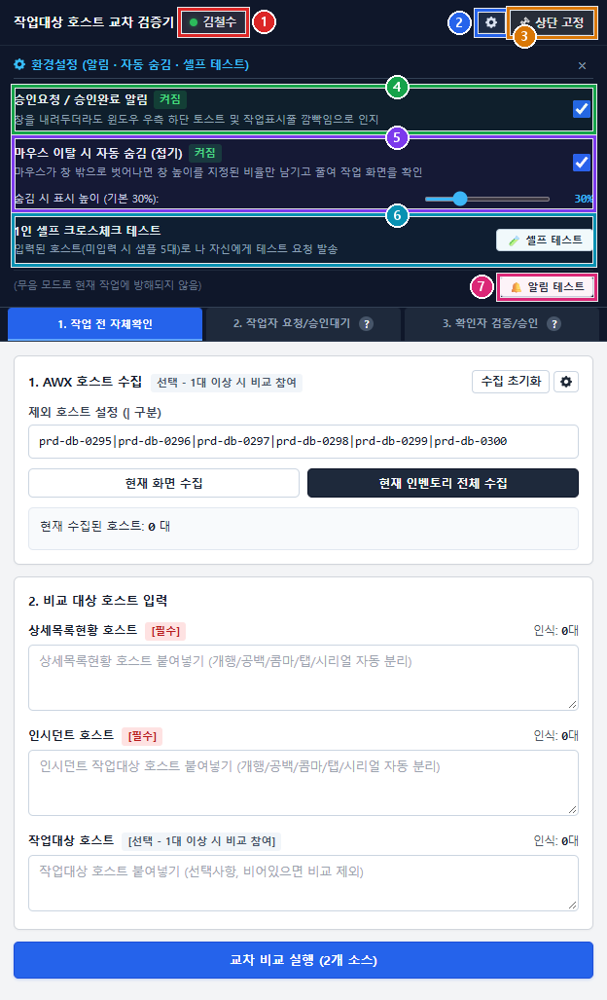
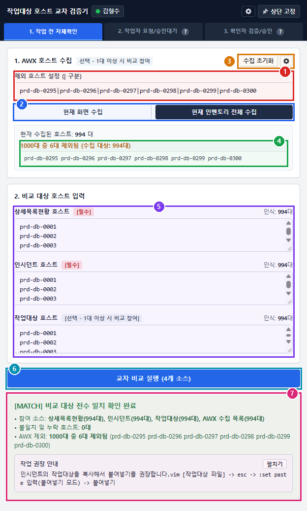
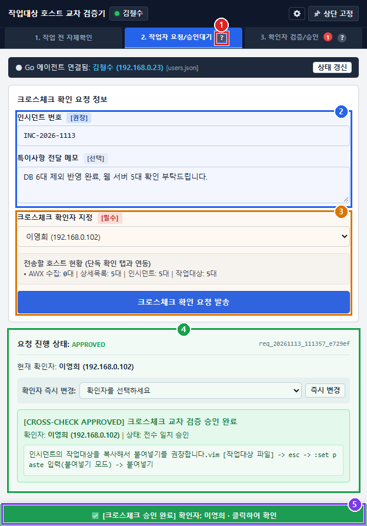
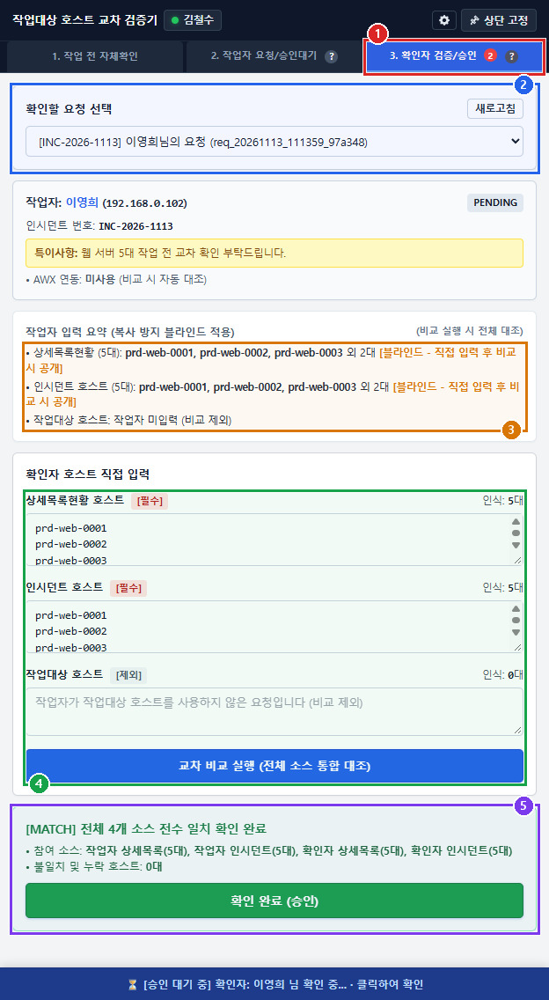
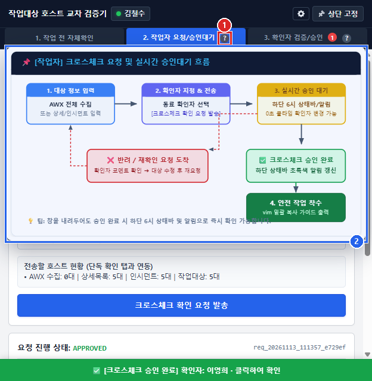

# [안내] 작업대상 호스트 교차 검증기(`host-cross-checker.exe`) 사용 가이드

> [!TIP]
> 아웃룩/사내 웹메일로 바로 복사해 붙이려면 [mail_draft_outlook.html](./mail_draft_outlook.html) 파일을 브라우저에서 열어 `Ctrl + A` → `Ctrl + C` 후 메일 작성 창에 그대로 붙여넣어 주세요. (이미지 5장이 본문 안에 인라인 포함되어 있습니다.)

---

**메일 제목(권장):** `[안내] 작업대상 호스트 교차 검증기(host-cross-checker.exe) 사용 가이드`

안녕하세요.

작업 전 AWX 호스트 대상 오류를 사전에 방지하고, 작업자와 확인자가 서로 교차 검증(Cross-Check)을 진행할 수 있도록 개선된 **작업대상 호스트 교차 검증기(`host-cross-checker.exe`)**의 실제 실행 화면 기준 항목별 설명 및 사용 방법을 안내드립니다.

### 한눈에 보는 전체 사용 흐름
1. **1. 작업 전 자체확인** 탭에서 AWX 호스트 수집 및 상세목록/인시던트/작업대상 대조로 1차 검증
2. **2. 작업자 요청/승인대기** 탭에서 동료 확인자를 지정해 크로스체크 요청 발송
3. **3. 확인자 검증/승인** 탭에서 확인자가 블라인드 대조 후 최종 확인 완료(승인) 또는 반려
4. 어느 탭에 있든 **하단 6시 상태 바**에서 승인 대기·완료·반려 상태를 상시 확인 후 작업 진행

---

## 1. 공통 상단 헤더 및 환경설정 (`⚙`)

- **① 현재 접속 사용자 표시**: 현재 실행 중인 본인 이름과 연결 상태가 상단 헤더에 표시됩니다.
- **② 환경설정 (`⚙`) 버튼**: 클릭 시 알림, 마우스 이탈 시 자동 숨김(접기), 1인 셀프 테스트, 알림 테스트 패널을 엽니다.
- **③ 상단 고정 / 상단 고정됨 버튼**: 클릭 시 다른 작업 창(터미널·브라우저·메신저 등) 위에 앱 창이 항상 떠 있도록 OS 레벨 최상위 고정을 켜고 끌 수 있습니다. (다른 작업 창을 클릭해도 뒤로 숨지 않고 작업 화면 위에 고정해 둘 수 있습니다.)
- **④ 승인요청 / 승인완료 알림 켜짐**: 창을 최소화하거나 내려두더라도 요청 도착 또는 승인 완료 시 윈도우 우측 하단 알림(Toast)과 작업표시줄 깜빡임으로 즉시 알려줍니다.
- **⑤ 마우스 이탈 시 자동 숨김 (접기) & 숨김 시 표시 높이 (기본 30%)**: 체크 시 마우스 커서가 창 밖으로 벗어나면 창 물리 높이 자체를 지정한 비율(기본 30%, 슬라이더로 조절)만 남기고 자동으로 접어 다른 작업 화면을 가리지 않습니다. 작업 내용을 덮어 가리지 않으며, 마우스를 다시 올리면 원래 크기로 복원됩니다.
- **⑥ 1인 셀프 크로스체크 테스트 (`[🧪 셀프 테스트]`)**: 동료에게 실제 요청을 보내지 않고 나 자신에게 테스트 요청을 발송해 전체 흐름을 단독 검증합니다. **오발송 방지를 위해 일반 확인자 목록에서는 본인 계정이 숨겨져 있으며, 오직 환경설정(`⚙`)의 `[🧪 셀프 테스트]` 버튼으로만 실행할 수 있습니다.** (호스트 미입력 시 샘플 5대가 자동 생성됩니다.)
- **⑦ 알림 테스트 (`[🔔 알림 테스트]`)**: 요청 도착 시 뜨는 윈도우 우측 하단 무음 토스트와 작업표시줄 강조 동작을 미리 확인합니다. (무음 모드로 동작하여 주변 작업에 방해되지 않습니다.)

---

## 2. [1단계] 작업 전 자체확인 (AWX 수집 및 사전 대조)

- **① 제외 호스트 설정 (`|` 구분)**: 작업 대상에서 의도적으로 제외해야 하는 호스트명을 파이프(`|`)로 구분해 입력하면 AWX 수집 시 자동으로 제외 처리됩니다.
- **② AWX 호스트 수집 (`[현재 화면 수집]` / `[현재 인벤토리 전체 수집]`)**: 열려 있는 AWX 화면 기준 현재 페이지 또는 인벤토리 전체 페이지의 호스트 목록을 자동으로 수집합니다.
- **③ 수집 초기화 / 세부 수집 설정**: 수집된 AWX 호스트 목록과 상태를 초기화하거나 수집 옵션을 확인합니다.
- **④ AWX 수집 결과 요약**: 전체 수집 대상 중 제외 호스트가 몇 대 빠졌는지와 최종 비교 대상 대수를 한눈에 확인합니다.
- **⑤ 비교 대상 호스트 입력 (`상세목록현황` / `인시던트` / `작업대상 호스트`)**: 상세목록현황(`[필수]`), 인시던트(`[필수]`), 작업대상 호스트(`[선택 - 1대 이상 시 비교 참여]`)를 붙여넣습니다. 개행·공백·콤마·탭·시리얼 형식을 자동 분리하며, 각 칸 우측에 인식 대수가 실시간 표시됩니다.
- **⑥ `[교차 비교 실행]` 버튼**: 입력된 항목들과 AWX 수집 목록에 누락되거나 초과된 호스트가 없는지 전수 대조를 실행합니다.
- **⑦ 전수 비교 결과 및 작업 권장 안내**: 모든 소스가 일치하면 `[MATCH] 비교 대상 전수 일치 확인 완료` 배너와 안전한 붙여넣기(`vim :set paste`) 가이드가 표시되며, 불일치 시 누락/추가 호스트가 즉시 구분 표시됩니다.

---

## 3. [2단계] 작업자 요청/승인대기

- **① 작업자 흐름 안내 `[?]` 버튼**: 마우스 커서를 올리면 작업자 기준의 요청 발송·승인 대기·최종 확인 절차가 도식 팝업으로 표시됩니다.
- **② 크로스체크 확인 요청 정보 (`인시던트 번호` / `특이사항 전달 메모`)**: 관련 인시던트 번호(`[권장]`)와 확인자가 참고해야 할 작업 특이사항 메모(`[선택]`)를 작성합니다.
- **③ 크로스체크 확인자 지정 및 요청 발송**: 목록에서 동료 확인자를 선택하고 전송할 호스트 요약(1단계 입력 연동)을 확인한 뒤 `[크로스체크 확인 요청 발송]`을 클릭합니다. (본인 계정은 일반 확인자 목록에서 제외됩니다.)
- **④ 요청 진행 상태 / 확인자 즉시 변경 / 최종 승인 결과 카드**: 현재 세션 상태(`PENDING` / `APPROVED` / `REJECTED`)와 지정 확인자를 확인합니다. 대기 중에는 쿨타임 없이 다른 확인자로 `[즉시 변경]`할 수 있으며, 확인자가 승인하면 초록색 `[CROSS-CHECK APPROVED]` 배너와 안전한 붙여넣기 안내가 표시됩니다.
- **⑤ 하단 6시 방향 글로벌 실시간 상태 바**: 1·2·3번 **어느 탭을 보고 있든** 화면 맨 아래(6시 방향)에서 현재 진행 중인 크로스체크의 승인 대기 / 승인 완료 / 반려 상태를 항상 확인할 수 있으며, 클릭 시 해당 화면으로 바로 이동합니다.

---

## 4. [3단계] 확인자 검증/승인

- **① 3단계 확인자 탭 및 대기 요청 숫자 배지**: 나에게 확인 요청이 도착하면 탭 우측 빨간 숫자 배지에 대기 건수가 표시되며 무음 데스크톱 알림·작업표시줄 강조로 안내합니다.
- **② 확인할 요청 선택 (`[새로고침]`)**: 드롭다운에서 요청자 이름과 인시던트 번호를 확인해 검증할 요청을 선택합니다.
- **③ 작업자 입력 요약 (복사 방지 블라인드 적용)**: 확인자가 작업자 데이터를 그대로 복사해 검증하는 것을 막기 위해 일부 호스트 외 목록이 블라인드 처리되며, 확인자가 직접 입력해 비교한 뒤 전체 목록이 공개됩니다.
- **④ 확인자 호스트 직접 입력 및 `[교차 비교 실행]`**: 확인자가 직접 확인한 상세목록현황·인시던트·작업대상 호스트를 붙여넣고 `[교차 비교 실행 (전체 소스 통합 대조)]` 버튼을 클릭합니다.
- **⑤ 전수 일치 결과 및 `[확인 완료 (승인)]` / 반려**: 작업자 데이터와 확인자 입력 데이터가 100% 일치하면 `[MATCH]` 배너가 표시되며, `[확인 완료 (승인)]`을 클릭해 작업자에게 승인 결과를 즉시 회신합니다. (불일치 시 반려 사유를 적어 반려할 수 있습니다.)

---

## 5. `[?]` 버튼 마우스 오버 워크플로우 가이드

- **① `[?]` 가이드 아이콘**: 2번 탭(작업자 기준)과 3번 탭(확인자 기준) 제목 오른쪽에 각각 배치되어 있습니다.
- **② 역할별 워크플로우 도식 팝업**: 마우스 커서를 올리면 창 크기에 맞춰 잘림 없이 전체 절차 흐름도가 자동으로 표시되므로, 작업 도중 다음 단계가 헷갈릴 때 즉시 참고할 수 있습니다.

---

### 사용 시 참고 팁
- **혼자 동작을 테스트해 보고 싶을 때**: 일반 확인자 선택 목록에서는 오발송 방지를 위해 본인 계정이 숨겨져 있으므로, 상단 **`⚙` 환경설정 → `[🧪 셀프 테스트]`** 버튼을 이용해 주세요.
- **작업 화면을 가리지 않고 띄워 두고 싶을 때**: 상단 **`[📌 상단 고정]`**을 켜 두고, 환경설정에서 **마우스 이탈 시 자동 숨김(기본 30%)**을 활성화하면 마우스를 치웠을 때 창 높이만 줄어들어 편리합니다.
- **절차가 헷갈릴 때**: 2번·3번 탭 제목 옆 **`[?]`** 아이콘에 마우스를 올리면 현재 역할에 맞는 전체 흐름도가 즉시 표시됩니다.

감사합니다.
