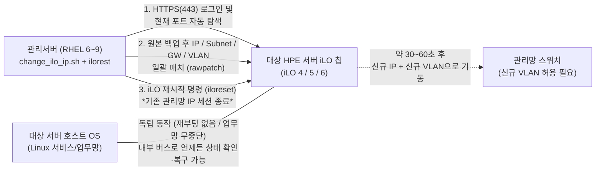

# HPE 서버 관리망(iLO) IP 및 VLAN 일괄 변경 도구 계획서

## 1. 배경 및 동작 원리

HPE 서버의 **iLO(Integrated Lights-Out)** 는 서버 메인보드에 별도로 탑재된 원격 관리 전용 칩셋(BMC)입니다. 관리서버에서 `ilorest` 도구를 실행하면 관리망 네트워크(HTTPS 443 포트, Redfish API)를 통해 대상 서버의 iLO 칩에 새 IP와 VLAN 태그를 주입하고 **iLO 칩만 재시작(`iloreset`)** 합니다.



> [!IMPORTANT]
> **통신 영향도 핵심 정리**
> 1. **업무망/호스트 OS 무중단**: `iloreset`은 관리 칩만 재부팅하므로 운영 중인 OS나 서비스 네트워크(NIC)는 **절대 끊기지 않습니다.**
> 2. **관리망(iLO) 전환**: `iloreset` 직후 **기존 관리망 IP 접속은 즉시 끊어지며**, 스위치 포트에 **변경될 VLAN(Trunk 허용 또는 포트 VLAN 변경)** 과 라우팅이 준비되어 있어야 약 1분 뒤 신규 관리망 IP로 접속됩니다.

---

## 2. 입력 파일(`list.txt`) 및 실행 인터페이스 설계

### 2.1 입력 파일 규격 (`list.txt`, 템플릿: `list.txt.example`)
관리서버 작업 디렉토리에서 `cp list.txt.example list.txt && vim list.txt`로 작성하며, 공백(스페이스 또는 탭)으로 구분된 3개 컬럼을 줄바꿈으로 나열합니다.
- 빈 줄 및 `#`으로 시작하는 주석 줄은 자동으로 건너뜁니다. (CRLF 줄바꿈 포함 시 `\r` 자동 제거)
- 변경 전 전체 라인의 IPv4 형식(`0..255` 4옥텟) 및 VLAN 범위(`1~4094`, 또는 VLAN 해제 시 `0`/`off`/`disable`/`none`) 유효성을 먼저 검사합니다.

```text
# [현재 관리망 IP]   [변경될 관리망 IP]   [변경될 VLAN]
# VLAN 해제(비활성화)가 필요하면 0 또는 off 입력
10.10.10.101        10.20.30.101        30
10.10.10.102        10.20.30.102        30
10.10.10.103        10.20.40.15         0
```

### 2.2 대화형 실행 흐름 및 CLI 옵션
기본 실행(`bash change_ilo_ip.sh`) 시 필요한 항목을 대화형으로 순서대로 입력받습니다.
1. 관리망(iLO) 계정 ID (미입력 시 기본값 `Administrator`, 환경변수 `ILO_USER` 지원)
2. 관리망(iLO) 비밀번호 (`read -r -s` 숨김 입력, 환경변수 `ILO_PASS` 지원)
3. 신규 서브넷 마스크 (미입력 시 기본값 `255.255.255.0`)
4. 신규 게이트웨이 (미입력 시 각 대상의 변경될 IP 기준 `<A.B.C>.1` 자동 계산, 직접 입력 시 고정 IP 적용)
5. 요약 출력 후 작업 모드 선택 (`y`: 실제 변경 진행 / `c`: 사전 점검(조회만) / `n`: 취소)

| 실행 예시 | 동작 설명 |
| :--- | :--- |
| `bash change_ilo_ip.sh --check` | **[사전 점검 / Dry-run]** 설정 변경 없이 전체 장비 로그인, iLO 세대(4/5/6), 활성 포트(전용/공유), 현재 IP·넷마스크·게이트웨이·VLAN 조회 및 변경 예정값 출력 |
| `bash change_ilo_ip.sh` | **[대화형 실행]** 계정/비밀번호/서브넷/게이트웨이/실행 모드를 대화형으로 확인한 뒤 순차 실행 |
| `bash change_ilo_ip.sh -m 255.255.254.0 -g 10.20.30.254 -y` | **[비대화형 오버라이드]** 지정된 서브넷과 고정 게이트웨이로 확인 질문 없이 일괄 변경 실행 |
| `bash change_ilo_ip.sh -f my_list.txt` | 기본 `list.txt` 대신 지정한 목록 파일 사용 |
| `bash change_ilo_ip.sh --ilorest-bin /opt/ilorest` | `ilorest` 실행 파일 경로 수동 지정 (`ILOREST_BIN` 환경변수도 지원) |

---

## 3. 내부 처리 흐름 및 RHEL 6 / 다세대 iLO 호환성 설계

### 3.1 `rawget` / `rawpatch` 채택 이유
- HPE 장비 세대(iLO 4 / 5 / 6)의 `IPv4StaticAddresses`가 JSON 배열(`[ { ... } ]`) 구조이므로, 구버전 `ilorest set`에서 발생할 수 있는 파싱 오류를 피하기 위해 `rawget`과 `rawpatch`를 사용합니다.
- 장비마다 관리망 케이블이 **전용 포트(`EthernetInterfaces/1`)** 또는 **공유 포트(`EthernetInterfaces/2`)** 에 연결되어 있을 수 있으므로, `rawget`으로 **`[현재 관리망 IP]`와 경계 일치하는 인터페이스 URI(`@odata.id`) 및 OEM 제조사 키(`Hp` vs `Hpe`)를 자동 탐색**한 뒤 패치합니다.

### 3.2 장비 1대당 순차 처리 단계
1. **세션 초기화 및 로그인**: `ilorest --nologo logout` 후 `ilorest --nologo login <현재IP> -u <ID> -p <PW>` 실행
2. **iLO 세대 및 활성 관리 포트 자동 탐색**:
   - `/redfish/v1/Managers/1`에서 `FirmwareVersion` 확인 (iLO 4 / 5 / 6 판별)
   - `/redfish/v1/Managers/1/EthernetInterfaces` 하위 포트들을 순회하며 `<현재IP>`가 정확히 매핑된 URI와 OEM 구조(`"Hpe"` vs `"Hp"`) 식별
3. **분기 처리**:
   - **`--check` 모드**: 현재 상태와 변경 예정값을 출력 후 `logout` (`점검완료`)
   - **변경 모드**:
     1. `logs/backup_<YYYYMMDD_HHMMSS>/<현재IP>.json`에 변경 전 원본 저장 (`chmod 600`)
     2. `mktemp`(`chmod 600`, `trap`으로 자동 정리) 임시 JSON 파일 생성 (`DHCPv4` 및 OEM `DHCPv4` 해제, `IPv4StaticAddresses`, `VLAN` 설정)
     3. `ilorest --nologo rawpatch <임시파일>` 실행 (실패 시 `iloreset`을 실행하지 않고 오류 기록 후 다음 장비로 이동)
     4. `ilorest --nologo iloreset` 실행하여 새 IP + 새 VLAN 적용 및 로그아웃
4. **에러 격리 및 최종 리포트**:
   - 개별 장비 실패 시에도 배치를 중단하지 않고 끝까지 진행하며, 종료 시 화면과 `logs/result_<YYYYMMDD_HHMMSS>.log`에 전체/성공/실패 요약표를 남깁니다.

### 3.3 RHEL 6 및 폐쇄망 특화 고려사항
- **외부 패키지 무의존성**: `jq`, `python3` 없이 RHEL 6 기본 Bash 4.1과 표준 POSIX 도구(`awk`, `sed`, `grep`, `mktemp`, `date`, `chmod`, `tr`)만으로 동작합니다.
- **RHEL 6 `prelink` 이슈 사전 감지**: 시작 시 `ilorest --nologo --version`을 점검하여 `Cannot open self` 오류가 감지되면 `/etc/prelink.conf`(`-b /usr/sbin/ilorest`) 및 `prelink -ua` 조치 가이드를 즉시 출력합니다.

---

## 4. 배포 및 검증 구조 (`/home-test` 및 `ilo` 브랜치)

### 4.1 Git 저장소 배포 구조
- 저장소 `https://github.com/qazx2675/myrepo.git`의 독립 orphan 브랜치 **`ilo`** 에 본 프로젝트 파일만 단독 배치하여, 관리서버에서 `git clone -b ilo --single-branch`로 가볍게 반입할 수 있도록 구성합니다.

### 4.2 자동화 테스트 및 검증 (`/home-test` + CI)
- `tests/mock_ilorest`와 `tests/run_tests.sh`로 실제 iLO 장비 없이도 iLO 4/5/6, Dedicated/Shared 포트, 인증 실패, `rawpatch` 실패 시 `iloreset` 미호출, IP 경계 매칭(`10.0.0.1` vs `10.0.0.10`), VLAN 비활성화(`0`/`off`), RHEL 6 `prelink` 오류 감지를 검증합니다.
- Windows 환경의 줄바꿈 이슈를 피하기 위해 모든 파일은 `LF(\n)`로 유지하며, Linux 검증 환경(`/home-test`) 및 `.github/workflows/ci.yml`에서 `bash -n`과 `bash tests/run_tests.sh`를 통과하는지 확인합니다.
- `README.md` 부록에는 `iloreset` 시 업무망 무중단 특성 및 관리망 두절 시 호스트 OS(`root`)에서 `ipmitool`, 로컬 `ilorest`, `hponcfg`로 즉시 확인·원복하는 절차를 제공합니다.
